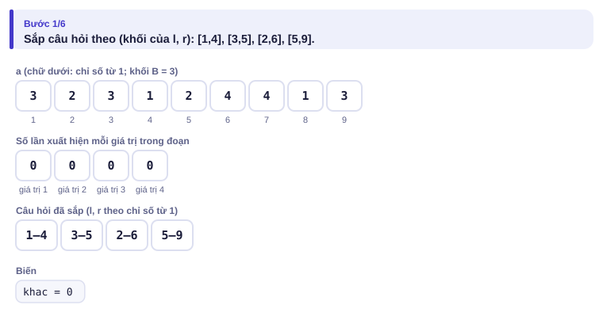
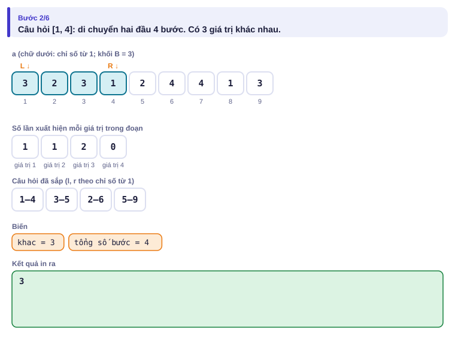
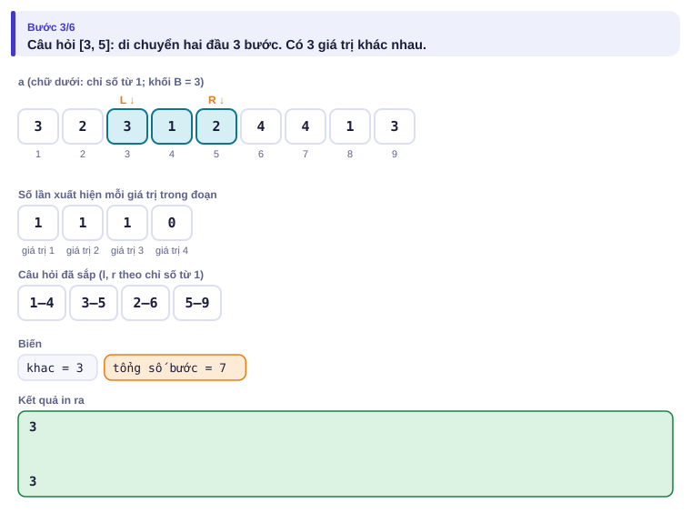
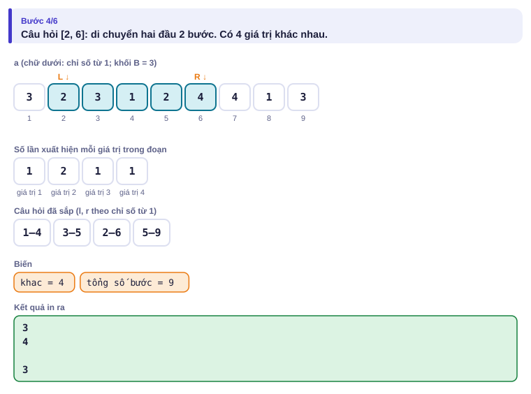
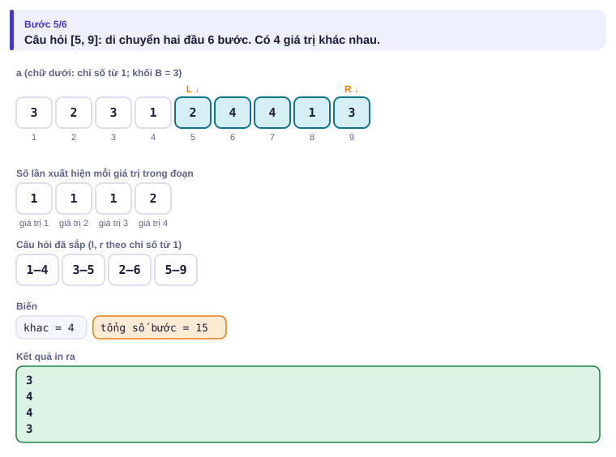
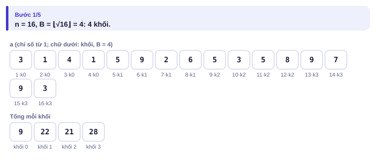
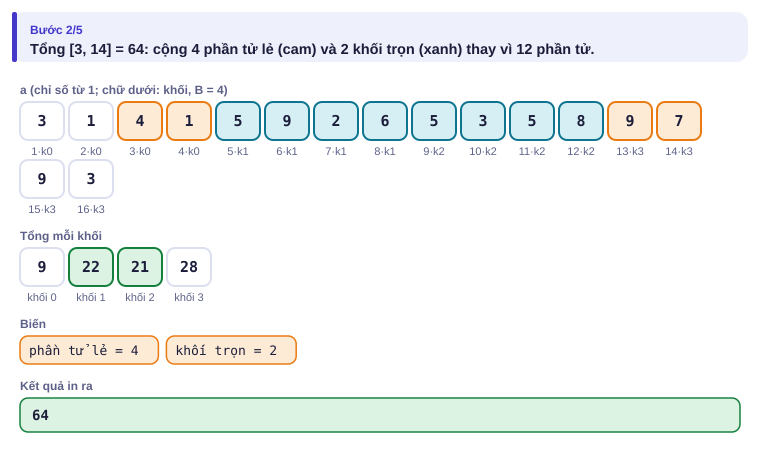
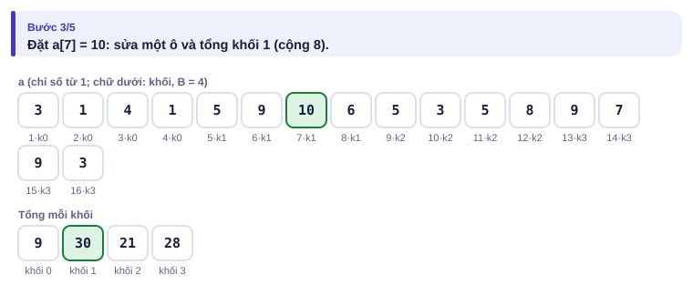
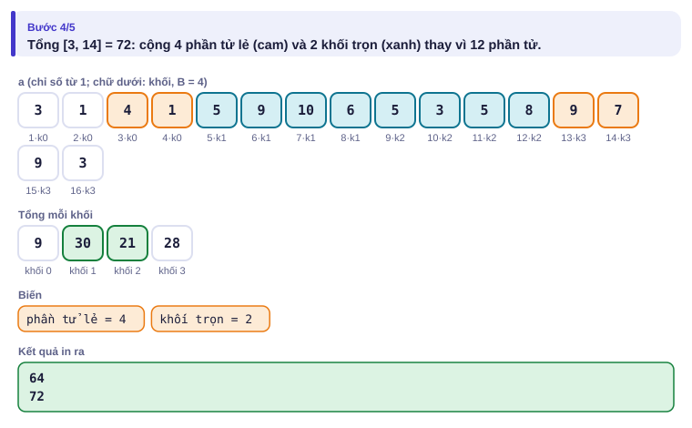

# Bài 4.2 – Chia căn và thuật toán Mo

> **Tập 4 · Chuyên đề nâng cao**
> Cần biết trước: bài 1.5 (hai con trỏ), bài 2.2 (đếm bằng mảng/`map`), bài 3.4 (nén giá trị).
> Thời lượng: khoảng 90 phút đọc, cộng 6 giờ thực hành trong tuần.

**Học xong bài này, em sẽ:**

- chia mảng thành khoảng √n khối để cân bằng giữa "sửa" và "hỏi";
- trả lời **offline** nhiều câu hỏi đoạn bằng **thuật toán Mo** trong O((n + q)·√n);
- nhận ra khi nào thông tin "không gộp được từ hai nửa" (số giá trị khác nhau, số cặp bằng nhau…) và cần Mo thay cho cây phân đoạn;
- giải trọn bài kiểu đề thi **Màu nổi bật**.

**Dấu hiệu nhận biết:** câu hỏi đoạn mà thông tin **không gộp được** từ hai nửa, n, q ≤ 2·10⁵, được đọc hết câu hỏi trước khi trả lời, mảng không đổi.

> [!TIP]
> **Học cùng hai trang mô phỏng.** [Chia căn](../../mo-phong/t4-chia-can.html): xem phần lẻ (cam) và khối trọn (xanh) của mỗi câu hỏi. [Thuật toán Mo](../../mo-phong/t4-mo.html): bật **Đoán trước** và để ý tổng số bước di chuyển hai đầu.

---

## 1. Bài toán mở màn: Bao nhiêu loại?

Kệ hàng có n món, món i thuộc loại xᵢ (xᵢ ≤ 10⁹). Có q câu hỏi: các món a..b gồm bao nhiêu **loại khác nhau**? (n, q ≤ 2·10⁵; bài [Distinct Values Queries](https://cses.fi/problemset/task/1734))

| Vào | Ra |
| --- | --- |
| `9 4`<br>`3 2 3 1 2 4 4 1 3`<br>`1 4`<br>`2 6`<br>`5 9`<br>`3 5` | `3`<br>`4`<br>`4`<br>`3` |

---

## 2. Dừng lại 10 phút

> [!IMPORTANT]
> **Dừng lại và nghĩ.**
> 1. Biết số loại khác nhau của nửa trái và nửa phải, có suy ra số loại của cả đoạn không? (Thử `1 2` và `2 3`.)
> 2. Nếu đã biết đáp án cho đoạn [l, r] **và** mảng đếm số lần mỗi loại xuất hiện, thì mở rộng sang [l, r + 1] hay thu hẹp thành [l + 1, r] tốn bao nhiêu?
> 3. Vậy chỉ cần di chuyển hai đầu đoạn từ câu hỏi này sang câu hỏi khác. Trả lời các câu hỏi theo thứ tự nào để tổng quãng đường nhỏ?

<details>
<summary>Đáp án</summary>

1. Không: `1 2` có 2 loại, `2 3` có 2 loại, cả đoạn có 3 loại chứ không phải 4. Cây phân đoạn không dùng được trực tiếp.
2. O(1): tăng/giảm số đếm; nếu số đếm đổi giữa 0 và 1 thì sửa đáp án.
3. Sắp câu hỏi theo khối chứa l (khối dài √n), cùng khối thì theo r tăng dần. Đó là **thuật toán Mo**.

</details>

---

## 3. Lời giải ngây thơ và vì sao nó chậm

Với mỗi câu hỏi, đếm bằng một mảng đánh dấu mới: O(độ dài đoạn) mỗi câu, O(n·q) = 4·10¹⁰. Dùng hai con trỏ nhưng trả lời theo **thứ tự đề cho**: hai đầu có thể nhảy qua lại cả mảng giữa các câu hỏi liên tiếp, vẫn O(n·q). Thứ tự trả lời là chìa khóa.

---

## 4. Ý tưởng then chốt

> [!IMPORTANT]
> **Chia căn: chia mảng thành khối dài B ≈ √n; một đoạn bất kỳ = vài khối trọn + hai phần lẻ ≤ B phần tử. Mo: đọc hết câu hỏi, sắp theo (l / B, r); giữ đoạn hiện tại với mảng đếm, thêm/bớt từng phần tử O(1). Tổng quãng đường O((n + q)√n).**

**Vì sao Mo nhanh:** trong cùng một khối của l, r chỉ tăng: tổng O(n) mỗi khối, có √n khối: O(n√n). Con trỏ l mỗi câu hỏi chỉ di chuyển trong phạm vi một khối (O(√n)), q câu hỏi: O(q√n).

### Chạy từng bước

Với ví dụ mở màn (n = 9, B = 3). Đoán đáp án rồi mới mở.

<details>
<summary><b>Bước 1</b> – Sắp câu hỏi</summary>



</details>

<details>
<summary><b>Bước 2</b> – Ba câu hỏi có l trong khối 0: R chỉ tăng</summary>





</details>

<details>
<summary><b>Bước 3</b> – Câu hỏi có l trong khối 1</summary>



</details>

---

## 5. Mã giả và cài đặt

```cpp
// file: mo.cpp
#include <bits/stdc++.h>
using namespace std;
int main() {
    ios::sync_with_stdio(false);
    cin.tie(nullptr);
    int n, q;
    cin >> n >> q;
    vector<int> x(n);
    vector<long long> raw(n);
    for (auto &v : raw) cin >> v;
    vector<long long> b = raw;                         // nén giá trị về 0..n-1
    sort(b.begin(), b.end());
    b.erase(unique(b.begin(), b.end()), b.end());
    for (int i = 0; i < n; i++) x[i] = lower_bound(b.begin(), b.end(), raw[i]) - b.begin();
    int B = max(1, (int)sqrt(n));
    vector<array<int, 3>> qs(q);                       // {l, r, chỉ số}, từ 0
    for (int i = 0; i < q; i++) { cin >> qs[i][0] >> qs[i][1]; qs[i][0]--; qs[i][1]--; qs[i][2] = i; }
    sort(qs.begin(), qs.end(), [&](const array<int, 3> &a, const array<int, 3> &c) {
        if (a[0] / B != c[0] / B) return a[0] / B < c[0] / B;
        return a[1] < c[1];
    });
    vector<int> dem(b.size(), 0), kq(q);
    int khac = 0, L = 0, Rr = -1;                       // đoạn hiện tại [L, Rr], ban đầu rỗng
    auto them = [&](int i) { if (dem[x[i]]++ == 0) khac++; };
    auto bot = [&](int i) { if (--dem[x[i]] == 0) khac--; };
    for (auto [l, r, id] : qs) {
        while (Rr < r) them(++Rr);
        while (L > l) them(--L);
        while (Rr > r) bot(Rr--);
        while (L < l) bot(L++);
        kq[id] = khac;
    }
    for (int v : kq) cout << v << '\n';
}
```

Thứ tự bốn vòng `while` quan trọng: **mở rộng trước, thu hẹp sau**, để đoạn không bao giờ "âm" (L > R + 1). Với Python, Mo cho n = q = 2·10⁵ cần khoảng 9·10⁷ lần thêm/bớt: quá chậm; bài này dùng C++.

### Chia căn tổng quát

Khi mảng **có sửa** và câu hỏi gộp được nhưng em không muốn viết cây phân đoạn (hoặc thao tác quá lạ), chia căn là lựa chọn an toàn: lưu thông tin tóm tắt cho mỗi khối.

<details>
<summary><b>Hình</b> – tổng đoạn bằng chia căn với n = 16, B = 4 (mở lần lượt)</summary>






</details>

Câu hỏi [3, 14] chỉ cộng 4 phần tử lẻ và 2 tổng khối thay vì 12 phần tử. Với n = 2·10⁵, B ≈ 450: mỗi câu hỏi tối đa khoảng 2B + n/B ≈ 1350 phép.

---

## 6. Vì sao đúng, chạy bao lâu

- **Mo đúng:** sau bốn vòng `while`, đoạn hiện tại đúng bằng [l, r] và mảng đếm phản ánh đúng các phần tử trong đó (mỗi phần tử được thêm đúng một lần khi vào đoạn, bớt đúng một lần khi ra).
- **Mo nhanh:** câu hỏi cùng khối của l: R chỉ tăng (tối đa n bước mỗi khối, √n khối), L dao động trong một khối (tối đa B bước mỗi câu). Tổng O(n√n + q√n). Chọn B = n/√q khi q nhỏ hơn n nhiều.
- **Chia căn:** mỗi câu hỏi ≤ 2B phần tử lẻ + n/B khối; B = √n cho O(√n). Sửa điểm O(1).

---

## 7. Bẫy thường gặp

> [!WARNING]
> **Bẫy 1: Mo cho bài có cập nhật.** Mo cơ bản chỉ dùng khi mảng **không đổi**. Có cập nhật cần biến thể "Mo có thời gian", phức tạp hơn nhiều.

> [!WARNING]
> **Bẫy 2: quên nén giá trị.** Giá trị tới 10⁹ không làm chỉ số mảng đếm được.

> [!WARNING]
> **Bẫy 3: in theo thứ tự đã sắp.** Phải lưu đáp án theo chỉ số gốc rồi mới in.
> *Test phá:* ví dụ mở màn: thứ tự đã sắp khác thứ tự đề cho.

> [!WARNING]
> **Bẫy 4: thu hẹp trước mở rộng.** Có thể làm số đếm âm tạm thời; với bài "số giá trị khác nhau" thì đáp án sai.

---

## 8. Ví dụ giảm dần hỗ trợ

### Ví dụ 2 – Điền vào chỗ trống: Tổng đoạn bằng chia căn

q thao tác: `1 i v` đặt aᵢ = v; `2 l r` in tổng aₗ..aᵣ. (n, q ≤ 2·10⁵)

| Vào | Ra |
| --- | --- |
| `6 3`<br>`1 2 3 4 5 6`<br>`2 2 5`<br>`1 3 10`<br>`2 1 6` | `14`<br>`28` |

```cpp
// chỉ số từ 0, đoạn [l, r] đóng
while (l <= r && l % B != 0) s += a[l++];
while (l + B - 1 <= r) { s += ____; l += B; }
while (l <= r) s += a[l++];
```

<details>
<summary>Đáp án</summary>

`kh[l / B]`.

```cpp
// file: khoi_tong.cpp
#include <bits/stdc++.h>
using namespace std;
int main() {
    ios::sync_with_stdio(false);
    cin.tie(nullptr);
    int n, q;
    cin >> n >> q;
    int B = max(1, (int)sqrt(n));
    vector<long long> a(n), kh((n + B - 1) / B, 0);
    for (int i = 0; i < n; i++) { cin >> a[i]; kh[i / B] += a[i]; }
    while (q--) {
        int t; long long x, y;
        cin >> t >> x >> y;
        if (t == 1) { int i = x - 1; kh[i / B] += y - a[i]; a[i] = y; }
        else {
            int l = x - 1, r = y - 1;
            long long s = 0;
            while (l <= r && l % B != 0) s += a[l++];
            while (l + B - 1 <= r) { s += kh[l / B]; l += B; }
            while (l <= r) s += a[l++];
            cout << s << '\n';
        }
    }
}
```

</details>

### Ví dụ 3 – Tự làm: Đếm cặp bằng nhau trong đoạn

Cho dãy n số (n, q ≤ 10⁵, aᵢ ≤ 10⁹). Mỗi câu hỏi (l, r): có bao nhiêu cặp l ≤ i < j ≤ r mà aᵢ = aⱼ?

| Vào | Ra |
| --- | --- |
| `6 3`<br>`1 2 1 1 2 3`<br>`1 4`<br>`2 5`<br>`1 6` | `3`<br>`2`<br>`4` |

> [!IMPORTANT]
> Tự làm trước. Gợi ý: Mo. Thêm phần tử có giá trị x: số cặp mới bằng số lần x **đang** có trong đoạn. Bớt phần tử x: làm ngược lại theo đúng thứ tự.

<details>
<summary>Lời giải</summary>

Thêm: `cap += dem[x]; dem[x]++`. Bớt: `dem[x]--; cap -= dem[x]` (giống Ví dụ 2 của bài 2.2).

```cpp
// file: dem_cap.cpp
#include <bits/stdc++.h>
using namespace std;
int main() {
    ios::sync_with_stdio(false);
    cin.tie(nullptr);
    int n, q;
    cin >> n >> q;
    vector<long long> raw(n);
    for (auto &v : raw) cin >> v;
    vector<long long> b = raw;
    sort(b.begin(), b.end());
    b.erase(unique(b.begin(), b.end()), b.end());
    vector<int> x(n);
    for (int i = 0; i < n; i++) x[i] = lower_bound(b.begin(), b.end(), raw[i]) - b.begin();
    int B = max(1, (int)sqrt(n));
    vector<array<int, 3>> qs(q);
    for (int i = 0; i < q; i++) { cin >> qs[i][0] >> qs[i][1]; qs[i][0]--; qs[i][1]--; qs[i][2] = i; }
    sort(qs.begin(), qs.end(), [&](const array<int, 3> &a, const array<int, 3> &c) {
        if (a[0] / B != c[0] / B) return a[0] / B < c[0] / B;
        return a[1] < c[1];
    });
    vector<long long> dem(b.size(), 0), kq(q);
    long long cap = 0;
    int L = 0, R = -1;
    auto them = [&](int i) { cap += dem[x[i]]; dem[x[i]]++; };
    auto bot = [&](int i) { dem[x[i]]--; cap -= dem[x[i]]; };
    for (auto [l, r, id] : qs) {
        while (R < r) them(++R);
        while (L > l) them(--L);
        while (R > r) bot(R--);
        while (L < l) bot(L++);
        kq[id] = cap;
    }
    for (auto v : kq) cout << v << '\n';
}
```

</details>

---

## 9. Bài tập

| Nấc | Bài | Nguồn | Ý chính |
| --- | --- | --- | --- |
| Khởi động | [Distinct Values Queries](https://cses.fi/problemset/task/1734) | CSES 1734 | Đúng mục 5 (cũng giải được bằng Fenwick offline) |
| Luyện | Ví dụ 3, đối chiếu với vét cạn bằng stress test | Tự luyện | Hàm thêm/bớt khác |
| Luyện | [Powerful array](https://codeforces.com/problemset/problem/86/D) | CF 86D · 2200 | Mo với hàm thêm/bớt khác |
| Thử thách | Cài lại bài mở màn bằng Fenwick: sắp câu hỏi theo r, mỗi giá trị chỉ giữ lần xuất hiện gần nhất | Tự luyện | So sánh hai hướng |
| Kiểu đề thi | Màu nổi bật | Bài của sách, chấm theo subtask | Xem bên dưới |

### Bài kiểu đề thi: Màu nổi bật

**Đề bài.** Dãy n chiếc đèn lồng, chiếc i có màu cᵢ (1 ≤ cᵢ ≤ 10⁹; n ≤ 2·10⁵). Một màu được gọi là **nổi bật** trong đoạn [l, r] nếu nó xuất hiện **ít nhất K lần** trong đoạn đó. Có q câu hỏi (q ≤ 2·10⁵), mỗi câu hỏi (l, r): đoạn có bao nhiêu màu nổi bật? Đọc từ `NOIBAT.INP` (dòng đầu n q K, dòng hai là các màu, q dòng sau là l r), ghi mỗi đáp án một dòng ra `NOIBAT.OUT`.

Subtask: 40% có n, q ≤ 3000; 60% còn lại có n, q ≤ 2·10⁵.

| NOIBAT.INP | NOIBAT.OUT |
| --- | --- |
| `8 3 2`<br>`1 2 1 3 2 2 3 1`<br>`1 5`<br>`2 7`<br>`1 8` | `2`<br>`2`<br>`3` |

Đoạn [1, 5] = `1 2 1 3 2`: màu 1 và 2 xuất hiện 2 lần.

<details>
<summary><b>Gợi ý 1</b> – hướng đi (đủ 40% điểm)</summary>

Mỗi câu hỏi đếm bằng `map` (bài 2.2): O(n log n) mỗi câu, O(q·n log n) ≈ 10⁸ với n = q = 3000.

</details>

<details>
<summary><b>Gợi ý 2</b> – ý then chốt</summary>

Mo với mảng đếm. Thêm một phần tử màu x: nếu `dem[x]` vừa tăng **từ K − 1 lên K** thì số màu nổi bật tăng 1. Bớt: nếu `dem[x]` vừa giảm **từ K xuống K − 1** thì giảm 1.

</details>

<details>
<summary><b>Gợi ý 3</b> – lời giải đầy đủ</summary>

O((n + q)√n).

```cpp
// file: noibat.cpp
#include <bits/stdc++.h>
using namespace std;
int main() {
    freopen("NOIBAT.INP", "r", stdin);
    freopen("NOIBAT.OUT", "w", stdout);
    int n, q, K;
    scanf("%d %d %d", &n, &q, &K);
    vector<long long> raw(n);
    for (auto &v : raw) scanf("%lld", &v);
    vector<long long> b = raw;
    sort(b.begin(), b.end());
    b.erase(unique(b.begin(), b.end()), b.end());
    vector<int> x(n);
    for (int i = 0; i < n; i++) x[i] = lower_bound(b.begin(), b.end(), raw[i]) - b.begin();
    int B = max(1, (int)sqrt(n));
    vector<array<int, 3>> qs(q);
    for (int i = 0; i < q; i++) { scanf("%d %d", &qs[i][0], &qs[i][1]); qs[i][0]--; qs[i][1]--; qs[i][2] = i; }
    sort(qs.begin(), qs.end(), [&](const array<int, 3> &a, const array<int, 3> &c) {
        if (a[0] / B != c[0] / B) return a[0] / B < c[0] / B;
        return (a[0] / B) & 1 ? a[1] > c[1] : a[1] < c[1];   // mẹo: khối lẻ đi ngược, nhanh hơn
    });
    vector<int> dem(b.size(), 0), kq(q);
    int noi = 0, L = 0, R = -1;
    auto them = [&](int i) { if (++dem[x[i]] == K) noi++; };
    auto bot = [&](int i) { if (dem[x[i]]-- == K) noi--; };
    for (auto [l, r, id] : qs) {
        while (R < r) them(++R);
        while (L > l) them(--L);
        while (R > r) bot(R--);
        while (L < l) bot(L++);
        kq[id] = noi;
    }
    for (int v : kq) printf("%d\n", v);
}
```

Mẹo "khối lẻ sắp r giảm dần" giúp R không phải chạy ngược từ cuối về đầu khi sang khối mới: giảm khoảng một nửa thời gian.

</details>

---

## 10. Tóm tắt, flashcard và checkpoint

**Tóm tắt trong 5 dòng.**

1. Chia căn: khối B ≈ √n; đoạn = khối trọn + hai phần lẻ; O(√n) mỗi thao tác.
2. Mo: offline, mảng không đổi; sắp theo (l / B, r); thêm/bớt O(1); tổng O((n + q)√n).
3. Mở rộng trước, thu hẹp sau; lưu đáp án theo chỉ số gốc.
4. Dùng Mo khi thông tin đoạn không gộp được từ hai nửa (số giá trị khác nhau, số cặp, số màu xuất hiện ≥ K lần).
5. Nén giá trị trước khi dùng mảng đếm.

**Flashcard.**

<details><summary>Vì sao cây phân đoạn không đếm được số giá trị khác nhau trực tiếp?</summary>Hai nửa có thể chung giá trị; đáp án của cả đoạn không suy ra từ đáp án hai nửa.</details>
<details><summary>Trong Mo, con trỏ R di chuyển tổng cộng bao nhiêu?</summary>O(n) mỗi khối của l, tổng O(n√n).</details>
<details><summary>Đếm cặp bằng nhau: thêm x thì cập nhật gì?</summary><code>cap += dem[x]; dem[x]++</code>.</details>
<details><summary>n = 16, B = 4: đoạn [3, 14] (từ 1) có mấy khối trọn?</summary>2 (khối chứa 5..8 và 9..12).</details>
<details><summary>Màu nổi bật: bớt phần tử x khi nào thì giảm đáp án?</summary>Khi dem[x] giảm từ K xuống K − 1.</details>

**Ôn xoắn ốc** (mỗi bài tối đa 20 phút):

- Viết lại cây lười cộng–tổng (bài 4.1) không nhìn sách.
- [Playlist](https://cses.fi/problemset/task/1141) (CSES 1141): hai con trỏ + đếm (bài 2.2).
- [Salary Queries](https://cses.fi/problemset/task/1144) (CSES 1144): nén giá trị + Fenwick (bài 3.4).

**Checkpoint – em đã sẵn sàng sang bài tiếp theo nếu:**

- [ ] AC [Distinct Values Queries](https://cses.fi/problemset/task/1734) bằng Mo.
- [ ] Giải thích được bằng lời vì sao Mo chạy O((n + q)√n).
- [ ] Làm xong Ví dụ 3 (Đếm cặp bằng nhau) mà không mở lời giải.
- [ ] Đạt trọn điểm bài Màu nổi bật khi tự làm trong 30 phút.

Chưa đạt? Nếu vướng ô 1 hoặc 2, chạy trang mô phỏng Mo và theo dõi "tổng số bước". Nếu vướng ô 3, đọc lại Ví dụ 2 của bài 2.2. Nếu vướng ô 4, đọc lại Gợi ý 2 và Bẫy 4.
