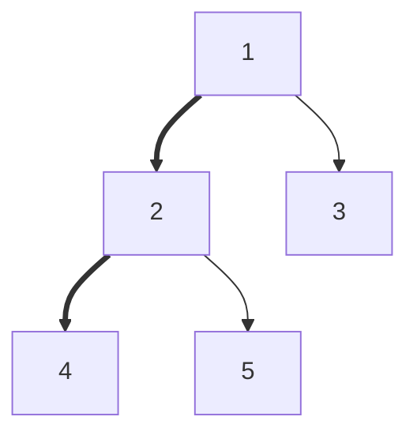

# Bài 4.3 – Cây: Euler tour và HLD

> **Tập 4** · Cần biết trước: bài 3.3, 3.4, 3.5 · Thời lượng: khoảng 2 giờ đọc, 10 giờ thực hành

**Học xong bài này, em sẽ:**

- "trải phẳng" cây thành mảng bằng **Euler tour**: mỗi cây con là một **đoạn liên tiếp**;
- dùng **phân rã nặng–nhẹ** (HLD) để mọi đường đi trên cây là O(log n) đoạn liên tiếp;
- trả lời truy vấn cây con và truy vấn đường đi bằng Fenwick / cây phân đoạn.

**Dấu hiệu nhận biết:** cây có giá trị trên đỉnh, có cập nhật xen kẽ câu hỏi về **cây con** hoặc **đường đi**.

---

## 1. Euler tour

Duyệt DFS, ghi `vao[u]` = thứ tự lúc vào u, `ra[u]` = thứ tự lớn nhất trong cây con của u. Khi đó cây con của u là đoạn **[vao[u], ra[u]]** trên mảng.

Bài [Path Queries](https://cses.fi/problemset/task/1138): cây gốc 1, đỉnh u có giá trị vᵤ. Thao tác `1 s x`: đặt giá trị đỉnh s là x; `2 s`: tổng giá trị trên đường từ gốc tới s.

| Vào | Ra |
| --- | --- |
| `5 3`<br>`4 2 5 2 1`<br>`1 2`<br>`1 3`<br>`3 4`<br>`3 5`<br>`2 4`<br>`1 3 2`<br>`2 4`| `11`<br>`8` |

**Lật ngược góc nhìn:** đổi giá trị đỉnh s thêm δ làm **mọi đỉnh trong cây con của s** có tổng-đường-về-gốc tăng δ. Vậy: cộng δ vào cả đoạn [vao[s], ra[s]] và hỏi giá trị tại một điểm, đúng bài Fenwick trên mảng hiệu (bài 3.4, Range Update Queries).

```cpp
// file: euler_tour.cpp
#include <bits/stdc++.h>
using namespace std;
int n;
vector<long long> fw;
void cong(int i, long long v) { for (; i <= n; i += i & -i) fw[i] += v; }
long long tong(int i) { long long s = 0; for (; i > 0; i -= i & -i) s += fw[i]; return s; }

int main() {
    ios::sync_with_stdio(false);
    cin.tie(nullptr);
    int q;
    cin >> n >> q;
    vector<long long> val(n + 1);
    for (int i = 1; i <= n; i++) cin >> val[i];
    vector<vector<int>> adj(n + 1);
    for (int i = 0; i < n - 1; i++) { int a, b; cin >> a >> b; adj[a].push_back(b); adj[b].push_back(a); }
    vector<int> vao(n + 1), ra(n + 1), cha(n + 1, 0), it(n + 1, 0);
    int t = 0;
    vector<int> st = {1};                             // DFS bằng ngăn xếp
    vao[1] = ++t;
    while (!st.empty()) {
        int u = st.back();
        if (it[u] < (int)adj[u].size()) {
            int v = adj[u][it[u]++];
            if (v == cha[u]) continue;
            cha[v] = u; vao[v] = ++t; st.push_back(v);
        } else { ra[u] = t; st.pop_back(); }
    }
    fw.assign(n + 1, 0);
    auto them = [&](int s, long long d) { cong(vao[s], d); cong(ra[s] + 1, -d); };   // + d cho cả cây con
    for (int s = 1; s <= n; s++) them(s, val[s]);
    while (q--) {
        int tp, s;
        cin >> tp >> s;
        if (tp == 1) { long long x; cin >> x; them(s, x - val[s]); val[s] = x; }
        else cout << tong(vao[s]) << '\n';
    }
}
```

---

## 2. HLD: đường đi giữa hai đỉnh bất kỳ

Bài [Path Queries II](https://cses.fi/problemset/task/2134): đổi giá trị một đỉnh; hỏi **max** giá trị trên đường đi giữa a và b. Euler tour không đủ, vì đường đi a–b không phải một đoạn.

**Ý tưởng.** Ở mỗi đỉnh, gọi đứa con có cây con lớn nhất là **con nặng**; cạnh tới nó là cạnh nặng. Các cạnh nặng nối thành **chuỗi**. Đánh số sao cho mỗi chuỗi là một đoạn liên tiếp. Đi từ một đỉnh lên gốc, mỗi lần chuyển sang chuỗi khác (qua cạnh nhẹ) thì kích thước cây con **ít nhất gấp đôi**, nên chỉ qua tối đa log₂ n chuỗi.



Nét đậm là cạnh nặng: chuỗi 1–2–4 là một đoạn; 3 và 5 là hai chuỗi một đỉnh.

| Vào | Ra |
| --- | --- |
| `5 3`<br>`2 4 1 3 3`<br>`1 2`<br>`1 3`<br>`2 4`<br>`2 5`<br>`2 3 5`<br>`1 2 2`<br>`2 3 5` | `4`<br>`3` |

```cpp
// file: hld.cpp
#include <bits/stdc++.h>
using namespace std;
int n;
vector<long long> seg;                                 // cây phân đoạn max, dạng vòng lặp (bài 3.5)
void sua(int i, long long v) { for (seg[i += n] = v; i > 1; i /= 2) seg[i / 2] = max(seg[i], seg[i ^ 1]); }
long long hoi(int l, int r) {                         // max trên [l, r)
    long long kq = LLONG_MIN;
    for (l += n, r += n; l < r; l /= 2, r /= 2) {
        if (l & 1) kq = max(kq, seg[l++]);
        if (r & 1) kq = max(kq, seg[--r]);
    }
    return kq;
}
int main() {
    ios::sync_with_stdio(false);
    cin.tie(nullptr);
    int q;
    cin >> n >> q;
    vector<long long> val(n + 1);
    for (int i = 1; i <= n; i++) cin >> val[i];
    vector<vector<int>> adj(n + 1);
    for (int i = 0; i < n - 1; i++) { int a, b; cin >> a >> b; adj[a].push_back(b); adj[b].push_back(a); }
    vector<int> cha(n + 1, 0), sau(n + 1, 0), sz(n + 1, 1), nang(n + 1, 0), dau(n + 1), vt(n + 1), bfs = {1};
    for (int k = 0; k < (int)bfs.size(); k++)
        for (int v : adj[bfs[k]]) if (v != cha[bfs[k]]) { cha[v] = bfs[k]; sau[v] = sau[bfs[k]] + 1; bfs.push_back(v); }
    for (int k = n - 1; k > 0; k--) {                 // kích thước cây con và con nặng
        int u = bfs[k], p = cha[u];
        sz[p] += sz[u];
        if (nang[p] == 0 || sz[u] > sz[nang[p]]) nang[p] = u;
    }
    int t = 0;
    vector<int> st = {1};
    while (!st.empty()) {                             // mỗi chuỗi nặng nhận các vị trí liên tiếp
        int h = st.back(); st.pop_back();
        for (int u = h; u != 0; u = nang[u]) {
            dau[u] = h; vt[u] = t++;
            for (int v : adj[u]) if (v != cha[u] && v != nang[u]) st.push_back(v);
        }
    }
    seg.assign(2 * n, LLONG_MIN);
    for (int u = 1; u <= n; u++) sua(vt[u], val[u]);
    while (q--) {
        int tp, a, b;
        cin >> tp >> a >> b;
        if (tp == 1) { sua(vt[a], b); continue; }
        long long kq = LLONG_MIN;
        while (dau[a] != dau[b]) {                    // nhảy chuỗi có đầu sâu hơn
            if (sau[dau[a]] < sau[dau[b]]) swap(a, b);
            kq = max(kq, hoi(vt[dau[a]], vt[a] + 1));
            a = cha[dau[a]];
        }
        if (sau[a] > sau[b]) swap(a, b);
        kq = max(kq, hoi(vt[a], vt[b] + 1));          // cùng chuỗi: một đoạn
        cout << kq << '\n';
    }
}
```

Mỗi câu hỏi: O(log n) chuỗi × O(log n) cho cây phân đoạn = O(log² n).

---

## 3. Bẫy thường gặp

> [!WARNING]
> **Bẫy 1: DFS đệ quy.** Cây đường thẳng 2·10⁵ đỉnh. Cả hai chương trình trên đều không dùng đệ quy.

> [!WARNING]
> **Bẫy 2: nhảy chuỗi sai.** Luôn nhảy đỉnh có **đầu chuỗi sâu hơn**, không phải đỉnh sâu hơn.

> [!WARNING]
> **Bẫy 3: giá trị trên cạnh thay vì trên đỉnh.** Đặt giá trị cạnh vào đỉnh con, và khi a, b cùng chuỗi thì **bỏ** vị trí của đỉnh nông hơn (LCA).

---

## 4. Bài tập

| Nấc | Bài | Nguồn | Ý chính |
| --- | --- | --- | --- |
| Khởi động | [Subtree Queries](https://cses.fi/problemset/task/1137) | CSES 1137 | Euler tour + Fenwick |
| Khởi động | [Path Queries](https://cses.fi/problemset/task/1138) | CSES 1138 | Đúng mục 1 |
| Luyện | [Path Queries II](https://cses.fi/problemset/task/2134) | CSES 2134 | Đúng mục 2 |
| Luyện | [Distinct Colors](https://cses.fi/problemset/task/1139) | CSES 1139 | Euler tour + bài 4.2 |
| Thử thách | [Fixed-Length Paths I](https://cses.fi/problemset/task/2080) | CSES 2080 | Phân rã trọng tâm (centroid) |

**Checkpoint:** AC Subtree Queries, Path Queries, Path Queries II.
