# Bài 4.3 – Cây: Euler tour và HLD

> **Tập 4 · Chuyên đề nâng cao**
> Cần biết trước: bài 3.3 (cây có gốc, LCA), bài 3.4 (Fenwick), bài 3.5 (cây phân đoạn), bài 4.1 (cây lười).
> Thời lượng: khoảng 2 giờ đọc, cộng 10 giờ thực hành (2 tuần).

**Học xong bài này, em sẽ:**

- "trải phẳng" cây thành mảng bằng **Euler tour**: mỗi cây con là một **đoạn liên tiếp**;
- trả lời truy vấn **cây con** và truy vấn **đường về gốc** bằng Fenwick;
- dùng **phân rã nặng–nhẹ** (HLD) để mọi đường đi trên cây là O(log n) đoạn liên tiếp, rồi dùng cây phân đoạn;
- giải trọn bài kiểu đề thi **Mạng nước**.

**Dấu hiệu nhận biết:** cây có giá trị trên đỉnh, có cập nhật xen kẽ câu hỏi về **cây con** hoặc **đường đi**.

> [!TIP]
> **Học cùng hai trang mô phỏng.** [Euler tour](../../mo-phong/t4-euler.html): bật **Đoán trước** để đoán vao[u], ra[u]; xem đoạn của mỗi cây con trên mảng phẳng. [HLD](../../mo-phong/t4-hld.html): xem các chuỗi nặng và cách đường đi bị cắt thành đoạn.

---

## 1. Bài toán mở màn: Tổng cây con

Cây n đỉnh gốc 1, đỉnh u có giá trị vᵤ. Thao tác `1 s x`: đặt giá trị đỉnh s là x; `2 s`: tổng giá trị mọi đỉnh trong **cây con** của s. (n, q ≤ 2·10⁵; bài [Subtree Queries](https://cses.fi/problemset/task/1137))

| Vào | Ra |
| --- | --- |
| `7 4`<br>`4 2 5 2 1 3 6`<br>`1 2`<br>`1 3`<br>`2 4`<br>`2 5`<br>`3 6`<br>`5 7`<br>`2 2`<br>`2 1`<br>`1 5 10`<br>`2 2` | `11`<br>`23`<br>`20` |

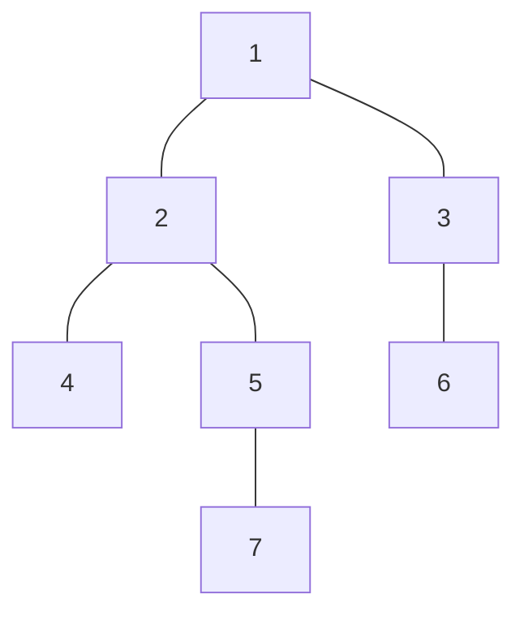

---

## 2. Dừng lại 10 phút

> [!IMPORTANT]
> **Dừng lại và nghĩ.**
> 1. Cộng tổng cây con bằng cách duyệt cây con mỗi câu hỏi tốn bao lâu khi cây là đường thẳng?
> 2. Viết các đỉnh theo thứ tự **DFS đi vào** (lần đầu gặp): 1, 2, 4, 5, 7, 3, 6. Các đỉnh của cây con 2 nằm ở đâu trong dãy này?
> 3. Nếu cây con nào cũng là một **đoạn liên tiếp** của dãy, bài toán trở thành bài gì quen thuộc?

<details>
<summary>Đáp án</summary>

1. O(n) mỗi câu, O(n·q) = 4·10¹⁰.
2. Vị trí 2..5: `2 4 5 7`, liền nhau. DFS đi hết cây con của 2 rồi mới sang nhánh khác.
3. "Sửa điểm, tổng đoạn" (bài 3.4): Fenwick.

</details>

---

## 3. Lời giải ngây thơ và vì sao nó chậm

Duyệt cây con bằng BFS/DFS mỗi câu hỏi: O(kích thước cây con). Cây đường thẳng có cây con của gốc dài n: O(n·q). Hoặc lưu sẵn tổng cây con của mọi đỉnh: câu hỏi O(1), nhưng sửa một đỉnh phải sửa mọi tổ tiên, O(độ sâu) = O(n). Cả hai đều một thao tác chậm.

---

## 4. Ý tưởng then chốt

> [!IMPORTANT]
> **Euler tour: DFS từ gốc, `vao[u]` = thứ tự lúc vào u, `ra[u]` = thứ tự lớn nhất trong cây con của u (gán lúc rời u). Cây con của u là đoạn [vao[u], ra[u]] trên mảng phẳng. Đặt giá trị đỉnh u tại vị trí vao[u] rồi dùng Fenwick.**

### Chạy từng bước

Với cây ví dụ. Đoán vao và ra rồi mới mở.

<details>
<summary><b>Bước 1</b> – Vào 1, 2, 4</summary>

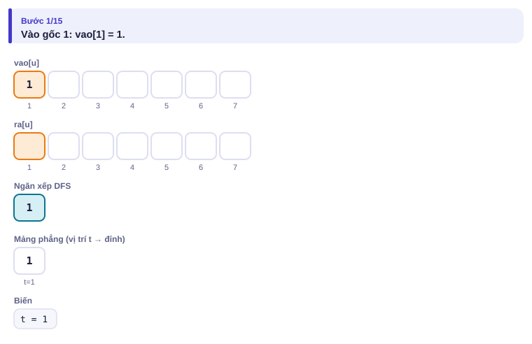
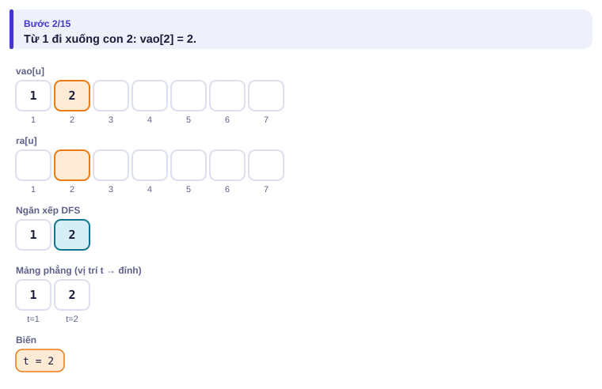
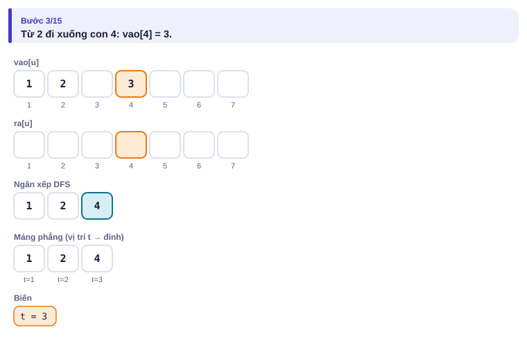

</details>

<details>
<summary><b>Bước 2</b> – Rời 4 (lá): ra[4] bằng bao nhiêu?</summary>

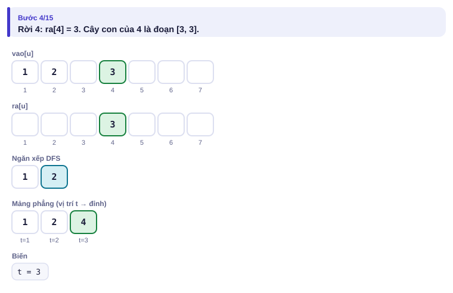

</details>

<details>
<summary><b>Bước 3</b> – Vào 5, 7 rồi rời 7, 5</summary>

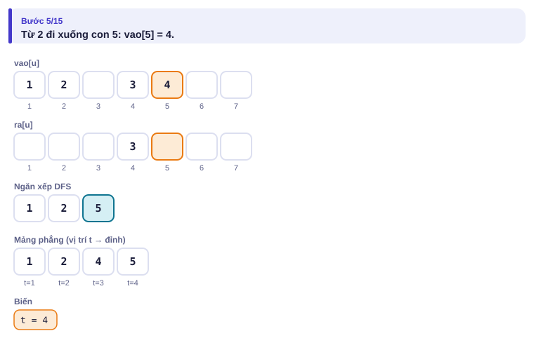
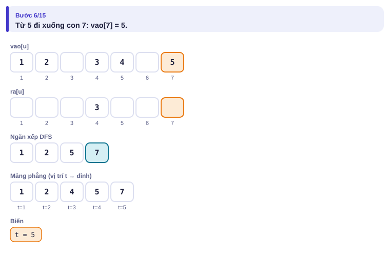
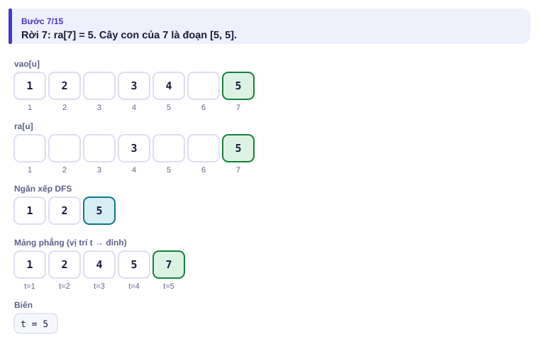
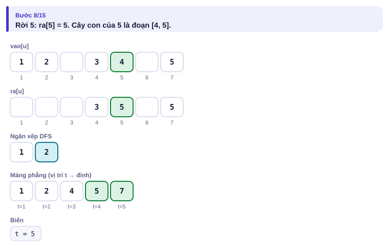

</details>

<details>
<summary><b>Bước 4</b> – Rời 2: cây con của 2 là đoạn nào?</summary>

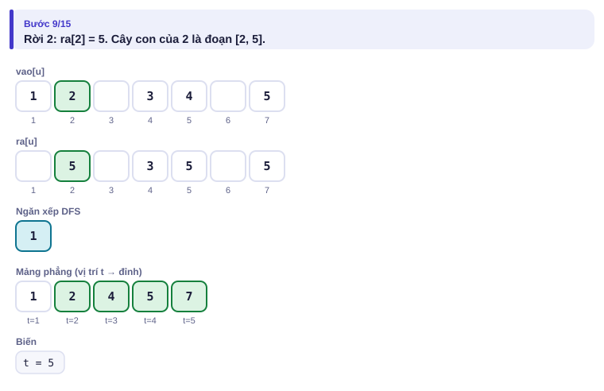
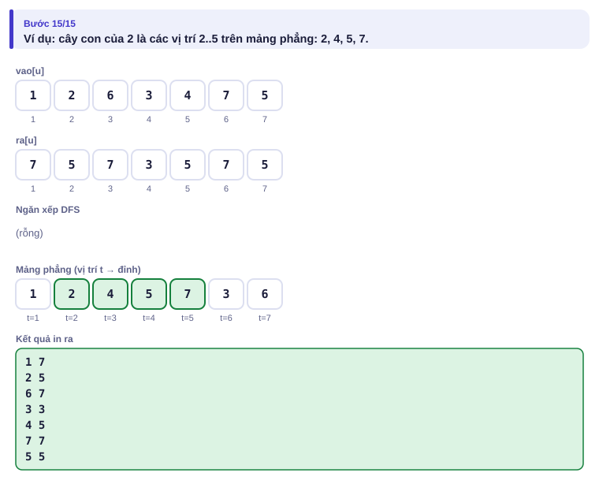

</details>

| u | 1 | 2 | 3 | 4 | 5 | 6 | 7 |
| --- | :---: | :---: | :---: | :---: | :---: | :---: | :---: |
| vao[u] | 1 | 2 | 6 | 3 | 4 | 7 | 5 |
| ra[u] | 7 | 5 | 7 | 3 | 5 | 7 | 5 |

---

## 5. Mã giả và cài đặt

```cpp
// file: cay_con.cpp
#include <bits/stdc++.h>
using namespace std;
int n;
vector<long long> fw;
void cong(int i, long long v) { for (; i <= n; i += i & -i) fw[i] += v; }
long long tong(int i) { long long s = 0; for (; i > 0; i -= i & -i) s += fw[i]; return s; }
int main() {
    ios::sync_with_stdio(false);
    cin.tie(nullptr);
    int q;
    cin >> n >> q;
    vector<long long> val(n + 1);
    for (int i = 1; i <= n; i++) cin >> val[i];
    vector<vector<int>> adj(n + 1);
    for (int i = 0; i < n - 1; i++) { int a, b; cin >> a >> b; adj[a].push_back(b); adj[b].push_back(a); }
    vector<int> vao(n + 1), ra(n + 1), cha(n + 1, 0), it(n + 1, 0);
    int t = 0;
    vector<int> st = {1};                             // DFS bằng ngăn xếp
    vao[1] = ++t;
    while (!st.empty()) {
        int u = st.back();
        if (it[u] < (int)adj[u].size()) {
            int v = adj[u][it[u]++];
            if (v == cha[u]) continue;
            cha[v] = u; vao[v] = ++t; st.push_back(v);
        } else { ra[u] = t; st.pop_back(); }
    }
    fw.assign(n + 1, 0);
    for (int u = 1; u <= n; u++) cong(vao[u], val[u]);
    while (q--) {
        int tp, s;
        cin >> tp >> s;
        if (tp == 1) { long long x; cin >> x; cong(vao[s], x - val[s]); val[s] = x; }
        else cout << tong(ra[s]) - tong(vao[s] - 1) << '\n';
    }
}
```

### HLD: đường đi giữa hai đỉnh bất kỳ

Bài [Path Queries II](https://cses.fi/problemset/task/2134): đổi giá trị một đỉnh; hỏi **max** giá trị trên đường đi giữa a và b. Euler tour không đủ, vì đường đi a–b không phải một đoạn.

**Ý tưởng.** Ở mỗi đỉnh, gọi đứa con có cây con lớn nhất là **con nặng**; cạnh tới nó là cạnh nặng. Các cạnh nặng nối thành **chuỗi**. Đánh số sao cho mỗi chuỗi là một đoạn liên tiếp. Đi từ một đỉnh lên gốc, mỗi lần chuyển sang chuỗi khác là đi qua một cạnh nhẹ, và kích thước cây con ít nhất gấp đôi: tối đa log₂ n lần.

<details>
<summary><b>Hình</b> – HLD trên cây 10 đỉnh, đường đi 7 – 9 (mở lần lượt)</summary>

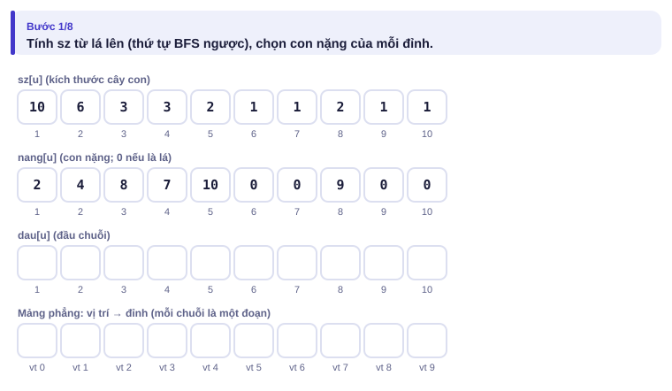
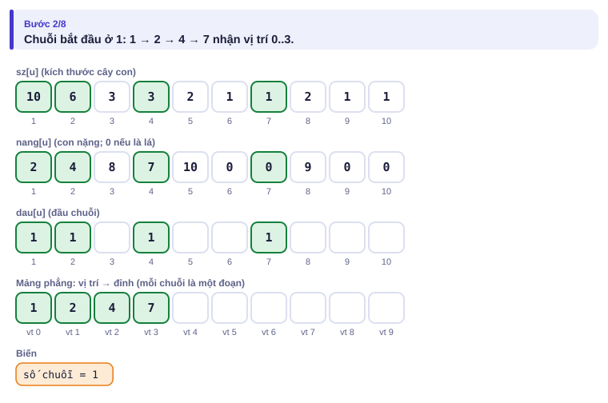
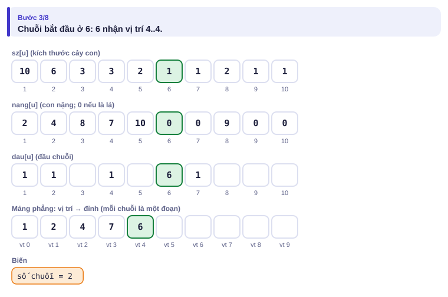
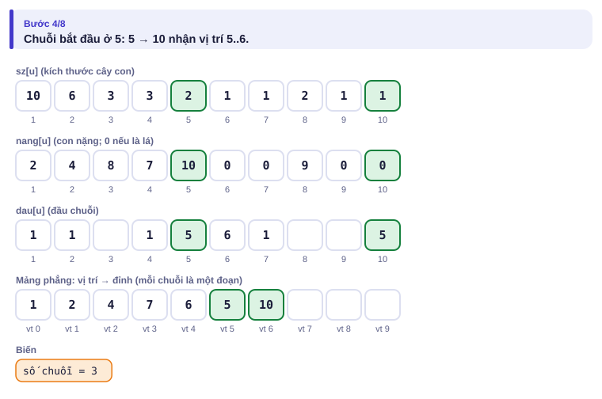
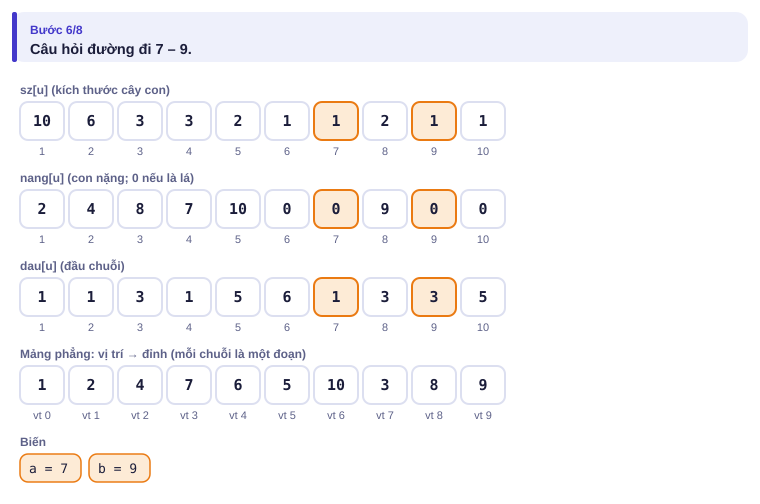
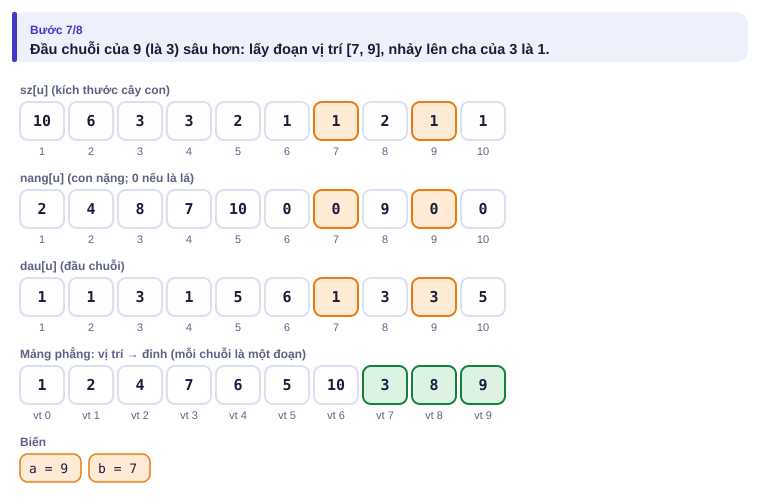
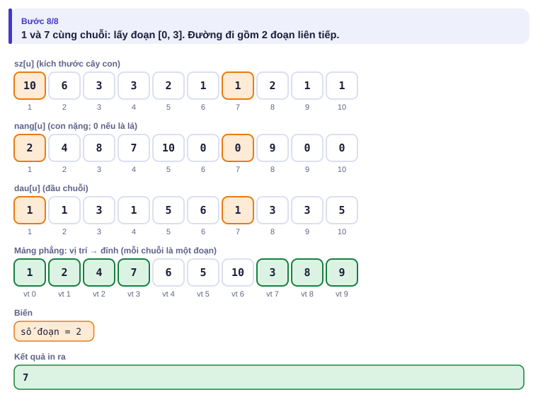

</details>

| Vào | Ra |
| --- | --- |
| `5 3`<br>`2 4 1 3 3`<br>`1 2`<br>`1 3`<br>`2 4`<br>`2 5`<br>`2 3 5`<br>`1 2 2`<br>`2 3 5` | `4`<br>`3` |

```cpp
// file: hld.cpp
#include <bits/stdc++.h>
using namespace std;
int n;
vector<long long> seg;                                 // cây phân đoạn max, dạng vòng lặp (bài 3.5)
void sua(int i, long long v) { for (seg[i += n] = v; i > 1; i /= 2) seg[i / 2] = max(seg[i], seg[i ^ 1]); }
long long hoi(int l, int r) {                         // max trên [l, r)
    long long kq = LLONG_MIN;
    for (l += n, r += n; l < r; l /= 2, r /= 2) {
        if (l & 1) kq = max(kq, seg[l++]);
        if (r & 1) kq = max(kq, seg[--r]);
    }
    return kq;
}
int main() {
    ios::sync_with_stdio(false);
    cin.tie(nullptr);
    int q;
    cin >> n >> q;
    vector<long long> val(n + 1);
    for (int i = 1; i <= n; i++) cin >> val[i];
    vector<vector<int>> adj(n + 1);
    for (int i = 0; i < n - 1; i++) { int a, b; cin >> a >> b; adj[a].push_back(b); adj[b].push_back(a); }
    vector<int> cha(n + 1, 0), sau(n + 1, 0), sz(n + 1, 1), nang(n + 1, 0), dau(n + 1), vt(n + 1), bfs = {1};
    for (int k = 0; k < (int)bfs.size(); k++)
        for (int v : adj[bfs[k]]) if (v != cha[bfs[k]]) { cha[v] = bfs[k]; sau[v] = sau[bfs[k]] + 1; bfs.push_back(v); }
    for (int k = n - 1; k > 0; k--) {                 // kích thước cây con và con nặng
        int u = bfs[k], p = cha[u];
        sz[p] += sz[u];
        if (nang[p] == 0 || sz[u] > sz[nang[p]]) nang[p] = u;
    }
    int t = 0;
    vector<int> st = {1};
    while (!st.empty()) {                             // mỗi chuỗi nặng nhận các vị trí liên tiếp
        int h = st.back(); st.pop_back();
        for (int u = h; u != 0; u = nang[u]) {
            dau[u] = h; vt[u] = t++;
            for (int v : adj[u]) if (v != cha[u] && v != nang[u]) st.push_back(v);
        }
    }
    seg.assign(2 * n, LLONG_MIN);
    for (int u = 1; u <= n; u++) sua(vt[u], val[u]);
    while (q--) {
        int tp, a, b;
        cin >> tp >> a >> b;
        if (tp == 1) { sua(vt[a], b); continue; }
        long long kq = LLONG_MIN;
        while (dau[a] != dau[b]) {                    // nhảy chuỗi có đầu sâu hơn
            if (sau[dau[a]] < sau[dau[b]]) swap(a, b);
            kq = max(kq, hoi(vt[dau[a]], vt[a] + 1));
            a = cha[dau[a]];
        }
        if (sau[a] > sau[b]) swap(a, b);
        kq = max(kq, hoi(vt[a], vt[b] + 1));          // cùng chuỗi: một đoạn
        cout << kq << '\n';
    }
}
```

Mỗi câu hỏi: O(log n) chuỗi × O(log n) cho cây phân đoạn = O(log² n).

---

## 6. Vì sao đúng, chạy bao lâu

- **Euler tour đúng:** DFS vào u rồi đi hết mọi đỉnh của cây con u trước khi rời u; các đỉnh đó nhận thứ tự vào liên tiếp từ vao[u] tới ra[u], và không đỉnh ngoài nào xen vào.
- **HLD đúng:** trong mỗi chuỗi, đỉnh đầu chuỗi có vị trí nhỏ nhất và các đỉnh tiếp theo (đi xuống theo con nặng) có vị trí liên tiếp tăng dần. Đoạn [vt[dau[a]], vt[a]] đúng là phần đường đi từ a lên đầu chuỗi.
- **HLD nhanh:** đi qua một cạnh nhẹ từ con lên cha, kích thước cây con tăng ít nhất gấp đôi (vì con nhẹ có cây con ≤ nửa cây con của cha): mỗi đường về gốc qua ≤ log₂ n cạnh nhẹ.
- **Chạy bao lâu:** chuẩn bị O(n); Euler + Fenwick O(log n) mỗi thao tác; HLD O(log² n) mỗi câu hỏi.

---

## 7. Bẫy thường gặp

> [!WARNING]
> **Bẫy 1: DFS đệ quy.** Cây đường thẳng 2·10⁵ đỉnh. Các chương trình trong bài đều không dùng đệ quy.

> [!WARNING]
> **Bẫy 2: nhảy chuỗi sai.** Luôn nhảy đỉnh có **đầu chuỗi sâu hơn**, không phải đỉnh sâu hơn.
> *Test phá:* cây hình "chữ Y" lệch: a nông nhưng nằm trong chuỗi có đầu rất sâu.

> [!WARNING]
> **Bẫy 3: giá trị trên cạnh thay vì trên đỉnh.** Đặt giá trị cạnh vào đỉnh con, và khi a, b cùng chuỗi thì **bỏ** vị trí của đỉnh nông hơn (LCA).

> [!WARNING]
> **Bẫy 4: dùng nhầm vao/ra.** Tổng cây con là tong(ra[s]) − tong(vao[s] − 1), không phải tong(vao[s]).

---

## 8. Ví dụ giảm dần hỗ trợ

### Ví dụ 2 – Điền vào chỗ trống: Tổng đường về gốc

Cùng cây có giá trị. `1 s x`: đặt giá trị đỉnh s là x; `2 s`: tổng giá trị trên **đường đi từ gốc tới s**. (bài [Path Queries](https://cses.fi/problemset/task/1138))

| Vào | Ra |
| --- | --- |
| `5 3`<br>`4 2 5 2 1`<br>`1 2`<br>`1 3`<br>`3 4`<br>`3 5`<br>`2 4`<br>`1 3 2`<br>`2 4` | `11`<br>`8` |

**Lật ngược góc nhìn:** đổi giá trị đỉnh s thêm δ làm **mọi đỉnh trong cây con của s** có tổng-đường-về-gốc tăng δ. Vậy cộng δ vào cả đoạn [vao[s], ra[s]] (Fenwick trên mảng hiệu, bài 3.4) và hỏi **điểm** vao[s].

```cpp
auto them = [&](int s, long long d) { cong(vao[s], d); cong(____, -d); };
// câu hỏi 2 s:
cout << tong(____) << '\n';
```

<details>
<summary>Đáp án</summary>

`ra[s] + 1` và `vao[s]`.

```cpp
// file: euler_tour.cpp
#include <bits/stdc++.h>
using namespace std;
int n;
vector<long long> fw;
void cong(int i, long long v) { for (; i <= n; i += i & -i) fw[i] += v; }
long long tong(int i) { long long s = 0; for (; i > 0; i -= i & -i) s += fw[i]; return s; }
int main() {
    ios::sync_with_stdio(false);
    cin.tie(nullptr);
    int q;
    cin >> n >> q;
    vector<long long> val(n + 1);
    for (int i = 1; i <= n; i++) cin >> val[i];
    vector<vector<int>> adj(n + 1);
    for (int i = 0; i < n - 1; i++) { int a, b; cin >> a >> b; adj[a].push_back(b); adj[b].push_back(a); }
    vector<int> vao(n + 1), ra(n + 1), cha(n + 1, 0), it(n + 1, 0);
    int t = 0;
    vector<int> st = {1};
    vao[1] = ++t;
    while (!st.empty()) {
        int u = st.back();
        if (it[u] < (int)adj[u].size()) {
            int v = adj[u][it[u]++];
            if (v == cha[u]) continue;
            cha[v] = u; vao[v] = ++t; st.push_back(v);
        } else { ra[u] = t; st.pop_back(); }
    }
    fw.assign(n + 2, 0);
    auto them = [&](int s, long long d) { cong(vao[s], d); cong(ra[s] + 1, -d); };   // + d cho cả cây con
    for (int s = 1; s <= n; s++) them(s, val[s]);
    while (q--) {
        int tp, s;
        cin >> tp >> s;
        if (tp == 1) { long long x; cin >> x; them(s, x - val[s]); val[s] = x; }
        else cout << tong(vao[s]) << '\n';
    }
}
```

</details>

### Ví dụ 3 – Tự làm: Tổng trên đường đi

Như bài HLD ở mục 5 nhưng hỏi **tổng** giá trị các đỉnh trên đường đi a–b (tính cả a và b).

| Vào | Ra |
| --- | --- |
| `5 3`<br>`2 4 1 3 3`<br>`1 2`<br>`1 3`<br>`2 4`<br>`2 5`<br>`2 3 5`<br>`1 2 2`<br>`2 3 5` | `10`<br>`8` |

> [!IMPORTANT]
> Tự làm trước. Gợi ý: giữ nguyên phần HLD, chỉ đổi cây phân đoạn max thành cây tổng (hoặc Fenwick) và phần tử trung tính từ −∞ thành 0.

<details>
<summary>Lời giải</summary>

Đường 3 – 1 – 2 – 5: 1 + 2 + 4 + 3 = 10; sau khi đặt giá trị đỉnh 2 là 2: 8.

```cpp
// file: hld_tong.cpp
#include <bits/stdc++.h>
using namespace std;
int n;
vector<long long> fw;
void cong(int i, long long v) { for (i++; i <= n; i += i & -i) fw[i] += v; }       // vị trí từ 0
long long tong(int i) { long long s = 0; for (; i > 0; i -= i & -i) s += fw[i]; return s; }   // tổng [0, i)
int main() {
    ios::sync_with_stdio(false);
    cin.tie(nullptr);
    int q;
    cin >> n >> q;
    vector<long long> val(n + 1);
    for (int i = 1; i <= n; i++) cin >> val[i];
    vector<vector<int>> adj(n + 1);
    for (int i = 0; i < n - 1; i++) { int a, b; cin >> a >> b; adj[a].push_back(b); adj[b].push_back(a); }
    vector<int> cha(n + 1, 0), sau(n + 1, 0), sz(n + 1, 1), nang(n + 1, 0), dau(n + 1), vt(n + 1), bfs = {1};
    for (int k = 0; k < (int)bfs.size(); k++)
        for (int v : adj[bfs[k]]) if (v != cha[bfs[k]]) { cha[v] = bfs[k]; sau[v] = sau[bfs[k]] + 1; bfs.push_back(v); }
    for (int k = n - 1; k > 0; k--) {
        int u = bfs[k], p = cha[u];
        sz[p] += sz[u];
        if (nang[p] == 0 || sz[u] > sz[nang[p]]) nang[p] = u;
    }
    int t = 0;
    vector<int> st = {1};
    while (!st.empty()) {
        int h = st.back(); st.pop_back();
        for (int u = h; u != 0; u = nang[u]) {
            dau[u] = h; vt[u] = t++;
            for (int v : adj[u]) if (v != cha[u] && v != nang[u]) st.push_back(v);
        }
    }
    fw.assign(n + 1, 0);
    for (int u = 1; u <= n; u++) cong(vt[u], val[u]);
    while (q--) {
        int tp, a, b;
        cin >> tp >> a >> b;
        if (tp == 1) { cong(vt[a], b - val[a]); val[a] = b; continue; }
        long long kq = 0;
        while (dau[a] != dau[b]) {
            if (sau[dau[a]] < sau[dau[b]]) swap(a, b);
            kq += tong(vt[a] + 1) - tong(vt[dau[a]]);
            a = cha[dau[a]];
        }
        if (sau[a] > sau[b]) swap(a, b);
        kq += tong(vt[b] + 1) - tong(vt[a]);
        cout << kq << '\n';
    }
}
```

</details>

---

## 9. Bài tập

| Nấc | Bài | Nguồn | Ý chính |
| --- | --- | --- | --- |
| Khởi động | [Subtree Queries](https://cses.fi/problemset/task/1137) | CSES 1137 | Đúng mục 5 |
| Khởi động | [Path Queries](https://cses.fi/problemset/task/1138) | CSES 1138 | Ví dụ 2 |
| Luyện | [Path Queries II](https://cses.fi/problemset/task/2134) | CSES 2134 | HLD max |
| Luyện | [Distinct Colors](https://cses.fi/problemset/task/1139) | CSES 1139 | Euler tour + bài 4.2 |
| Thử thách | [Fixed-Length Paths I](https://cses.fi/problemset/task/2080) | CSES 2080 | Phân rã trọng tâm (centroid) |
| Kiểu đề thi | Mạng nước | Bài của sách, chấm theo subtask | Xem bên dưới |

### Bài kiểu đề thi: Mạng nước

**Đề bài.** Mạng ống nước của khu phố là một cây n nút, gốc là trạm bơm 1 (n ≤ 2·10⁵); nút u ban đầu có áp lực aᵤ. Có q thao tác (q ≤ 2·10⁵):

- `1 u v`: tăng áp lực thêm v cho **mọi** nút trong cây con của u (|v| ≤ 10⁴);
- `2 u`: in **tổng** áp lực các nút trong cây con của u.

Đọc từ `MANGNUOC.INP` (dòng đầu n q, dòng hai a₁ … aₙ, n − 1 dòng cạnh, q dòng thao tác), ghi mỗi đáp án một dòng ra `MANGNUOC.OUT`.

Subtask: 40% có n, q ≤ 5000; 60% còn lại có n, q ≤ 2·10⁵.

| MANGNUOC.INP | MANGNUOC.OUT |
| --- | --- |
| `7 6`<br>`1 1 1 1 1 1 1`<br>`1 2`<br>`1 3`<br>`2 4`<br>`2 5`<br>`3 6`<br>`5 7`<br>`1 2 3`<br>`2 2`<br>`2 1`<br>`1 1 1`<br>`2 5`<br>`2 3` | `16`<br>`19`<br>`10`<br>`4` |

<details>
<summary><b>Gợi ý 1</b> – hướng đi (đủ 40% điểm)</summary>

Duyệt cây con bằng ngăn xếp cho mỗi thao tác: O(n) mỗi lần.

</details>

<details>
<summary><b>Gợi ý 2</b> – ý then chốt</summary>

Euler tour biến cây con thành đoạn [vao[u], ra[u]]. Thao tác 1 là **cộng cả đoạn**, thao tác 2 là **tổng đoạn**: đúng cây lười của bài 4.1.

</details>

<details>
<summary><b>Gợi ý 3</b> – lời giải đầy đủ</summary>

O((n + q) log n). Đặt aᵤ vào vị trí vao[u] khi dựng.

```cpp
// file: mangnuoc.cpp
#include <bits/stdc++.h>
using namespace std;
int n;
vector<long long> tg, no;
void ap(int x, int l, int r, long long v) { tg[x] += v * (r - l + 1); no[x] += v; }
void day(int x, int l, int r) {
    if (!no[x]) return;
    int m = (l + r) / 2;
    ap(2 * x, l, m, no[x]); ap(2 * x + 1, m + 1, r, no[x]); no[x] = 0;
}
void cong(int x, int l, int r, int ql, int qr, long long v) {
    if (qr < l || r < ql) return;
    if (ql <= l && r <= qr) { ap(x, l, r, v); return; }
    day(x, l, r);
    int m = (l + r) / 2;
    cong(2 * x, l, m, ql, qr, v); cong(2 * x + 1, m + 1, r, ql, qr, v);
    tg[x] = tg[2 * x] + tg[2 * x + 1];
}
long long hoi(int x, int l, int r, int ql, int qr) {
    if (qr < l || r < ql) return 0;
    if (ql <= l && r <= qr) return tg[x];
    day(x, l, r);
    int m = (l + r) / 2;
    return hoi(2 * x, l, m, ql, qr) + hoi(2 * x + 1, m + 1, r, ql, qr);
}
int main() {
    freopen("MANGNUOC.INP", "r", stdin);
    freopen("MANGNUOC.OUT", "w", stdout);
    int q;
    scanf("%d %d", &n, &q);
    vector<long long> a(n + 1);
    for (int i = 1; i <= n; i++) scanf("%lld", &a[i]);
    vector<vector<int>> adj(n + 1);
    for (int i = 0; i < n - 1; i++) { int x, y; scanf("%d %d", &x, &y); adj[x].push_back(y); adj[y].push_back(x); }
    vector<int> vao(n + 1), ra(n + 1), cha(n + 1, 0), it(n + 1, 0);
    int t = 0;
    vector<int> st = {1};
    vao[1] = ++t;
    while (!st.empty()) {
        int u = st.back();
        if (it[u] < (int)adj[u].size()) {
            int v = adj[u][it[u]++];
            if (v == cha[u]) continue;
            cha[v] = u; vao[v] = ++t; st.push_back(v);
        } else { ra[u] = t; st.pop_back(); }
    }
    tg.assign(4 * n, 0); no.assign(4 * n, 0);
    for (int u = 1; u <= n; u++) cong(1, 1, n, vao[u], vao[u], a[u]);
    while (q--) {
        int tp, u;
        scanf("%d %d", &tp, &u);
        if (tp == 1) { long long v; scanf("%lld", &v); cong(1, 1, n, vao[u], ra[u], v); }
        else printf("%lld\n", hoi(1, 1, n, vao[u], ra[u]));
    }
}
```

</details>

---

## 10. Tóm tắt, flashcard và checkpoint

**Tóm tắt trong 5 dòng.**

1. Euler tour: vao/ra từ DFS (ngăn xếp); cây con u = đoạn [vao[u], ra[u]].
2. Truy vấn cây con: cấu trúc đoạn thường (Fenwick, cây lười) trên mảng phẳng.
3. Truy vấn đường về gốc với sửa điểm: "lật ngược" thành cộng cả cây con, hỏi điểm.
4. HLD: con nặng → chuỗi; mỗi chuỗi một đoạn; đường đi = O(log n) đoạn.
5. HLD luôn nhảy đỉnh có đầu chuỗi sâu hơn; O(log² n) mỗi câu hỏi.

**Flashcard.**

<details><summary>Cây con của 5 trong cây ví dụ là đoạn nào?</summary>[4, 5] (đỉnh 5 và 7).</details>
<details><summary>Vì sao đường đi về gốc qua tối đa log₂ n cạnh nhẹ?</summary>Mỗi lần đi lên qua cạnh nhẹ, kích thước cây con ít nhất gấp đôi.</details>
<details><summary>Path Queries: đổi giá trị đỉnh s thì cộng vào đoạn nào?</summary>[vao[s], ra[s]].</details>
<details><summary>HLD: khi a, b cùng chuỗi thì lấy đoạn nào?</summary>[vt[đỉnh nông hơn], vt[đỉnh sâu hơn]].</details>
<details><summary>Mạng nước: cần cấu trúc gì trên mảng phẳng?</summary>Cây lười cộng đoạn, tổng đoạn.</details>

**Ôn xoắn ốc** (mỗi bài tối đa 20 phút):

- Viết lại thuật toán Mo (bài 4.2) không nhìn sách.
- [Company Queries II](https://cses.fi/problemset/task/1688) (CSES 1688): LCA (bài 3.3); thử giải lại bằng HLD.
- [Subordinates](https://cses.fi/problemset/task/1674) (CSES 1674): ra[u] − vao[u] chính là số cấp dưới.

**Checkpoint – em đã sẵn sàng sang bài tiếp theo nếu:**

- [ ] AC [Subtree Queries](https://cses.fi/problemset/task/1137) và [Path Queries](https://cses.fi/problemset/task/1138).
- [ ] AC [Path Queries II](https://cses.fi/problemset/task/2134).
- [ ] Làm xong Ví dụ 3 (Tổng trên đường đi) mà không mở lời giải.
- [ ] Đạt trọn điểm bài Mạng nước khi tự làm trong 35 phút.

Chưa đạt? Nếu vướng ô 1, chạy trang mô phỏng Euler tour và tự lập bảng vao/ra. Nếu vướng ô 2 hoặc 3, chạy trang HLD với ví dụ "cây nhị phân" và đọc lại Bẫy 2. Nếu vướng ô 4, đọc lại bài 4.1.
