# Bài 4.4 – Tối ưu QHĐ: kỹ thuật bao lồi

> **Tập 4 · Chuyên đề nâng cao**
> Cần biết trước: bài 2.9 (QHĐ), bài 2.6 (hàng đợi đơn điệu), bài 3.5 (cây phân đoạn).
> Thời lượng: khoảng 100 phút đọc, cộng 8 giờ thực hành (1,5 tuần).

**Học xong bài này, em sẽ:**

- tăng tốc QHĐ dạng dp[i] = min theo j < i của (dp[j] + aⱼ·xᵢ) từ O(n²) xuống O(n), bằng cách xem mỗi j là một **đường thẳng** và chỉ giữ phần "đáy" của chúng;
- dùng **cây Li Chao** khi điểm hỏi hoặc hệ số góc không đơn điệu;
- biến đổi một công thức có bình phương thành dạng đường thẳng;
- biết tên và điều kiện của các kỹ thuật tối ưu QHĐ khác (chia để trị, Knuth);
- giải trọn bài kiểu đề thi **Nhảy đá**.

**Dấu hiệu nhận biết:** công thức truy hồi có **tích** của một đại lượng theo j và một đại lượng theo i.

> [!TIP]
> **Học cùng hai trang mô phỏng.** [Bao lồi với deque](../../mo-phong/t4-cht.html): xem đường nào bị bỏ ở đầu, đường nào bị kẹp ở cuối; bật **Đoán trước** để đoán dp. [Cây Li Chao](../../mo-phong/t4-li-chao.html): mỗi nút giữ một đường; xem đường bị đẩy xuống nửa nào.

---

## 1. Bài toán mở màn: Diệt quái vật

Trò chơi có n màn. Màn i có quái vật sức mạnh sᵢ; diệt nó tốn sᵢ × f giây, với f là **hệ số kỹ năng hiện tại**. Diệt quái màn i thì hệ số kỹ năng trở thành fᵢ. Ban đầu hệ số là x. Có thể bỏ qua quái ở các màn 1..n − 1, nhưng phải diệt quái màn n. Đảm bảo s₁ ≤ s₂ ≤ … ≤ sₙ và x ≥ f₁ ≥ f₂ ≥ … ≥ fₙ. Tổng thời gian ít nhất? (n ≤ 2·10⁵, giá trị ≤ 10⁶; bài [Monster Game I](https://cses.fi/problemset/task/2084))

| Vào | Ra |
| --- | --- |
| `5 100`<br>`20 30 30 50 90`<br>`90 60 20 10 1` | `4800` |

Cách tốt nhất: chỉ diệt quái màn 3 (30 × 100 = 3000 giây, hệ số thành 20) rồi màn 5 (90 × 20 = 1800 giây).

---

## 2. Dừng lại 10 phút

> [!IMPORTANT]
> **Dừng lại và nghĩ.**
> 1. Gọi dp[i] = thời gian ít nhất nếu màn i là màn diệt quái **cuối cùng** tới giờ. Viết công thức dp[i] theo các dp[j] trước đó. Nó tốn bao nhiêu phép?
> 2. Cố định j, biểu thức dp[j] + fⱼ·s là hàm gì của s?
> 3. Có 3 đường thẳng; em cần giá trị nhỏ nhất tại s = 30. Có đường nào chắc chắn **không bao giờ** là thấp nhất, dù s là bao nhiêu?

<details>
<summary>Đáp án</summary>

1. Trước màn i, quái cuối cùng bị diệt là j (hoặc chưa diệt ai: j = 0 với f₀ = x, dp[0] = 0). dp[i] = min theo j < i của (dp[j] + fⱼ·sᵢ). Thử mọi j là O(n²) = 4·10¹⁰.
2. Một **đường thẳng** theo s: hệ số góc fⱼ, tung độ gốc dp[j].
3. Có thể: đường "bị kẹp" giữa hai đường kia (luôn nằm trên ít nhất một trong hai). Chỉ những đường tạo nên **đáy** (bao lồi dưới) mới có ích.

</details>

---

## 3. Lời giải ngây thơ và vì sao nó chậm

```cpp
dp[0] = 0;   // F[0] = x, F[j] = f[j]
for (int i = 1; i <= n; i++) {
    dp[i] = LLONG_MAX;
    for (int j = 0; j < i; j++) dp[i] = min(dp[i], dp[j] + s[i] * F[j]);
}
```

O(n²) = 4·10¹⁰. Lãng phí: với mỗi i ta thử lại cả những j "vô dụng mãi mãi" (đường bị kẹp, hoặc đường đã bị vượt và không bao giờ thấp nhất lại vì s chỉ tăng).

---

## 4. Ý tưởng then chốt

> [!IMPORTANT]
> **Mỗi j là đường y = fⱼ·s + dp[j]; dp[i] là giá trị nhỏ nhất tại s = sᵢ. Khi hệ số góc giảm dần và điểm hỏi tăng dần, giữ các đường trong deque: hỏi thì bỏ đầu khi đường thứ hai không cao hơn đường đầu; thêm thì bỏ cuối khi đường cuối bị kẹp giữa đường áp cuối và đường mới. Mỗi đường vào/ra một lần: O(n).**

Điều kiện "đường giữa l₂ thừa" khi thêm l₃ (l₁ là đường áp cuối): giao điểm của l₁ với l₃ nằm **bên trái hoặc trùng** giao điểm của l₁ với l₂. So sánh bằng nhân chéo để khỏi chia:

(b₃ − b₁)·(m₁ − m₂) ≤ (b₂ − b₁)·(m₁ − m₃)

### Chạy từng bước

Với ví dụ mở màn. Đoán dp rồi mới mở.

<details>
<summary><b>Bước 1</b> – Đường ban đầu, màn 1</summary>

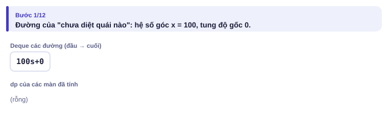
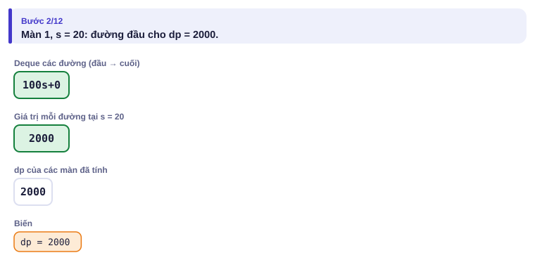
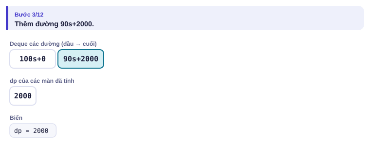

</details>

<details>
<summary><b>Bước 2</b> – Màn 2: đường 90s + 2000 bị kẹp</summary>

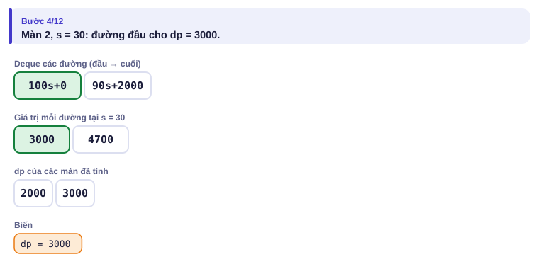
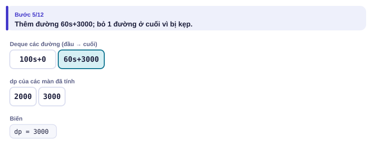

</details>

<details>
<summary><b>Bước 3</b> – Màn 3</summary>

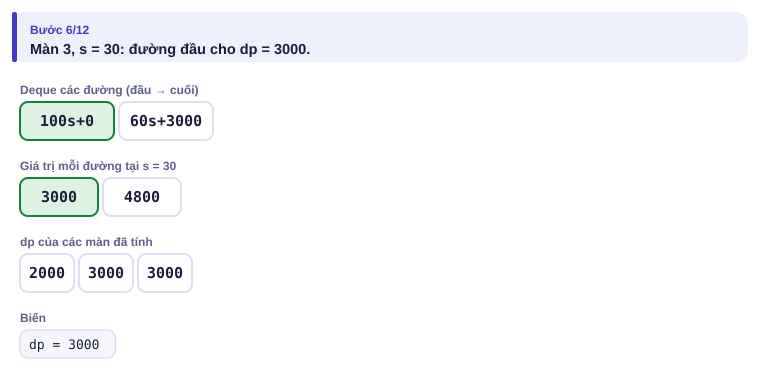
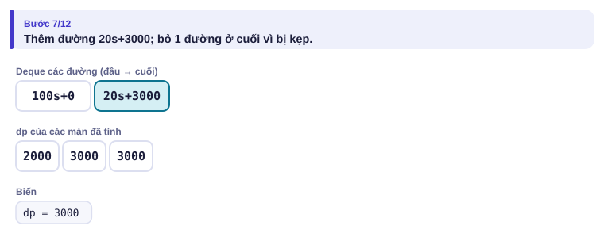

</details>

<details>
<summary><b>Bước 4</b> – Kết quả</summary>

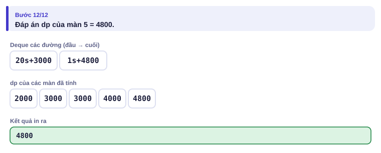

</details>

---

## 5. Mã giả và cài đặt

```cpp
// file: cht.cpp
#include <bits/stdc++.h>
using namespace std;
typedef long long ll;
struct Line { ll m, b; ll at(ll x) const { return m * x + b; } };
bool thua(const Line &l1, const Line &l2, const Line &l3) {   // l2 không bao giờ là thấp nhất
    return (__int128)(l3.b - l1.b) * (l1.m - l2.m) <= (__int128)(l2.b - l1.b) * (l1.m - l3.m);
}
int main() {
    ios::sync_with_stdio(false);
    cin.tie(nullptr);
    int n;
    ll x;
    cin >> n >> x;
    vector<ll> s(n), f(n);
    for (auto &v : s) cin >> v;
    for (auto &v : f) cin >> v;
    deque<Line> dq;
    dq.push_back({x, 0});                              // j = 0: hệ số ban đầu x, thời gian 0
    ll dp = 0;
    for (int i = 0; i < n; i++) {
        while (dq.size() >= 2 && dq[1].at(s[i]) <= dq[0].at(s[i])) dq.pop_front();
        dp = dq[0].at(s[i]);
        Line moi = {f[i], dp};
        while (dq.size() >= 2 && thua(dq[dq.size() - 2], dq.back(), moi)) dq.pop_back();
        dq.push_back(moi);
    }
    cout << dp << '\n';                                // dp của màn n
}
```

```python
# file: cht.py
import sys
from collections import deque
data = sys.stdin.buffer.read().split()
n, x = int(data[0]), int(data[1])
s = list(map(int, data[2:2 + n]))
f = list(map(int, data[2 + n:2 + 2 * n]))

def thua(l1, l2, l3):                       # Python không tràn số, nhân thẳng được
    return (l3[1] - l1[1]) * (l1[0] - l2[0]) <= (l2[1] - l1[1]) * (l1[0] - l3[0])

dq = deque([(x, 0)])
dp = 0
for i in range(n):
    si = s[i]
    while len(dq) >= 2 and dq[1][0] * si + dq[1][1] <= dq[0][0] * si + dq[0][1]:
        dq.popleft()
    dp = dq[0][0] * si + dq[0][1]
    moi = (f[i], dp)
    while len(dq) >= 2 and thua(dq[-2], dq[-1], moi):
        dq.pop()
    dq.append(moi)
print(dp)
```

`__int128` tránh tràn khi nhân: dp tới cỡ 2·10¹⁷, nhân với hệ số góc 10⁶ vượt `long long`.

### Cây Li Chao: khi không đơn điệu

Nếu điểm hỏi sᵢ **không** tăng dần (hoặc hệ số góc không giảm dần), deque không dùng được. **Cây Li Chao** trên miền x: mỗi nút quản lý đoạn [l, r] và giữ **một** đường. Thêm đường mới: so với đường của nút tại điểm giữa, giữ đường thấp hơn ở nút; đường còn lại chỉ có thể thấp hơn ở **một nửa** (hai đường thẳng cắt nhau tối đa một lần), đẩy nó xuống nửa đó. Hỏi tại x: đi từ gốc xuống lá chứa x, lấy min. Mỗi thao tác O(log C), C là độ rộng miền x.

<details>
<summary><b>Hình</b> – cây Li Chao trên miền x ∈ [0, 7] (mở lần lượt)</summary>

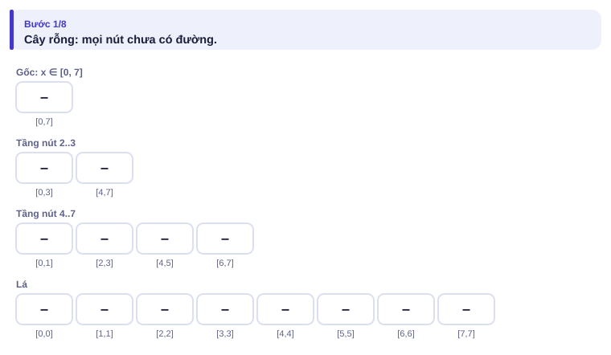
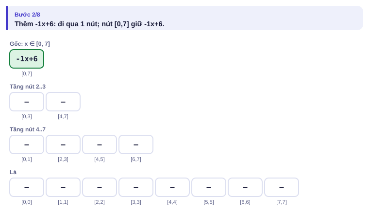
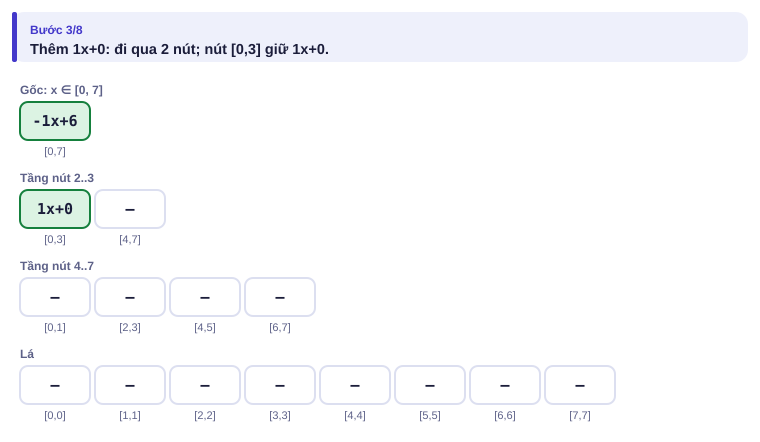
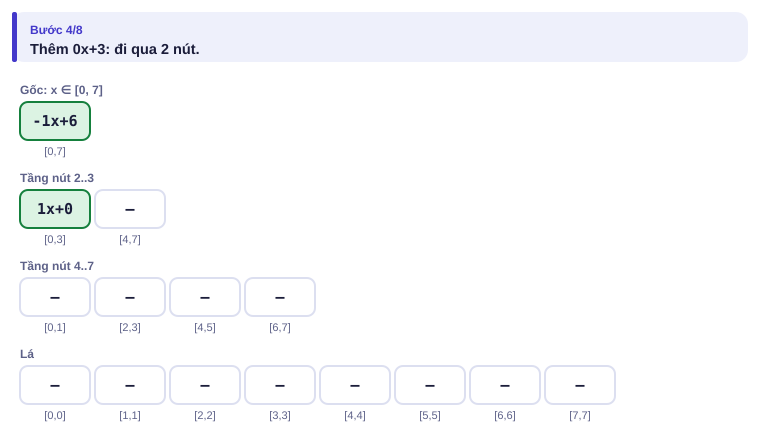
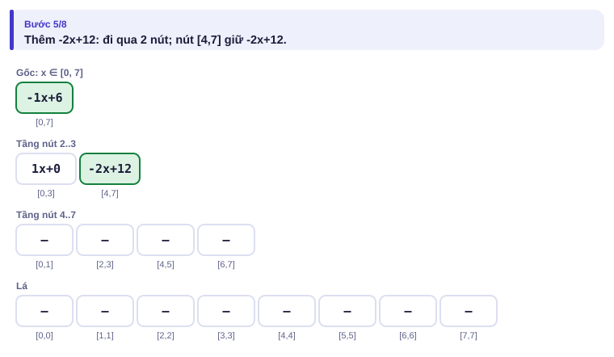
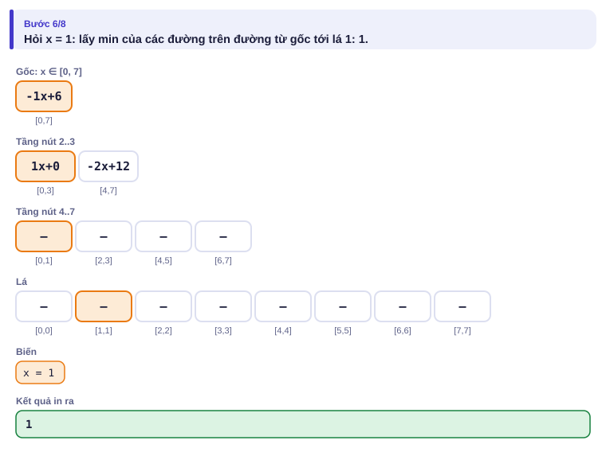
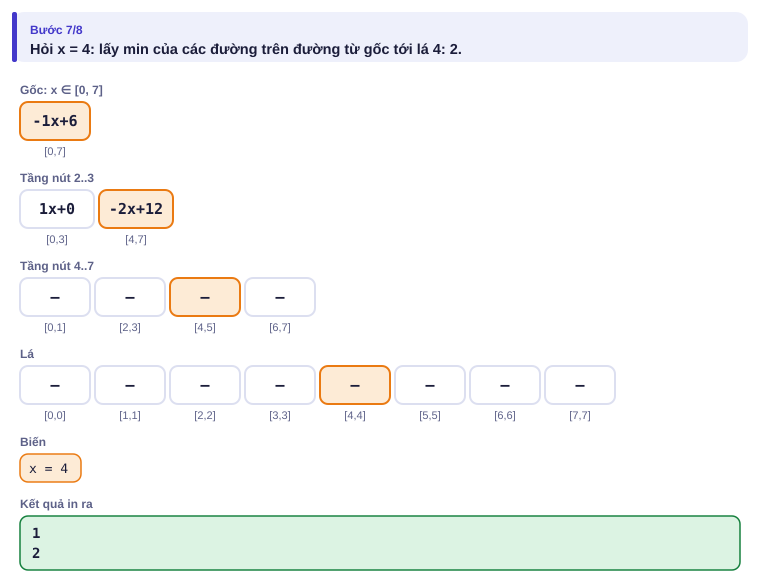
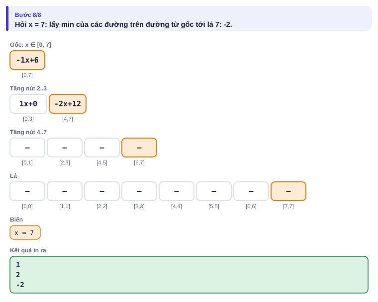

</details>

### Các kỹ thuật tối ưu QHĐ khác

| Kỹ thuật | Dạng công thức | Điều kiện | Từ → tới |
| --- | --- | --- | --- |
| Bao lồi (deque) | min(dp[j] + aⱼ·xᵢ) | góc đơn điệu, điểm hỏi đơn điệu | O(n²) → O(n) |
| Bao lồi + tìm nhị phân | như trên | chỉ góc đơn điệu | O(n²) → O(n log n) |
| Cây Li Chao | như trên | không cần đơn điệu | O(n²) → O(n log C) |
| Chia để trị | dp[k][i] = min(dp[k−1][j] + cost(j, i)) | điểm chọn tối ưu tăng theo i | O(k·n²) → O(k·n log n) |
| Knuth | dp[l][r] = min(dp[l][k] + dp[k][r]) + cost(l, r) | cost thỏa bất đẳng thức tứ giác | O(n³) → O(n²) |

---

## 6. Vì sao đúng, chạy bao lâu

- **Bỏ đầu đúng:** hai đường đầu có hệ số góc m₁ > m₂. Tại s, nếu đường 2 đã không cao hơn đường 1 thì với mọi s' ≥ s, đường 2 càng thấp hơn (dốc ít hơn). Điểm hỏi chỉ tăng, nên đường 1 vô dụng mãi.
- **Bỏ cuối đúng:** nếu giao điểm l₁–l₃ ở bên trái giao điểm l₁–l₂ thì tại mọi s, l₂ cao hơn l₁ (bên trái giao l₁–l₂) hoặc cao hơn l₃ (bên phải giao l₁–l₃): l₂ không bao giờ thấp nhất.
- **Li Chao đúng:** bất biến "tại mỗi x, min của các đường trên đường đi gốc → lá x bằng min của mọi đường đã thêm". Khi đẩy đường thua xuống, nó chỉ có thể thắng ở nửa được đẩy xuống.
- **Chạy bao lâu:** deque O(n); Li Chao O(n log C).

---

## 7. Bẫy thường gặp

> [!WARNING]
> **Bẫy 1: tràn số khi so giao điểm.** Dùng `__int128` hoặc `long double`.

> [!WARNING]
> **Bẫy 2: dùng deque khi điểm hỏi không đơn điệu.** Bỏ đường ở đầu chỉ đúng khi s tăng.
> *Test phá:* Ví dụ 3 (s không tăng dần) chạy bằng `cht.cpp` cho kết quả sai.

> [!WARNING]
> **Bẫy 3: nhầm min và max.** Bài cần max thì đổi dấu: max(m·x + b) = −min(−m·x − b).

> [!WARNING]
> **Bẫy 4: hệ số góc bằng nhau.** Hai đường song song: giữ đường có tung độ gốc nhỏ hơn. Điều kiện `thua` với "≤" xử lý đúng khi đường mới song song và thấp hơn.

---

## 8. Ví dụ giảm dần hỗ trợ

### Ví dụ 2 – Điền vào chỗ trống: Lời giải chậm để đối chiếu

Viết lời giải O(n²) của bài mở màn, để stress test (bài 1.9) với bản bao lồi.

```cpp
for (int i = 1; i <= n; i++) {
    dp[i] = LLONG_MAX;
    for (int j = 0; j < i; j++) dp[i] = min(dp[i], ____ + s[i] * ____);
}
```

<details>
<summary>Đáp án</summary>

`dp[j]` và `F[j]` (F[0] = x, F[j] = fⱼ).

```cpp
// file: quai_cham.cpp
#include <bits/stdc++.h>
using namespace std;
typedef long long ll;
int main() {
    int n;
    ll x;
    cin >> n >> x;
    vector<ll> s(n + 1), F(n + 1);
    for (int i = 1; i <= n; i++) cin >> s[i];
    for (int i = 1; i <= n; i++) cin >> F[i];
    F[0] = x;
    vector<ll> dp(n + 1, 0);
    for (int i = 1; i <= n; i++) {
        dp[i] = LLONG_MAX;
        for (int j = 0; j < i; j++) dp[i] = min(dp[i], dp[j] + s[i] * F[j]);
    }
    cout << dp[n] << '\n';
}
```

</details>

### Ví dụ 3 – Tự làm: Diệt quái vật, không đơn điệu

Như bài mở màn nhưng **không** còn đảm bảo s tăng dần hay f giảm dần (1 ≤ sᵢ, fᵢ, x ≤ 10⁶). (bài [Monster Game II](https://cses.fi/problemset/task/2085))

| Vào | Ra |
| --- | --- |
| `5 100`<br>`20 70 30 50 90`<br>`90 30 60 10 1` | `5900` |

> [!IMPORTANT]
> Tự làm trước. Gợi ý: cây Li Chao trên miền s ∈ [1, 10⁶]. Thêm đường (x, 0) trước; với mỗi màn: dp = hỏi tại sᵢ, rồi thêm đường (fᵢ, dp).

<details>
<summary>Lời giải</summary>

Cây Li Chao cần 4 × 10⁶ nút; mỗi nút giữ một đường, ban đầu là đường "vô cùng" (hệ số góc 0, tung độ gốc rất lớn).

```cpp
// file: li_chao.cpp
#include <bits/stdc++.h>
using namespace std;
typedef long long ll;
const int MX = 1000000;
struct Line { ll m, b; ll at(ll x) const { return m * x + b; } };
vector<Line> t;
void them(int x, int l, int r, Line d) {
    int m = (l + r) / 2;
    if (d.at(m) < t[x].at(m)) swap(t[x], d);
    if (l == r) return;
    if (d.at(l) < t[x].at(l)) them(2 * x, l, m, d);
    else if (d.at(r) < t[x].at(r)) them(2 * x + 1, m + 1, r, d);
}
ll hoi(int x, int l, int r, int X) {
    ll kq = t[x].at(X);
    if (l == r) return kq;
    int m = (l + r) / 2;
    return min(kq, X <= m ? hoi(2 * x, l, m, X) : hoi(2 * x + 1, m + 1, r, X));
}
int main() {
    ios::sync_with_stdio(false);
    cin.tie(nullptr);
    int n;
    ll x;
    cin >> n >> x;
    vector<ll> s(n), f(n);
    for (auto &v : s) cin >> v;
    for (auto &v : f) cin >> v;
    t.assign(4 * MX + 4, {0, (ll)4e18});
    them(1, 1, MX, {x, 0});
    ll dp = 0;
    for (int i = 0; i < n; i++) {
        dp = hoi(1, 1, MX, s[i]);
        them(1, 1, MX, {f[i], dp});
    }
    cout << dp << '\n';
}
```

</details>

---

## 9. Bài tập

| Nấc | Bài | Nguồn | Ý chính |
| --- | --- | --- | --- |
| Khởi động | [Monster Game I](https://cses.fi/problemset/task/2084) | CSES 2084 | Đúng mục 5 |
| Luyện | [Monster Game II](https://cses.fi/problemset/task/2085) | CSES 2085 | Ví dụ 3 |
| Luyện | [Subarray Squares](https://cses.fi/problemset/task/2086) | CSES 2086 | Chia để trị hoặc bao lồi |
| Thử thách | [Houses and Schools](https://cses.fi/problemset/task/2087) | CSES 2087 | Chia để trị, cost tính O(1) |
| Kiểu đề thi | Nhảy đá | Bài của sách, chấm theo subtask | Xem bên dưới |

### Bài kiểu đề thi: Nhảy đá

**Đề bài.** Có n hòn đá, hòn i cao hᵢ với h₁ < h₂ < … < hₙ (n ≤ 2·10⁵, hᵢ ≤ 10⁶). Chú ếch ở hòn 1 muốn tới hòn n; từ hòn j có thể nhảy tới **bất kỳ** hòn i > j, tốn (hᵢ − hⱼ)² + C sức (C ≤ 10¹²). Tổng sức ít nhất? Đọc từ `NHAYDA.INP` (dòng đầu n C, dòng hai h₁ … hₙ), ghi ra `NHAYDA.OUT`.

Subtask: 40% có n ≤ 5000; 60% còn lại có n ≤ 2·10⁵.

| NHAYDA.INP | NHAYDA.OUT |
| --- | --- |
| `5 5`<br>`1 3 4 7 10` | `42` |

Nhảy 1 → 3 → 4 → 5 (độ cao 1 → 4 → 7 → 10): (9 + 5) + (9 + 5) + (9 + 5) = 42.

<details>
<summary><b>Gợi ý 1</b> – hướng đi (đủ 40% điểm)</summary>

dp[i] = min theo j < i của dp[j] + (hᵢ − hⱼ)² + C. O(n²) = 2,5·10⁷ với n = 5000. Giống bài Ếch nhảy (bài 2.9) nhưng nhảy xa bao nhiêu cũng được.

</details>

<details>
<summary><b>Gợi ý 2</b> – ý then chốt</summary>

Khai triển: dp[j] + hᵢ² − 2hᵢhⱼ + hⱼ² + C. Phần chỉ theo i (hᵢ² + C) đưa ra ngoài. Phần còn lại là **đường thẳng** theo x = hᵢ: hệ số góc m = −2hⱼ, tung độ gốc b = dp[j] + hⱼ². Hệ số góc giảm dần (h tăng), điểm hỏi hᵢ tăng dần: dùng deque như mục 5.

</details>

<details>
<summary><b>Gợi ý 3</b> – lời giải đầy đủ</summary>

O(n).

```cpp
// file: nhayda.cpp
#include <bits/stdc++.h>
using namespace std;
typedef long long ll;
struct Line { ll m, b; ll at(ll x) const { return m * x + b; } };
bool thua(const Line &l1, const Line &l2, const Line &l3) {
    return (__int128)(l3.b - l1.b) * (l1.m - l2.m) <= (__int128)(l2.b - l1.b) * (l1.m - l3.m);
}
int main() {
    freopen("NHAYDA.INP", "r", stdin);
    freopen("NHAYDA.OUT", "w", stdout);
    int n;
    ll C;
    scanf("%d %lld", &n, &C);
    vector<ll> h(n);
    for (auto &v : h) scanf("%lld", &v);
    deque<Line> dq;
    dq.push_back({-2 * h[0], h[0] * h[0]});            // hòn 1: dp = 0
    ll dp = 0;
    for (int i = 1; i < n; i++) {
        while (dq.size() >= 2 && dq[1].at(h[i]) <= dq[0].at(h[i])) dq.pop_front();
        dp = dq[0].at(h[i]) + h[i] * h[i] + C;
        Line moi = {-2 * h[i], dp + h[i] * h[i]};
        while (dq.size() >= 2 && thua(dq[dq.size() - 2], dq.back(), moi)) dq.pop_back();
        dq.push_back(moi);
    }
    printf("%lld\n", dp);
}
```

```python
# file: nhayda.py
from collections import deque
with open("NHAYDA.INP") as fi:
    data = fi.read().split()
n, C = int(data[0]), int(data[1])
h = list(map(int, data[2:2 + n]))

def thua(l1, l2, l3):
    return (l3[1] - l1[1]) * (l1[0] - l2[0]) <= (l2[1] - l1[1]) * (l1[0] - l3[0])

dq = deque([(-2 * h[0], h[0] * h[0])])
dp = 0
for i in range(1, n):
    x = h[i]
    while len(dq) >= 2 and dq[1][0] * x + dq[1][1] <= dq[0][0] * x + dq[0][1]:
        dq.popleft()
    dp = dq[0][0] * x + dq[0][1] + x * x + C
    moi = (-2 * x, dp + x * x)
    while len(dq) >= 2 and thua(dq[-2], dq[-1], moi):
        dq.pop()
    dq.append(moi)
with open("NHAYDA.OUT", "w") as fo:
    fo.write(f"{dp}\n")
```

</details>

---

## 10. Tóm tắt, flashcard và checkpoint

**Tóm tắt trong 5 dòng.**

1. dp[i] = min(dp[j] + aⱼ·xᵢ) ⇒ mỗi j là một đường thẳng, hỏi min tại xᵢ.
2. Góc đơn điệu + điểm hỏi đơn điệu: deque, O(n). Chỉ góc đơn điệu: tìm nhị phân trên deque.
3. Không đơn điệu: cây Li Chao O(log C) mỗi thao tác.
4. Có bình phương (hᵢ − hⱼ)²: khai triển, tách phần theo i ra ngoài, phần còn lại là đường thẳng.
5. So giao điểm bằng nhân chéo với `__int128`; bài max thì đổi dấu.

**Flashcard.**

<details><summary>Trong bài Diệt quái vật, đường của j có hệ số góc và tung độ gốc là gì?</summary>Hệ số góc fⱼ, tung độ gốc dp[j].</details>
<details><summary>Khi nào bỏ đường ở đầu deque?</summary>Khi đường thứ hai không cao hơn đường đầu tại điểm hỏi hiện tại (điểm hỏi tăng dần).</details>
<details><summary>Hai đường thẳng cắt nhau mấy lần? Vì sao điều này quan trọng với Li Chao?</summary>Tối đa một lần; nên đường thua chỉ có thể thắng ở một nửa đoạn.</details>
<details><summary>Nhảy đá: đường của j là gì?</summary>Hệ số góc −2hⱼ, tung độ gốc dp[j] + hⱼ².</details>
<details><summary>Kỹ thuật nào cho dp[l][r] = min(dp[l][k] + dp[k][r]) + cost?</summary>Knuth (khi cost thỏa bất đẳng thức tứ giác).</details>

**Ôn xoắn ốc** (mỗi bài tối đa 20 phút):

- Viết lại Euler tour (bài 4.3) không nhìn sách.
- [Sliding Window Maximum](https://leetcode.com/problems/sliding-window-maximum/) (LeetCode 239): hàng đợi đơn điệu (bài 2.6), nền của deque bao lồi.
- [Frog 2](https://atcoder.jp/contests/dp/tasks/dp_b) (AtCoder DP B): QHĐ nhảy có giới hạn (bài 2.9).

**Checkpoint – em đã sẵn sàng sang bài tiếp theo nếu:**

- [ ] AC [Monster Game I](https://cses.fi/problemset/task/2084); stress test với Ví dụ 2.
- [ ] Viết cây Li Chao không nhìn sách trong 10 phút.
- [ ] Làm xong Ví dụ 3 mà không mở lời giải; AC [Monster Game II](https://cses.fi/problemset/task/2085).
- [ ] Đạt trọn điểm bài Nhảy đá khi tự làm trong 40 phút.

Chưa đạt? Nếu vướng ô 1, chạy trang mô phỏng bao lồi với Đoán trước và đọc lại mục 6. Nếu vướng ô 2 hoặc 3, chạy trang Li Chao với ví dụ "hai đường song song". Nếu vướng ô 4, đọc lại Gợi ý 2: luyện khai triển trên giấy trước khi code.
