# Bài 4.5 – Thành phần liên thông mạnh

> **Tập 4 · Chuyên đề nâng cao**
> Cần biết trước: bài 2.7 (DFS bằng ngăn xếp), bài 3.2 (tô-pô, QHĐ trên DAG).
> Thời lượng: khoảng 100 phút đọc, cộng 8 giờ thực hành (1,5 tuần).

**Học xong bài này, em sẽ:**

- tìm các **thành phần liên thông mạnh** (SCC) của đồ thị có hướng bằng thuật toán **Kosaraju**;
- **nén** mỗi SCC thành một đỉnh để được đồ thị không chu trình, rồi QHĐ trên đó;
- tìm **cầu** của đồ thị vô hướng bằng kỹ thuật `vao`/`thap`;
- giải trọn bài kiểu đề thi **Dây cầu**.

**Dấu hiệu nhận biết:** đồ thị có hướng **có chu trình**, nhưng bài toán sẽ dễ nếu không có chu trình (thứ tự tô-pô, QHĐ trên DAG).

> [!TIP]
> **Học cùng hai trang mô phỏng.** [Kosaraju](../../mo-phong/t4-kosaraju.html): xem thứ tự hoàn thành và các SCC được tách ra ở bước 2. [Tìm cầu](../../mo-phong/t4-cau.html): bật **Đoán trước** để quyết định cạnh nào là cầu.

---

## 1. Bài toán mở màn: Nhặt xu

Mê cung có n phòng và m đường hầm **một chiều**; phòng i có kᵢ đồng xu. Em xuất phát ở phòng bất kỳ, đi theo đường hầm, kết thúc ở phòng bất kỳ, nhặt xu ở mọi phòng đi qua (mỗi phòng một lần). Nhặt được nhiều nhất bao nhiêu xu? (n ≤ 10⁵, m ≤ 2·10⁵; bài [Coin Collector](https://cses.fi/problemset/task/1686))

| Vào | Ra |
| --- | --- |
| `4 4`<br>`4 5 2 7`<br>`1 2`<br>`2 1`<br>`1 3`<br>`2 4` | `16` |

Đi 1 → 2 → 1 → … → 2 → 4: nhặt 4 + 5 + 7 = 16.

---

## 2. Dừng lại 10 phút

> [!IMPORTANT]
> **Dừng lại và nghĩ.**
> 1. Nếu đồ thị **không có chu trình**, em giải thế nào? (Gợi ý: bài 3.2.)
> 2. Phòng 1 và 2 đi qua lại được với nhau. Nếu vào được một trong hai, có nhặt được cả hai không?
> 3. Gộp mỗi nhóm phòng "đi qua lại được" thành một đỉnh thì đồ thị mới còn chu trình không?

<details>
<summary>Đáp án</summary>

1. QHĐ theo thứ tự tô-pô: dp[v] = xu[v] + max dp của các đỉnh đi tới v.
2. Có: trong một nhóm đi qua lại được, vào một phòng là nhặt hết cả nhóm.
3. Không: nếu còn chu trình giữa các nhóm thì các nhóm trên chu trình đi qua lại được với nhau, đáng lẽ đã là **một** nhóm. Mỗi nhóm như vậy là một **thành phần liên thông mạnh** (SCC).

</details>

---

## 3. Lời giải ngây thơ và vì sao nó chậm

Với mỗi cặp đỉnh (u, v), kiểm tra u tới được v và v tới được u bằng BFS: O(n · (n + m)) để biết ai cùng nhóm với ai, tức khoảng 3·10¹⁰ với n = 10⁵. Cần một thuật toán chỉ duyệt đồ thị **hai** lần.

---

## 4. Ý tưởng then chốt

> [!IMPORTANT]
> **Kosaraju: (1) DFS trên đồ thị gốc, ghi các đỉnh theo thứ tự hoàn thành. (2) Lấy các đỉnh theo thứ tự hoàn thành ngược, DFS trên đồ thị đảo chiều; mỗi lần bắt đầu từ một đỉnh chưa thuộc SCC nào thu được đúng một SCC. Các SCC ra đời theo thứ tự tô-pô của đồ thị nén.**

Vì sao đúng (ý chính): đỉnh hoàn thành sau cùng nằm trong một SCC "nguồn" của đồ thị nén (không SCC nào đi tới nó). Trên đồ thị đảo, từ SCC nguồn ta chỉ đi được trong chính nó. Bỏ nó đi, lặp lại.

### Chạy từng bước

Với đồ thị 7 đỉnh: vòng 1 → 2 → 3 → 1, cạnh 3 → 4, vòng 4 ⇄ 5, cạnh 5 → 6, vòng 6 ⇄ 7. Đoán các SCC rồi mới mở.

<details>
<summary><b>Bước 1</b> – DFS trên đồ thị gốc: thứ tự hoàn thành</summary>

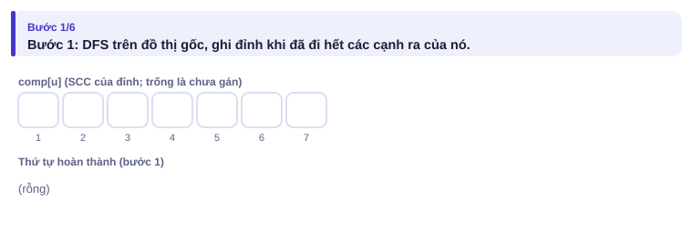
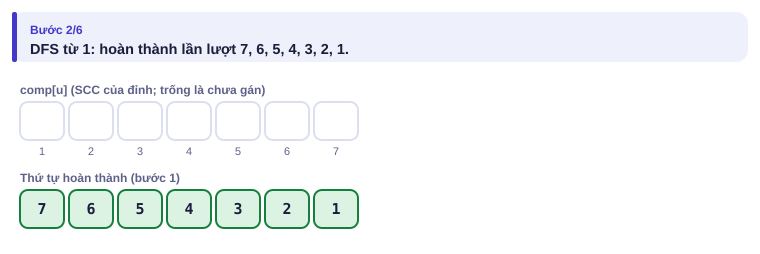

</details>

<details>
<summary><b>Bước 2</b> – Đỉnh hoàn thành muộn nhất là 1: DFS trên đồ thị đảo</summary>

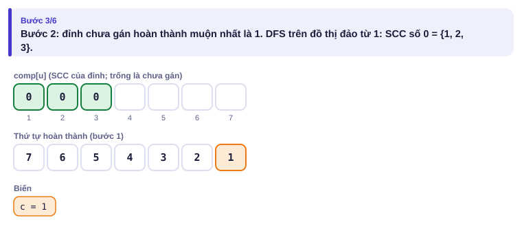

</details>

<details>
<summary><b>Bước 3</b> – Hai SCC tiếp theo</summary>

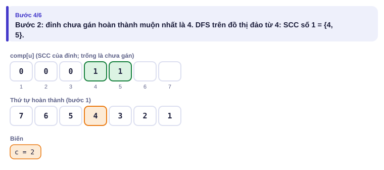
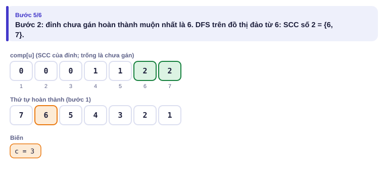

</details>

---

## 5. Mã giả và cài đặt

```cpp
// file: nhat_xu.cpp
#include <bits/stdc++.h>
using namespace std;
int main() {
    ios::sync_with_stdio(false);
    cin.tie(nullptr);
    int n, m;
    cin >> n >> m;
    vector<long long> k(n + 1);
    for (int i = 1; i <= n; i++) cin >> k[i];
    vector<vector<int>> g(n + 1), rg(n + 1);
    for (int i = 0; i < m; i++) { int a, b; cin >> a >> b; g[a].push_back(b); rg[b].push_back(a); }
    // Bước 1: thứ tự hoàn thành, DFS bằng ngăn xếp
    vector<int> xong, it(n + 1, 0);
    vector<bool> tham(n + 1, false);
    for (int s = 1; s <= n; s++) {
        if (tham[s]) continue;
        vector<int> st = {s};
        tham[s] = true;
        while (!st.empty()) {
            int u = st.back();
            if (it[u] < (int)g[u].size()) {
                int v = g[u][it[u]++];
                if (!tham[v]) { tham[v] = true; st.push_back(v); }
            } else { xong.push_back(u); st.pop_back(); }
        }
    }
    // Bước 2: DFS trên đồ thị đảo theo thứ tự hoàn thành ngược
    vector<int> comp(n + 1, -1);
    int c = 0;
    for (int i = n - 1; i >= 0; i--) {
        int s = xong[i];
        if (comp[s] != -1) continue;
        vector<int> st = {s};
        comp[s] = c;
        while (!st.empty()) {
            int u = st.back(); st.pop_back();
            for (int v : rg[u]) if (comp[v] == -1) { comp[v] = c; st.push_back(v); }
        }
        c++;
    }
    // Nén và QHĐ: SCC đánh số theo thứ tự tô-pô 0, 1, ..., c-1
    vector<long long> xu(c, 0), dp(c, 0);
    for (int u = 1; u <= n; u++) xu[comp[u]] += k[u];
    vector<vector<int>> cg(c);
    for (int u = 1; u <= n; u++) for (int v : g[u]) if (comp[u] != comp[v]) cg[comp[u]].push_back(comp[v]);
    long long kq = 0;
    for (int x = 0; x < c; x++) dp[x] = xu[x];
    for (int x = 0; x < c; x++) {                     // theo thứ tự tô-pô: x xong trước khi đẩy đi
        kq = max(kq, dp[x]);
        for (int y : cg[x]) dp[y] = max(dp[y], dp[x] + xu[y]);
    }
    cout << kq << '\n';
}
```

O(n + m).

### Cầu (đồ thị vô hướng)

**Cầu** là cạnh mà xóa đi làm đồ thị mất liên thông. DFS, ghi `vao[u]` (thời điểm vào) và `thap[u]` = thời điểm vào nhỏ nhất tới được từ cây con của u bằng các cạnh cây đi xuống rồi **một** cạnh ngược. Cạnh cha–con (p, u) là cầu khi `thap[u] > vao[p]`: cây con của u không có đường vòng nào lên tới p hoặc cao hơn. (Khớp, tức đỉnh xóa đi làm mất liên thông, dùng điều kiện `thap[u] >= vao[p]`, riêng gốc xét số con.)

<details>
<summary><b>Hình</b> – tìm cầu trên đồ thị 7 đỉnh, 8 cạnh (mở lần lượt; đoán cầu trước)</summary>

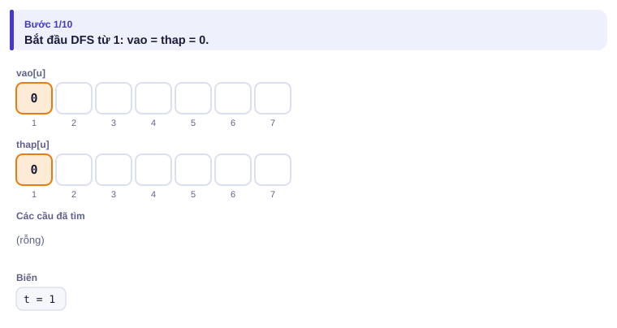
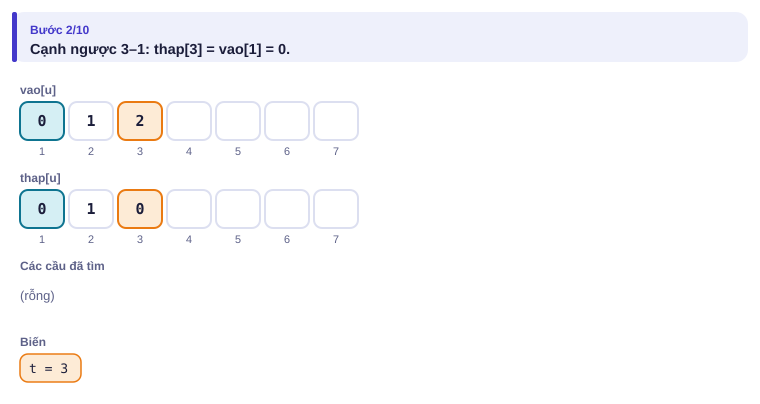
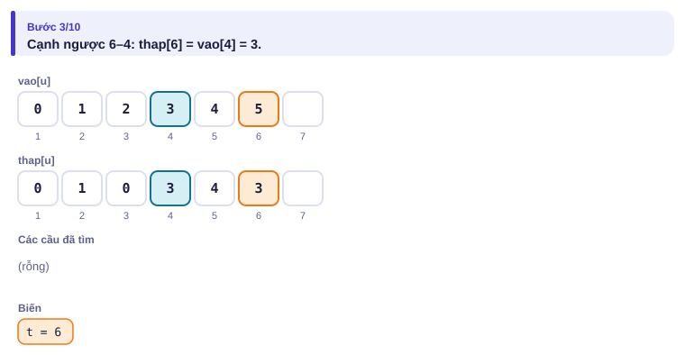
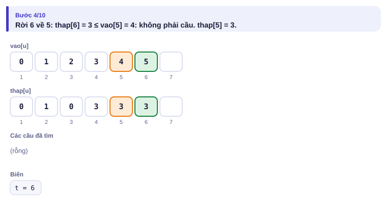
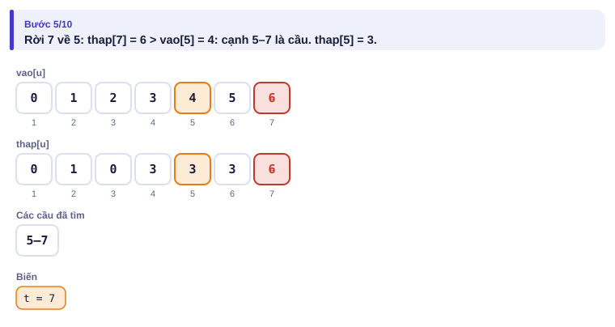
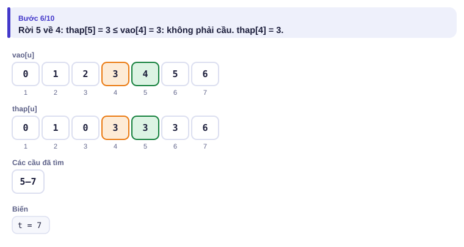
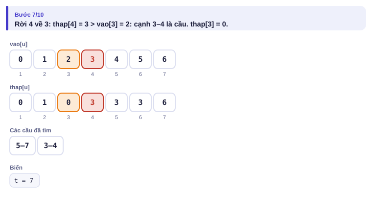
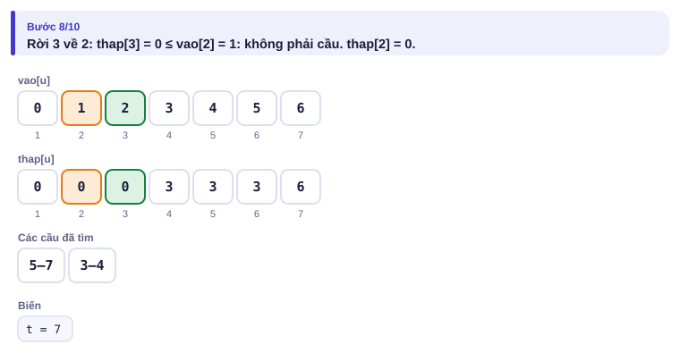
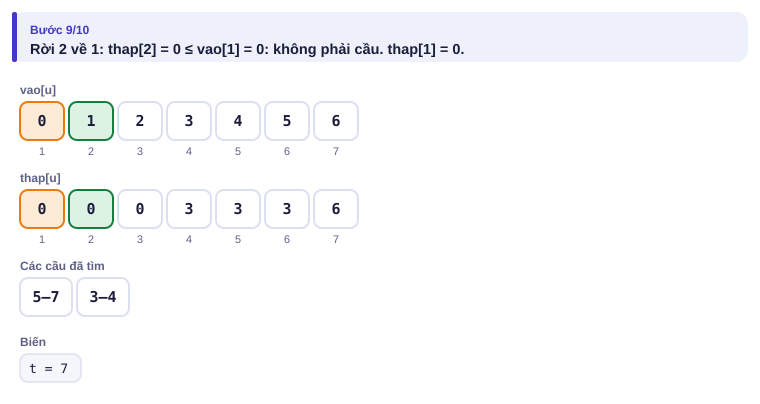
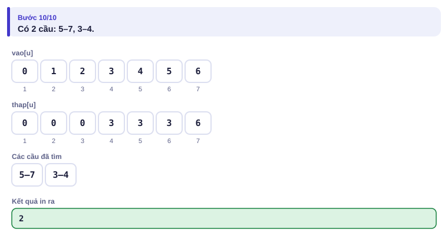

</details>

---

## 6. Vì sao đúng, chạy bao lâu

- **Kosaraju đúng:** gọi C là SCC chứa đỉnh hoàn thành muộn nhất. Nếu có SCC khác D đi tới C (D → C trong đồ thị nén) thì DFS đã vào D… và đỉnh hoàn thành muộn nhất phải nằm trong D, mâu thuẫn. Vậy C là nguồn; trên đồ thị đảo, từ C chỉ tới được chính C. Lập luận tiếp cho phần còn lại.
- **Cầu đúng:** cạnh cây p–u không phải cầu khi và chỉ khi có cạnh ngược từ cây con của u lên p hoặc tổ tiên của p, tức thap[u] ≤ vao[p].
- **Chạy bao lâu:** mỗi thuật toán duyệt mỗi cạnh O(1) lần: O(n + m).

---

## 7. Bẫy thường gặp

> [!WARNING]
> **Bẫy 1: quên đồ thị đảo.** Bước 2 phải chạy trên `rg`, không phải `g`.

> [!WARNING]
> **Bẫy 2: cạnh trong cùng một SCC.** Khi nén, bỏ các cạnh có hai đầu cùng SCC, kẻo QHĐ cộng xu một nhóm hai lần.

> [!WARNING]
> **Bẫy 3: đệ quy sâu.** Đồ thị đường thẳng 10⁵ đỉnh: dùng ngăn xếp như trên.

> [!WARNING]
> **Bẫy 4: cạnh lặp khi tìm cầu.** Hai cạnh song song giữa p và u không phải cầu. Bỏ qua cạnh tới cha theo **chỉ số cạnh**, không theo đỉnh cha.
> *Test phá:* `2 2` / `1 2` / `1 2`: không có cầu.

---

## 8. Ví dụ giảm dần hỗ trợ

### Ví dụ 2 – Điền vào chỗ trống: Đếm SCC

In số SCC và số đỉnh của SCC lớn nhất. (n ≤ 10⁵, m ≤ 2·10⁵)

| Vào | Ra |
| --- | --- |
| `7 9`<br>`1 2`<br>`2 3`<br>`3 1`<br>`3 4`<br>`4 5`<br>`5 4`<br>`5 6`<br>`6 7`<br>`7 6` | `3 3` |

```cpp
for (int i = n - 1; i >= 0; i--) {
    int s = xong[i];
    if (comp[s] != -1) continue;
    vector<int> st = {s};
    comp[s] = c;
    while (!st.empty()) {
        int u = st.back(); st.pop_back();
        for (int v : ____[u]) if (comp[v] == -1) { comp[v] = ____; st.push_back(v); }
    }
    c++;
}
```

<details>
<summary>Đáp án</summary>

`rg` và `c`.

```cpp
// file: dem_scc.cpp
#include <bits/stdc++.h>
using namespace std;
int main() {
    ios::sync_with_stdio(false);
    cin.tie(nullptr);
    int n, m;
    cin >> n >> m;
    vector<vector<int>> g(n + 1), rg(n + 1);
    for (int i = 0; i < m; i++) { int a, b; cin >> a >> b; g[a].push_back(b); rg[b].push_back(a); }
    vector<int> xong, it(n + 1, 0);
    vector<bool> tham(n + 1, false);
    for (int s = 1; s <= n; s++) {
        if (tham[s]) continue;
        vector<int> st = {s};
        tham[s] = true;
        while (!st.empty()) {
            int u = st.back();
            if (it[u] < (int)g[u].size()) {
                int v = g[u][it[u]++];
                if (!tham[v]) { tham[v] = true; st.push_back(v); }
            } else { xong.push_back(u); st.pop_back(); }
        }
    }
    vector<int> comp(n + 1, -1);
    int c = 0;
    for (int i = n - 1; i >= 0; i--) {
        int s = xong[i];
        if (comp[s] != -1) continue;
        vector<int> st = {s};
        comp[s] = c;
        while (!st.empty()) {
            int u = st.back(); st.pop_back();
            for (int v : rg[u]) if (comp[v] == -1) { comp[v] = c; st.push_back(v); }
        }
        c++;
    }
    vector<int> sz(c, 0);
    for (int u = 1; u <= n; u++) sz[comp[u]]++;
    cout << c << ' ' << *max_element(sz.begin(), sz.end()) << '\n';
}
```

</details>

### Ví dụ 3 – Tự làm: Đi đâu cũng tới

Đồ thị có hướng n đỉnh, m cạnh. Từ mọi đỉnh có đi tới được mọi đỉnh khác không? In `YES` hoặc `NO`. (n ≤ 10⁵, m ≤ 2·10⁵; giống [Flight Routes Check](https://cses.fi/problemset/task/1682) nhưng chỉ in YES/NO)

| Vào | Ra |
| --- | --- |
| `4 5`<br>`1 2`<br>`2 3`<br>`3 1`<br>`1 4`<br>`4 1` | `YES` |
| `3 2`<br>`1 2`<br>`2 3` | `NO` |

> [!IMPORTANT]
> Tự làm trước. Gợi ý: không cần Kosaraju đầy đủ. Đủ khi và chỉ khi từ đỉnh 1 đi tới mọi đỉnh **và** mọi đỉnh đi tới được đỉnh 1. Điều thứ hai kiểm tra trên đồ thị nào?

<details>
<summary>Lời giải</summary>

BFS từ 1 trên g và BFS từ 1 trên rg (đồ thị đảo). Cả hai đều thăm đủ n đỉnh thì YES.

```cpp
// file: di_dau_cung_toi.cpp
#include <bits/stdc++.h>
using namespace std;
int n;
bool du(const vector<vector<int>> &g) {
    vector<bool> t(n + 1, false);
    queue<int> q;
    q.push(1); t[1] = true;
    int dem = 1;
    while (!q.empty()) {
        int u = q.front(); q.pop();
        for (int v : g[u]) if (!t[v]) { t[v] = true; dem++; q.push(v); }
    }
    return dem == n;
}
int main() {
    ios::sync_with_stdio(false);
    cin.tie(nullptr);
    int m;
    cin >> n >> m;
    vector<vector<int>> g(n + 1), rg(n + 1);
    for (int i = 0; i < m; i++) { int a, b; cin >> a >> b; g[a].push_back(b); rg[b].push_back(a); }
    cout << (du(g) && du(rg) ? "YES" : "NO") << '\n';
}
```

</details>

---

## 9. Bài tập

| Nấc | Bài | Nguồn | Ý chính |
| --- | --- | --- | --- |
| Khởi động | [Planets and Kingdoms](https://cses.fi/problemset/task/1683) | CSES 1683 | In SCC của từng đỉnh |
| Khởi động | [Coin Collector](https://cses.fi/problemset/task/1686) | CSES 1686 | Đúng mục 5 |
| Luyện | [Flight Routes Check](https://cses.fi/problemset/task/1682) | CSES 1682 | Ví dụ 3, in thêm cặp không tới được |
| Luyện | [Necessary Roads](https://cses.fi/problemset/task/2076) | CSES 2076 | Cầu |
| Luyện | [Necessary Cities](https://cses.fi/problemset/task/2077) | CSES 2077 | Khớp |
| Thử thách | [Giant Pizza](https://cses.fi/problemset/task/1684) | CSES 1684 | 2-SAT qua SCC |
| Kiểu đề thi | Dây cầu | Bài của sách, chấm theo subtask | Xem bên dưới |

### Bài kiểu đề thi: Dây cầu

**Đề bài.** Lưới điện có n trạm (n ≤ 10⁵) và m đường dây hai chiều (m ≤ 2·10⁵, có thể có nhiều dây giữa hai trạm, không có dây nối một trạm với chính nó). Một đường dây là **dây cầu** nếu đứt nó thì số cụm trạm còn liên lạc được với nhau tăng lên. Đếm số dây cầu. Đọc từ `DAYCAU.INP` (dòng đầu n m, m dòng sau là hai đầu dây), ghi ra `DAYCAU.OUT`.

Subtask: 40% có n, m ≤ 2000; 60% còn lại có n ≤ 10⁵, m ≤ 2·10⁵.

| DAYCAU.INP | DAYCAU.OUT |
| --- | --- |
| `7 8`<br>`1 2`<br>`2 3`<br>`3 1`<br>`3 4`<br>`4 5`<br>`5 6`<br>`6 4`<br>`5 7` | `2` |

Dây 3–4 và dây 5–7 là dây cầu.

<details>
<summary><b>Gợi ý 1</b> – hướng đi (đủ 40% điểm)</summary>

Với mỗi dây, bỏ nó ra rồi đếm số cụm bằng DSU (bài 2.8) hoặc BFS: O(m · (n + m)) = 8·10⁶ với n, m ≤ 2000.

</details>

<details>
<summary><b>Gợi ý 2</b> – ý then chốt</summary>

Kỹ thuật vao/thap ở mục 5: dây cây p–u là cầu khi thap[u] > vao[p]. Dây không thuộc cây DFS (cạnh ngược) không bao giờ là cầu. Nhớ Bẫy 4 (dây song song) và đồ thị có thể không liên thông.

</details>

<details>
<summary><b>Gợi ý 3</b> – lời giải đầy đủ</summary>

DFS bằng ngăn xếp, bỏ qua cạnh tới cha theo chỉ số cạnh. O(n + m).

```cpp
// file: daycau.cpp
#include <bits/stdc++.h>
using namespace std;
int main() {
    freopen("DAYCAU.INP", "r", stdin);
    freopen("DAYCAU.OUT", "w", stdout);
    int n, m;
    scanf("%d %d", &n, &m);
    vector<vector<pair<int, int>>> adj(n + 1);           // (đỉnh kề, chỉ số cạnh)
    for (int i = 0; i < m; i++) {
        int a, b;
        scanf("%d %d", &a, &b);
        adj[a].push_back({b, i});
        adj[b].push_back({a, i});
    }
    vector<int> vao(n + 1, -1), thap(n + 1), it(n + 1, 0), canh_cha(n + 1, -1), cha(n + 1, 0);
    int t = 0, cau = 0;
    for (int s = 1; s <= n; s++) {
        if (vao[s] != -1) continue;
        vao[s] = thap[s] = t++;
        vector<int> st = {s};
        while (!st.empty()) {
            int u = st.back();
            if (it[u] < (int)adj[u].size()) {
                auto [v, id] = adj[u][it[u]++];
                if (id == canh_cha[u]) continue;
                if (vao[v] == -1) { vao[v] = thap[v] = t++; canh_cha[v] = id; cha[v] = u; st.push_back(v); }
                else thap[u] = min(thap[u], vao[v]);    // cạnh ngược
            } else {
                st.pop_back();
                int p = cha[u];
                if (p) {
                    thap[p] = min(thap[p], thap[u]);
                    if (thap[u] > vao[p]) cau++;
                }
            }
        }
    }
    printf("%d\n", cau);
}
```

</details>

---

## 10. Tóm tắt, flashcard và checkpoint

**Tóm tắt trong 5 dòng.**

1. SCC: nhóm đỉnh đi qua lại được; nén SCC cho đồ thị không chu trình.
2. Kosaraju: thứ tự hoàn thành trên g, rồi DFS trên rg theo thứ tự ngược; SCC ra theo thứ tự tô-pô.
3. Khi nén: bỏ cạnh trong cùng SCC; QHĐ trên đồ thị nén như bài 3.2.
4. Cầu: thap[u] > vao[p]; khớp: thap[u] ≥ vao[p] (gốc: có ≥ 2 con).
5. DFS bằng ngăn xếp; bỏ cạnh tới cha theo chỉ số cạnh.

**Flashcard.**

<details><summary>Đồ thị nén của các SCC có chu trình không?</summary>Không.</details>
<details><summary>Bước 2 của Kosaraju chạy trên đồ thị nào, theo thứ tự nào?</summary>Đồ thị đảo, theo thứ tự hoàn thành ngược.</details>
<details><summary>Một vòng 4 đỉnh có bao nhiêu cầu?</summary>0.</details>
<details><summary>Đường thẳng 4 đỉnh có bao nhiêu cầu?</summary>3: mọi cạnh.</details>
<details><summary>Kiểm tra đồ thị liên thông mạnh nhanh nhất thế nào?</summary>BFS từ 1 trên g và trên rg, cả hai phải thăm đủ n đỉnh.</details>

**Ôn xoắn ốc** (mỗi bài tối đa 20 phút):

- Viết lại bao lồi deque (bài 4.4) không nhìn sách.
- [Course Schedule](https://cses.fi/problemset/task/1679) (CSES 1679): tô-pô (bài 3.2).
- [Building Roads](https://cses.fi/problemset/task/1666) (CSES 1666): thành phần liên thông (bài 2.7).

**Checkpoint – em đã sẵn sàng sang bài tiếp theo nếu:**

- [ ] Viết Kosaraju không nhìn sách; AC [Coin Collector](https://cses.fi/problemset/task/1686).
- [ ] AC [Necessary Roads](https://cses.fi/problemset/task/2076).
- [ ] Làm xong Ví dụ 3 mà không mở lời giải.
- [ ] Đạt trọn điểm bài Dây cầu khi tự làm trong 35 phút.

Chưa đạt? Nếu vướng ô 1, chạy trang mô phỏng Kosaraju và đọc lại mục 6. Nếu vướng ô 2 hoặc 4, chạy trang Tìm cầu với ví dụ "một vòng" và "đường thẳng", rồi đọc Bẫy 4. Nếu vướng ô 3, đọc lại câu 3 của mục 2.
