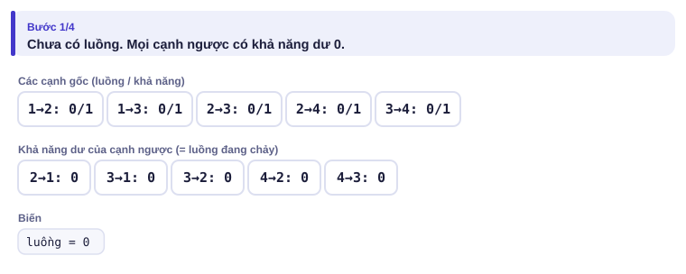
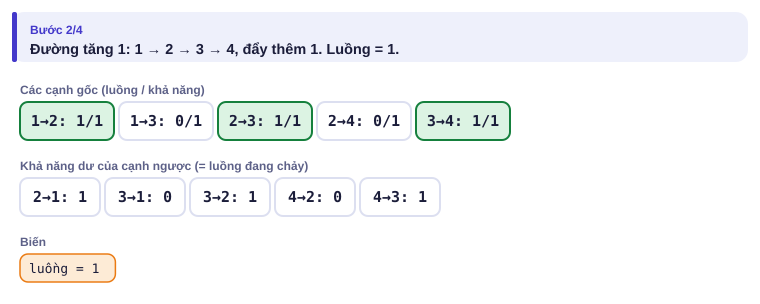
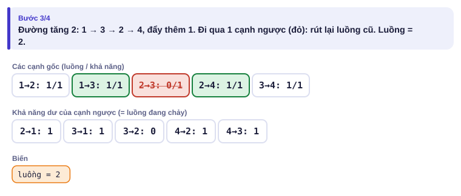
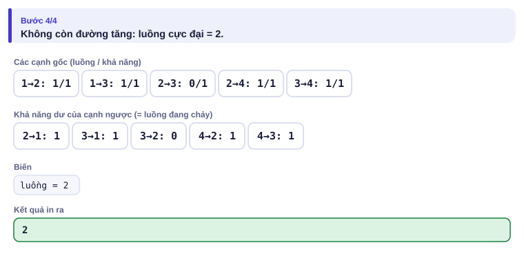
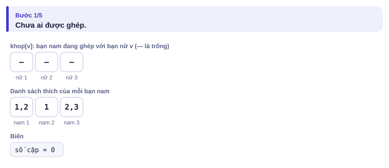
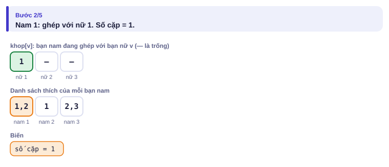
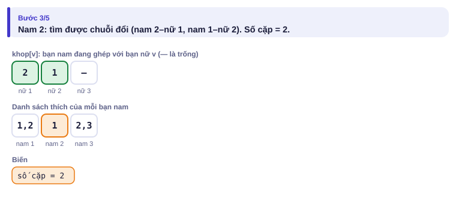
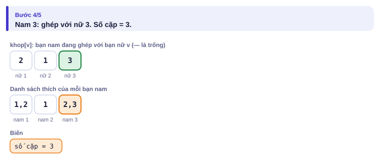

# Bài 4.6 – Luồng cực đại

> **Tập 4 · Chuyên đề nâng cao**
> Cần biết trước: bài 2.7 (BFS), bài 3.1 (đồ thị có trọng số), bài 1.8 (tham lam và khi nào nó sai).
> Thời lượng: khoảng 2 giờ đọc, cộng 10 giờ thực hành (2 tuần).

**Học xong bài này, em sẽ:**

- tìm **luồng cực đại** từ nguồn s tới đích t, hiểu vai trò của **cạnh ngược**;
- cài thuật toán **Dinic** (BFS chia tầng + DFS luồng chặn);
- dùng định lý **lát cắt nhỏ nhất = luồng cực đại**;
- đưa bài **cặp ghép hai phía** và bài **phân công có sức chứa** về luồng;
- giải trọn bài kiểu đề thi **Câu lạc bộ**.

**Dấu hiệu nhận biết:** "chuyển nhiều nhất bao nhiêu… qua mạng có giới hạn"; "ghép nhiều nhất bao nhiêu cặp"; "cắt ít nhất bao nhiêu để tách…"; n nhỏ (vài trăm tới vài nghìn).

> [!TIP]
> **Học cùng hai trang mô phỏng.** [Đường tăng luồng](../../mo-phong/t4-tang-luong.html): ví dụ đầu tiên cho thấy vì sao cần cạnh ngược; bật **Đoán trước**. [Cặp ghép hai phía](../../mo-phong/t4-cap-ghep.html): xem "chuỗi đổi" khi một bạn phải nhường chỗ.

---

## 1. Bài toán mở màn: Tốc độ tải

Mạng có n máy tính và m đường truyền **một chiều**; đường từ a tới b truyền được tối đa c MB/giây. Từ máy 1 tới máy n tải được nhanh nhất bao nhiêu MB/giây? (n ≤ 500, m ≤ 1000, c ≤ 10⁹; bài [Download Speed](https://cses.fi/problemset/task/1694))

| Vào | Ra |
| --- | --- |
| `4 5`<br>`1 2 3`<br>`2 4 2`<br>`1 3 4`<br>`3 4 5`<br>`4 1 3` | `6` |

---

## 2. Dừng lại 10 phút

> [!IMPORTANT]
> **Dừng lại và nghĩ.**
> 1. Tham lam: tìm một đường từ 1 tới n còn dư khả năng, đẩy hết mức có thể, lặp lại. Xét mạng 4 máy, mọi đường khả năng 1: 1→2, 1→3, 2→3, 2→4, 3→4. Nếu lần đầu chọn đường 1 → 2 → 3 → 4, còn đẩy thêm được không? Đáp án đúng là bao nhiêu?
> 2. Làm sao để thuật toán "sửa sai" khi đã đẩy luồng theo đường không tốt?
> 3. Nếu "cắt" một tập đường truyền để máy 1 không còn tới được máy n, tổng khả năng các đường bị cắt liên quan gì tới tốc độ tải tối đa?

<details>
<summary>Đáp án</summary>

1. Sau 1 → 2 → 3 → 4, các cạnh 1→2, 2→3, 3→4 đầy; còn 1→3 và 2→4 nhưng không nối thành đường. Tham lam dừng ở 1, trong khi đáp án là 2 (1 → 2 → 4 và 1 → 3 → 4).
2. Mỗi cạnh a → b có một **cạnh ngược** b → a với khả năng bằng lượng luồng đang đi qua a → b. Đẩy luồng theo cạnh ngược nghĩa là "rút lại" luồng đã đẩy sai. Ở ví dụ: đường 1 → 3 → 2 (ngược) → 4 rút luồng khỏi 2 → 3.
3. Mọi luồng phải đi qua lát cắt, nên luồng ≤ tổng khả năng lát cắt. Định lý: luồng cực đại **bằng** lát cắt nhỏ nhất.

</details>

---

## 3. Lời giải ngây thơ và vì sao nó chậm

Tham lam ở câu 1 **sai**. Thêm cạnh ngược thì đúng (thuật toán Ford–Fulkerson), nhưng nếu mỗi lần chọn đường bất kỳ và khả năng lớn (10⁹), số lần tăng luồng có thể tới cỡ giá trị luồng: quá chậm. Edmonds–Karp (luôn chọn đường ngắn nhất bằng BFS) giới hạn số lần tăng là O(n·m), tổng O(n·m²). Dinic còn nhanh hơn: mỗi pha đẩy cùng lúc mọi đường ngắn nhất.

---

## 4. Ý tưởng then chốt

> [!IMPORTANT]
> **Mỗi cạnh có cạnh ngược (khả năng ban đầu 0). Dinic lặp: (1) BFS trên các cạnh còn dư để chia tầng; (2) DFS chỉ đi từ tầng k sang k + 1, đẩy luồng tới khi bị chặn, con trỏ `it[u]` nhớ cạnh nào đã dùng hết. Khi BFS không tới được t thì dừng.**

Cách lưu cạnh: cạnh thứ i và cạnh ngược của nó là i và i ^ 1 (đổi bit cuối, bài 2.5): luôn đứng cạnh nhau trong mảng.

### Chạy từng bước

Mạng ở câu 1 của mục 2 (mọi khả năng 1). Trang mô phỏng chọn đường theo DFS để thấy cạnh ngược được dùng. Đoán lượng đẩy rồi mới mở.

<details>
<summary><b>Bước 1</b> – Chưa có luồng</summary>



</details>

<details>
<summary><b>Bước 2</b> – Đường tăng 1: 1 → 2 → 3 → 4</summary>



</details>

<details>
<summary><b>Bước 3</b> – Đường tăng 2 đi qua cạnh ngược 3 → 2</summary>



</details>

<details>
<summary><b>Bước 4</b> – Hết đường tăng</summary>



</details>

---

## 5. Mã giả và cài đặt

```cpp
// file: dinic.cpp
#include <bits/stdc++.h>
using namespace std;
struct Canh { int toi; long long con; };               // con = khả năng còn dư
vector<Canh> E;
vector<vector<int>> g;
vector<int> tang, it;

void them(int a, int b, long long c) {
    g[a].push_back(E.size()); E.push_back({b, c});
    g[b].push_back(E.size()); E.push_back({a, 0});    // cạnh ngược, ban đầu 0; cạnh i và i^1 là một cặp
}
bool bfs(int s, int t) {
    fill(tang.begin(), tang.end(), -1);
    queue<int> q; q.push(s); tang[s] = 0;
    while (!q.empty()) {
        int u = q.front(); q.pop();
        for (int id : g[u]) if (E[id].con > 0 && tang[E[id].toi] == -1) { tang[E[id].toi] = tang[u] + 1; q.push(E[id].toi); }
    }
    return tang[t] != -1;
}
long long dfs(int u, int t, long long f) {
    if (u == t) return f;
    for (int &i = it[u]; i < (int)g[u].size(); i++) {
        int id = g[u][i], v = E[id].toi;
        if (E[id].con > 0 && tang[v] == tang[u] + 1) {
            long long d = dfs(v, t, min(f, E[id].con));
            if (d > 0) { E[id].con -= d; E[id ^ 1].con += d; return d; }
        }
    }
    return 0;
}
int main() {
    int n, m;
    cin >> n >> m;
    g.assign(n + 1, {}); tang.assign(n + 1, -1); it.assign(n + 1, 0);
    for (int i = 0; i < m; i++) { int a, b; long long c; cin >> a >> b >> c; them(a, b, c); }
    long long luong = 0;
    while (bfs(1, n)) {
        fill(it.begin(), it.end(), 0);
        while (long long f = dfs(1, n, LLONG_MAX)) luong += f;
    }
    cout << luong << '\n';
}
```

```python
# file: dinic.py
import sys
from collections import deque
sys.setrecursionlimit(10000)
data = sys.stdin.buffer.read().split()
n, m = int(data[0]), int(data[1])
toi, con = [], []
g = [[] for _ in range(n + 1)]

def them(a, b, c):
    g[a].append(len(toi)); toi.append(b); con.append(c)
    g[b].append(len(toi)); toi.append(a); con.append(0)

for i in range(m):
    them(int(data[2 + 3 * i]), int(data[3 + 3 * i]), int(data[4 + 3 * i]))

def bfs(s, t):
    global tang
    tang = [-1] * (n + 1)
    tang[s] = 0
    q = deque([s])
    while q:
        u = q.popleft()
        for id in g[u]:
            if con[id] > 0 and tang[toi[id]] == -1:
                tang[toi[id]] = tang[u] + 1
                q.append(toi[id])
    return tang[t] != -1

def dfs(u, t, f):
    if u == t:
        return f
    while it[u] < len(g[u]):
        id = g[u][it[u]]
        v = toi[id]
        if con[id] > 0 and tang[v] == tang[u] + 1:
            d = dfs(v, t, min(f, con[id]))
            if d > 0:
                con[id] -= d
                con[id ^ 1] += d
                return d
        it[u] += 1
    return 0

luong = 0
while bfs(1, n):
    it = [0] * (n + 1)
    f = dfs(1, n, float('inf'))
    while f:
        luong += f
        f = dfs(1, n, float('inf'))
print(luong)
```

Đệ quy trong `dfs` sâu tối đa n tầng (n ≤ vài nghìn): an toàn.

### Lát cắt nhỏ nhất và cặp ghép

- **Lát cắt:** chia đỉnh thành hai phía, s ở một phía, t ở phía kia; chi phí = tổng khả năng các cạnh đi từ phía s sang phía t. **Lát cắt nhỏ nhất bằng luồng cực đại.** Sau Dinic, các đỉnh còn tới được từ s trên các cạnh dư là phía s của một lát cắt nhỏ nhất.
- **Cặp ghép hai phía** (ghép nam–nữ, học sinh–đề tài): thêm nguồn s nối tới mọi đỉnh bên trái, mọi đỉnh bên phải nối tới đích t, mọi cạnh khả năng 1. Luồng cực đại = số cặp ghép nhiều nhất. Viết gọn hơn bằng thuật toán **tìm đường mở rộng** (Kuhn) ở Ví dụ 2.

<details>
<summary><b>Hình</b> – cặp ghép hai phía bằng đường mở rộng (mở lần lượt)</summary>






</details>

---

## 6. Vì sao đúng, chạy bao lâu

- **Đúng (ý chính):** khi không còn đường tăng trên đồ thị dư, gọi S là tập đỉnh tới được từ s. Mọi cạnh S → ngoài S đều đầy, mọi cạnh ngoài S → S đều rỗng (nếu không, cạnh ngược còn dư). Vậy luồng hiện tại bằng khả năng của lát cắt (S, phần còn lại): không luồng nào lớn hơn được.
- **Dinic nhanh:** mỗi pha làm tầng của t tăng ít nhất 1, nên tối đa n pha; mỗi pha O(n·m). Tổng O(n²·m) xấu nhất, thực tế rất nhanh; với đồ thị cặp ghép hai phía là O(m·√n).
- **Kuhn:** mỗi bạn bên trái một lần DFS O(m): O(n·m).

---

## 7. Bẫy thường gặp

> [!WARNING]
> **Bẫy 1: quên cạnh ngược**, hoặc lưu sai cặp. Cách lưu `id` và `id ^ 1` bảo đảm hai cạnh của một cặp luôn đứng cạnh nhau.
> *Test phá:* mạng ở câu 1 mục 2: không có cạnh ngược có thể ra 1 thay vì 2.

> [!WARNING]
> **Bẫy 2: không reset `it` mỗi pha.** Sau mỗi lần BFS phải đặt lại con trỏ cạnh.

> [!WARNING]
> **Bẫy 3: đường truyền hai chiều.** Cạnh vô hướng khả năng c: thêm a → b khả năng c **và** b → a khả năng c.

> [!WARNING]
> **Bẫy 4: quên reset mảng `tham` trong Kuhn.** Mỗi bạn bên trái bắt đầu tìm đường với `tham` sạch.

---

## 8. Ví dụ giảm dần hỗ trợ

### Ví dụ 2 – Điền vào chỗ trống: Khiêu vũ

Có a bạn nam, b bạn nữ và k cặp (nam x, nữ y) sẵn sàng nhảy cùng nhau. Ghép được nhiều nhất bao nhiêu cặp? (a, b ≤ 500, k ≤ 1000; giống [School Dance](https://cses.fi/problemset/task/1696) nhưng chỉ in số cặp)

| Vào | Ra |
| --- | --- |
| `3 3 5`<br>`1 1`<br>`1 2`<br>`2 1`<br>`3 2`<br>`3 3` | `3` |

```cpp
bool thu(int u) {
    for (int v : thich[u]) if (!tham[v]) {
        tham[v] = true;
        if (khop[v] == -1 || ____) { khop[v] = ____; return true; }
    }
    return false;
}
```

<details>
<summary>Đáp án</summary>

`thu(khop[v])` (người đang giữ v thử đổi sang bạn khác) và `u`.

```cpp
// file: khieu_vu.cpp
#include <bits/stdc++.h>
using namespace std;
vector<vector<int>> thich;
vector<int> khop;
vector<bool> tham;
bool thu(int u) {
    for (int v : thich[u]) if (!tham[v]) {
        tham[v] = true;
        if (khop[v] == -1 || thu(khop[v])) { khop[v] = u; return true; }
    }
    return false;
}
int main() {
    int a, b, k;
    cin >> a >> b >> k;
    thich.assign(a + 1, {});
    for (int i = 0; i < k; i++) { int x, y; cin >> x >> y; thich[x].push_back(y); }
    khop.assign(b + 1, -1);
    int dem = 0;
    for (int u = 1; u <= a; u++) {
        tham.assign(b + 1, false);
        if (thu(u)) dem++;
    }
    cout << dem << '\n';
}
```

</details>

### Ví dụ 3 – Tự làm: Chặn đường

Thành phố có n giao lộ và m con đường **hai chiều**. Cảnh sát muốn chặn ít đường nhất sao cho không còn đường đi từ giao lộ 1 tới giao lộ n. Chặn ít nhất bao nhiêu đường? (n ≤ 500, m ≤ 1000; giống [Police Chase](https://cses.fi/problemset/task/1695) nhưng chỉ in số đường)

| Vào | Ra |
| --- | --- |
| `4 5`<br>`1 2`<br>`1 3`<br>`2 3`<br>`3 4`<br>`1 4` | `2` |

> [!IMPORTANT]
> Tự làm trước. Gợi ý: lát cắt nhỏ nhất = luồng cực đại. Mỗi đường hai chiều là hai cạnh khả năng 1 (Bẫy 3).

<details>
<summary>Lời giải</summary>

Chặn 3–4 và 1–4. Dùng lại Dinic ở mục 5, chỉ đổi phần đọc dữ liệu.

```cpp
// file: chan_duong.cpp
#include <bits/stdc++.h>
using namespace std;
struct Canh { int toi; long long con; };
vector<Canh> E;
vector<vector<int>> g;
vector<int> tang, it;
void them(int a, int b, long long c) {
    g[a].push_back(E.size()); E.push_back({b, c});
    g[b].push_back(E.size()); E.push_back({a, 0});
}
bool bfs(int s, int t) {
    fill(tang.begin(), tang.end(), -1);
    queue<int> q; q.push(s); tang[s] = 0;
    while (!q.empty()) {
        int u = q.front(); q.pop();
        for (int id : g[u]) if (E[id].con > 0 && tang[E[id].toi] == -1) { tang[E[id].toi] = tang[u] + 1; q.push(E[id].toi); }
    }
    return tang[t] != -1;
}
long long dfs(int u, int t, long long f) {
    if (u == t) return f;
    for (int &i = it[u]; i < (int)g[u].size(); i++) {
        int id = g[u][i], v = E[id].toi;
        if (E[id].con > 0 && tang[v] == tang[u] + 1) {
            long long d = dfs(v, t, min(f, E[id].con));
            if (d > 0) { E[id].con -= d; E[id ^ 1].con += d; return d; }
        }
    }
    return 0;
}
int main() {
    int n, m;
    cin >> n >> m;
    g.assign(n + 1, {}); tang.assign(n + 1, -1); it.assign(n + 1, 0);
    for (int i = 0; i < m; i++) { int a, b; cin >> a >> b; them(a, b, 1); them(b, a, 1); }
    long long luong = 0;
    while (bfs(1, n)) {
        fill(it.begin(), it.end(), 0);
        while (long long f = dfs(1, n, LLONG_MAX)) luong += f;
    }
    cout << luong << '\n';
}
```

</details>

---

## 9. Bài tập

| Nấc | Bài | Nguồn | Ý chính |
| --- | --- | --- | --- |
| Khởi động | [Download Speed](https://cses.fi/problemset/task/1694) | CSES 1694 | Đúng mục 5 |
| Luyện | [Police Chase](https://cses.fi/problemset/task/1695) | CSES 1695 | Ví dụ 3, in thêm các đường bị chặn |
| Luyện | [School Dance](https://cses.fi/problemset/task/1696) | CSES 1696 | Ví dụ 2, in thêm các cặp |
| Thử thách | [Distinct Routes](https://cses.fi/problemset/task/1711) | CSES 1711 | Luồng + in các đường đi |
| Kiểu đề thi | Câu lạc bộ | Bài của sách, chấm theo subtask | Xem bên dưới |

### Bài kiểu đề thi: Câu lạc bộ

**Đề bài.** Trường có n học sinh (n ≤ 500) và m câu lạc bộ (m ≤ 500); câu lạc bộ j nhận tối đa cⱼ thành viên. Có k cặp (học sinh i, câu lạc bộ j) cho biết học sinh i muốn vào câu lạc bộ j (k ≤ 5000). Mỗi học sinh vào **tối đa một** câu lạc bộ. Xếp được nhiều nhất bao nhiêu học sinh? Đọc từ `CAULACBO.INP` (dòng đầu n m k, dòng hai c₁ … cₘ, k dòng sau là i j), ghi ra `CAULACBO.OUT`.

Subtask: 40% có mọi cⱼ = 1; 60% còn lại không có ràng buộc thêm.

| CAULACBO.INP | CAULACBO.OUT |
| --- | --- |
| `4 2 5`<br>`1 2`<br>`1 1`<br>`2 1`<br>`3 2`<br>`4 2`<br>`2 2` | `3` |

Câu lạc bộ 1 nhận học sinh 1, câu lạc bộ 2 nhận học sinh 3 và 4; học sinh 2 không còn chỗ.

<details>
<summary><b>Gợi ý 1</b> – hướng đi (đủ 40% điểm)</summary>

Mọi sức chứa bằng 1: đúng bài cặp ghép hai phía (Ví dụ 2).

</details>

<details>
<summary><b>Gợi ý 2</b> – ý then chốt</summary>

Dựng mạng: nguồn s → học sinh i (khả năng 1); học sinh i → câu lạc bộ j (khả năng 1) cho mỗi cặp muốn; câu lạc bộ j → đích t (khả năng **cⱼ**). Luồng cực đại là đáp án. Sức chứa nằm ở cạnh tới đích.

</details>

<details>
<summary><b>Gợi ý 3</b> – lời giải đầy đủ</summary>

Đánh số: s = 0, học sinh 1..n, câu lạc bộ n + 1..n + m, t = n + m + 1.

```cpp
// file: caulacbo.cpp
#include <bits/stdc++.h>
using namespace std;
struct Canh { int toi; long long con; };
vector<Canh> E;
vector<vector<int>> g;
vector<int> tang, it;
void them(int a, int b, long long c) {
    g[a].push_back(E.size()); E.push_back({b, c});
    g[b].push_back(E.size()); E.push_back({a, 0});
}
bool bfs(int s, int t) {
    fill(tang.begin(), tang.end(), -1);
    queue<int> q; q.push(s); tang[s] = 0;
    while (!q.empty()) {
        int u = q.front(); q.pop();
        for (int id : g[u]) if (E[id].con > 0 && tang[E[id].toi] == -1) { tang[E[id].toi] = tang[u] + 1; q.push(E[id].toi); }
    }
    return tang[t] != -1;
}
long long dfs(int u, int t, long long f) {
    if (u == t) return f;
    for (int &i = it[u]; i < (int)g[u].size(); i++) {
        int id = g[u][i], v = E[id].toi;
        if (E[id].con > 0 && tang[v] == tang[u] + 1) {
            long long d = dfs(v, t, min(f, E[id].con));
            if (d > 0) { E[id].con -= d; E[id ^ 1].con += d; return d; }
        }
    }
    return 0;
}
int main() {
    freopen("CAULACBO.INP", "r", stdin);
    freopen("CAULACBO.OUT", "w", stdout);
    int n, m, k;
    scanf("%d %d %d", &n, &m, &k);
    int s = 0, t = n + m + 1;
    g.assign(t + 1, {}); tang.assign(t + 1, -1); it.assign(t + 1, 0);
    for (int j = 1; j <= m; j++) { long long c; scanf("%lld", &c); them(n + j, t, c); }
    for (int i = 1; i <= n; i++) them(s, i, 1);
    for (int e = 0; e < k; e++) { int i, j; scanf("%d %d", &i, &j); them(i, n + j, 1); }
    long long luong = 0;
    while (bfs(s, t)) {
        fill(it.begin(), it.end(), 0);
        while (long long f = dfs(s, t, LLONG_MAX)) luong += f;
    }
    printf("%lld\n", luong);
}
```

</details>

---

## 10. Tóm tắt, flashcard và checkpoint

**Tóm tắt trong 5 dòng.**

1. Luồng cực đại: tăng luồng theo đường trên đồ thị dư; cạnh ngược cho phép rút lại luồng sai.
2. Dinic: BFS chia tầng, DFS luồng chặn với con trỏ `it`; cạnh i và i ^ 1 là một cặp.
3. Luồng cực đại = lát cắt nhỏ nhất; đường hai chiều là hai cạnh.
4. Cặp ghép hai phía: s → trái (1), trái → phải (1), phải → t (1); hoặc thuật toán Kuhn.
5. Sức chứa của một nhóm: đặt ở cạnh từ nhóm tới đích.

**Flashcard.**

<details><summary>Khả năng ban đầu của cạnh ngược là bao nhiêu?</summary>0.</details>
<details><summary>Cạnh ngược của cạnh số 7 là cạnh số mấy?</summary>6 (7 ^ 1).</details>
<details><summary>Vì sao luồng không vượt quá một lát cắt bất kỳ?</summary>Mọi đơn vị luồng từ s tới t phải đi qua lát cắt.</details>
<details><summary>Kuhn: người đang giữ v làm gì khi có người mới muốn v?</summary>Thử tìm người khác cho mình (gọi đệ quy).</details>
<details><summary>Câu lạc bộ: sức chứa cⱼ đặt ở cạnh nào?</summary>Câu lạc bộ j → đích t.</details>

**Ôn xoắn ốc** (mỗi bài tối đa 20 phút):

- Viết lại Kosaraju (bài 4.5) không nhìn sách.
- [Shortest Routes I](https://cses.fi/problemset/task/1671) (CSES 1671): Dijkstra (bài 3.1).
- [Message Route](https://cses.fi/problemset/task/1667) (CSES 1667): BFS (bài 2.7), nền của bước chia tầng.

**Checkpoint – em đã sẵn sàng sang bài tiếp theo nếu:**

- [ ] Viết Dinic không nhìn sách trong 10 phút; AC [Download Speed](https://cses.fi/problemset/task/1694).
- [ ] AC [School Dance](https://cses.fi/problemset/task/1696).
- [ ] Làm xong Ví dụ 3 (Chặn đường) mà không mở lời giải.
- [ ] Đạt trọn điểm bài Câu lạc bộ khi tự làm trong 35 phút.

Chưa đạt? Nếu vướng ô 1, chạy trang mô phỏng đường tăng luồng và đọc lại câu 1, 2 của mục 2. Nếu vướng ô 2, chạy trang Cặp ghép với ví dụ "chuỗi đổi dài". Nếu vướng ô 3 hoặc 4, đọc lại mục "Lát cắt nhỏ nhất và cặp ghép".
