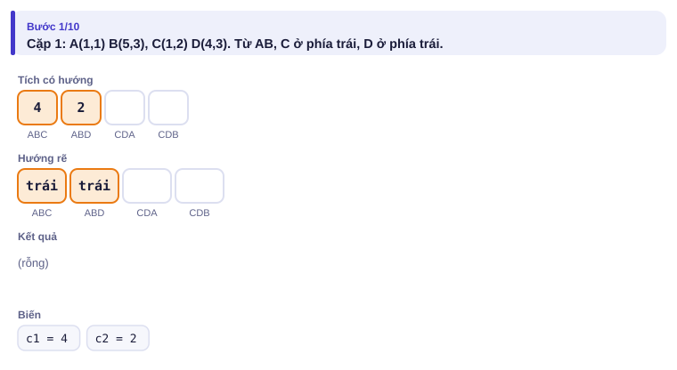
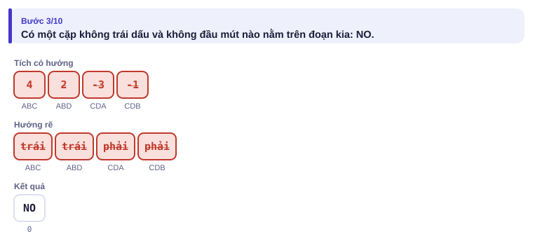
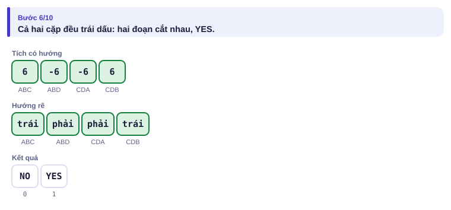
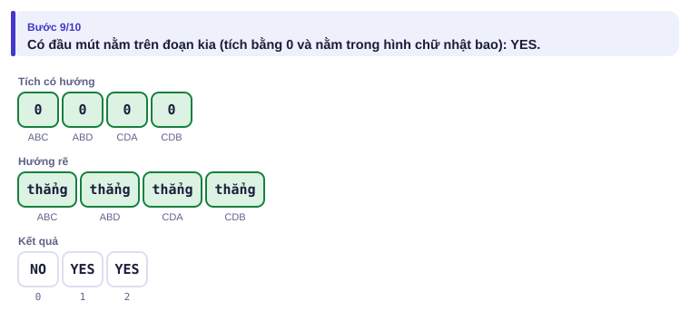
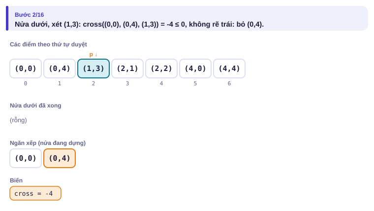
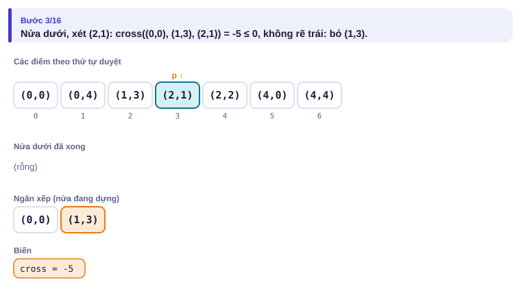
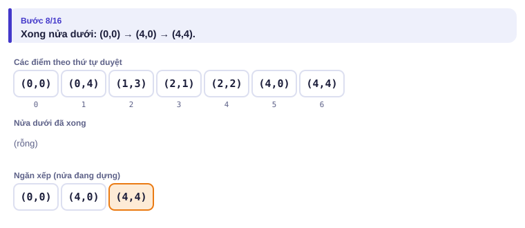
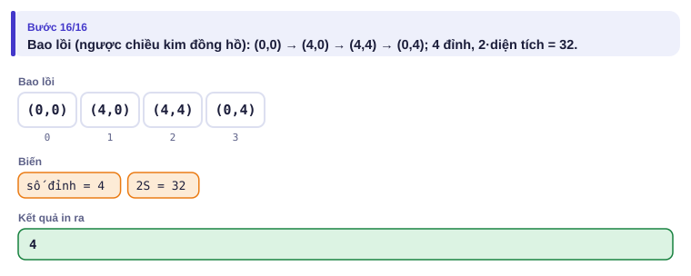

# Bài 4.7 – Hình học tính toán cơ bản

> **Tập 4 · Chuyên đề nâng cao**
> Cần biết trước: bài 1.1 (tràn số, `long long`), bài 1.2 (sắp xếp), bài 2.1 (ngăn xếp).
> Thời lượng: khoảng 2 giờ đọc, cộng 8 giờ thực hành (1,5 tuần).

**Học xong bài này, em sẽ:**

- dùng **tích có hướng** để biết rẽ trái, rẽ phải hay thẳng hàng;
- kiểm tra hai đoạn thẳng có cắt nhau không, **chỉ dùng số nguyên**;
- tính **diện tích đa giác** bằng công thức dây giày;
- dựng **bao lồi** bằng chuỗi đơn điệu trong O(n log n);
- dùng **định lý Pick** để đếm điểm nguyên trong đa giác, giải trọn bài kiểu đề thi **Vườn cây**.

**Dấu hiệu nhận biết:** đề cho tọa độ nguyên; hỏi cắt nhau, nằm trong, diện tích, hàng rào bao quanh, đếm điểm nguyên.

> [!TIP]
> **Học cùng hai trang mô phỏng.** [Hai đoạn cắt nhau](../../mo-phong/t4-giao-doan.html): bật **Đoán trước**, đoán YES/NO trước khi xem dấu. [Bao lồi](../../mo-phong/t4-bao-loi.html): đoán điểm nào bị bỏ khỏi ngăn xếp.

---

## 1. Bài toán mở màn: Hai con đường

An vẽ hai đoạn đường thẳng trên bản đồ: đoạn AB và đoạn CD. Hai đoạn có chung điểm nào không? Có t cặp cần hỏi. (t ≤ 10⁵, tọa độ |x|, |y| ≤ 10⁹; bài [Line Segment Intersection](https://cses.fi/problemset/task/2190))

| Vào | Ra |
| --- | --- |
| `5`<br>`1 1 5 3 1 2 4 3`<br>`1 1 5 3 1 1 4 3`<br>`1 1 5 3 2 3 4 1`<br>`1 1 5 3 2 4 4 1`<br>`1 1 5 3 3 2 7 4` | `NO`<br>`YES`<br>`YES`<br>`YES`<br>`YES` |

---

## 2. Dừng lại 10 phút

> [!IMPORTANT]
> **Dừng lại và nghĩ.**
> 1. Cách "lớp 10": viết phương trình hai đường thẳng, giải hệ, xem giao điểm có nằm trong cả hai đoạn không. Cách này gặp những rắc rối gì?
> 2. Đứng ở A nhìn về B. Làm sao biết điểm C ở bên trái hay bên phải mà chỉ dùng nhân và trừ?
> 3. Cặp thứ năm trong ví dụ: A(1,1), B(5,3), C(3,2), D(7,4). Bốn điểm thẳng hàng. Vì sao đáp án là YES?

<details>
<summary>Đáp án</summary>

1. Phải chia, sinh số thực và sai số làm tròn; hai đường song song (định thức 0) phải xử lý riêng; hai đoạn trùng nhau trên một đường lại thêm trường hợp nữa.
2. Dấu của tích có hướng `(B.x − A.x)(C.y − A.y) − (B.y − A.y)(C.x − A.x)`: dương là trái, âm là phải, 0 là thẳng hàng (mục 4).
3. C(3,2) nằm ngay trên đoạn AB (là trung điểm), nên hai đoạn có chung điểm C.

</details>

---

## 3. Lời giải ngây thơ và vì sao nó sai

Giải hệ bằng `double`: tọa độ tới 10⁹ thì tích tới 10¹⁸, vượt 15–16 chữ số chính xác của `double`. Hai đoạn chỉ "chạm" nhau ở đầu mút có thể bị tính là cách nhau 10⁻⁷ và trả lời NO. Trong hình học thi đấu, nếu dữ liệu nguyên thì **giữ nguyên số nguyên tới cùng**.

---

## 4. Ý tưởng then chốt

> [!IMPORTANT]
> **cross(O, A, B) = (A.x − O.x)·(B.y − O.y) − (A.y − O.y)·(B.x − O.x).** Dương: đi O → A rồi rẽ **trái** để tới B. Âm: rẽ **phải**. Bằng 0: **thẳng hàng**. Mọi câu hỏi "phía nào", "cắt nhau không", "lồi không" đều quy về dấu của tích này.

Tọa độ tới 10⁹ thì hiệu tới 2·10⁹, tích tới 4·10¹⁸: vừa `long long` (tối đa khoảng 9,2·10¹⁸).

**Hai đoạn AB và CD có chung điểm** khi:

- một đầu mút nằm **trên** đoạn kia (tích bằng 0 và nằm trong hình chữ nhật bao của đoạn kia), **hoặc**
- C, D ở hai phía **ngặt** của đường AB, **và** A, B ở hai phía ngặt của đường CD.

### Chạy từng bước

Ba cặp đầu, ba kiểu khác nhau. Đoán YES/NO rồi mới mở.

<details>
<summary><b>Bước 1</b> – Cặp 1: C và D nằm cùng phía đường AB</summary>



</details>

<details>
<summary><b>Bước 2</b> – Cặp 1: kết luận</summary>



</details>

<details>
<summary><b>Bước 3</b> – Cặp 2: hai cặp dấu đều trái nhau</summary>



</details>

<details>
<summary><b>Bước 4</b> – Cặp 3: bốn điểm thẳng hàng</summary>



</details>

**Tóm lại:** cặp 1 NO vì cả C và D ở bên trái AB; cặp 2 YES vì cả hai cặp dấu đều trái nhau; cặp 3 YES vì C nằm trên đoạn AB, dù mọi tích đều bằng 0.

---

## 5. Mã giả và cài đặt

```
cat(A, B, C, D):
    nếu một đầu mút nằm trên đoạn kia: đúng
    ngược lại: dau(c1)·dau(c2) < 0 và dau(c3)·dau(c4) < 0
```

```cpp
// file: giao_doan.cpp
#include <bits/stdc++.h>
using namespace std;
typedef long long ll;
struct P { ll x, y; };
ll cross(P o, P a, P b) { return (a.x - o.x) * (b.y - o.y) - (a.y - o.y) * (b.x - o.x); }
int dau(ll v) { return (v > 0) - (v < 0); }
bool tren_doan(P a, P b, P c) {          // c nằm trên đoạn ab?
    return cross(a, b, c) == 0 && min(a.x, b.x) <= c.x && c.x <= max(a.x, b.x)
                               && min(a.y, b.y) <= c.y && c.y <= max(a.y, b.y);
}
bool cat(P a, P b, P c, P d) {
    if (tren_doan(a, b, c) || tren_doan(a, b, d) || tren_doan(c, d, a) || tren_doan(c, d, b)) return true;
    return dau(cross(a, b, c)) * dau(cross(a, b, d)) < 0 && dau(cross(c, d, a)) * dau(cross(c, d, b)) < 0;
}
int main() {
    int t; cin >> t;
    while (t--) {
        P a, b, c, d;
        cin >> a.x >> a.y >> b.x >> b.y >> c.x >> c.y >> d.x >> d.y;
        cout << (cat(a, b, c, d) ? "YES" : "NO") << '\n';
    }
}
```

```python
# file: giao_doan.py
import sys
def cross(o, a, b): return (a[0] - o[0]) * (b[1] - o[1]) - (a[1] - o[1]) * (b[0] - o[0])
def dau(v): return (v > 0) - (v < 0)
def tren_doan(a, b, c):
    return (cross(a, b, c) == 0 and min(a[0], b[0]) <= c[0] <= max(a[0], b[0])
            and min(a[1], b[1]) <= c[1] <= max(a[1], b[1]))
def cat(a, b, c, d):
    if tren_doan(a, b, c) or tren_doan(a, b, d) or tren_doan(c, d, a) or tren_doan(c, d, b):
        return True
    return dau(cross(a, b, c)) * dau(cross(a, b, d)) < 0 and dau(cross(c, d, a)) * dau(cross(c, d, b)) < 0
data = list(map(int, sys.stdin.buffer.read().split()))
out = []
for i in range(data[0]):
    v = data[1 + 8 * i: 9 + 8 * i]
    out.append("YES" if cat(v[0:2], v[2:4], v[4:6], v[6:8]) else "NO")
print("\n".join(out))
```

### Diện tích đa giác: công thức dây giày

Đa giác đỉnh P₁, …, Pₙ theo thứ tự (Pₙ₊₁ = P₁): `2·S = |Σ (xᵢ·yᵢ₊₁ − xᵢ₊₁·yᵢ)|`. Mỗi số hạng là tích có hướng của hai đỉnh liên tiếp nhìn từ gốc O: cộng "diện tích có dấu" của các tam giác O Pᵢ Pᵢ₊₁, phần nằm ngoài đa giác tự triệt tiêu. In **2·S** để kết quả luôn nguyên.

Ví dụ (1,1), (4,2), (3,5), (0,4): các số hạng −2, 14, 12, −4; tổng 20, nên S = 10.

### Bao lồi: chuỗi đơn điệu

Bao lồi là đa giác lồi nhỏ nhất chứa mọi điểm (hình dạng sợi dây thun bao quanh các đinh). Sắp điểm theo x rồi y. Dựng **nửa dưới** từ trái sang phải bằng ngăn xếp: trước khi thêm p, bỏ đỉnh ngăn xếp khi hai đỉnh cuối và p **không rẽ trái** (cross ≤ 0). Làm lại từ phải sang trái được **nửa trên**. Mỗi điểm vào và ra ngăn xếp tối đa một lần mỗi nửa.

<details>
<summary><b>Hình</b> – bao lồi của 7 điểm (mở lần lượt)</summary>

Điểm: (0,0) (4,0) (2,1) (1,3) (4,4) (0,4) (2,2).






</details>

---

## 6. Vì sao đúng, chạy bao lâu

- **Tích có hướng** là diện tích có dấu của hình bình hành dựng trên OA, OB: dấu cho biết B ở bên nào của tia OA.
- **Hai đoạn cắt nhau:** nếu C, D ở hai phía ngặt của đường AB thì đoạn CD cắt **đường** AB tại một điểm; điều kiện thứ hai bảo đảm điểm đó nằm trong **đoạn** AB. Các trường hợp có tích bằng 0 đều là "có đầu mút nằm trên đường kia", được bắt bằng `tren_doan`.
- **Bao lồi:** khi đi ngược chiều kim đồng hồ quanh đa giác lồi, mọi chỗ rẽ đều là rẽ trái; điểm làm "rẽ phải hoặc thẳng" không thể là đỉnh. Thời gian O(n log n) cho sắp xếp, O(n) cho hai lần quét.
- **Dây giày:** O(n). Mọi phép tính nguyên, không sai số.

---

## 7. Bẫy thường gặp

> [!WARNING]
> **Bẫy 1: nhân hai tích có hướng với nhau** (`c1 * c2 < 0`): mỗi tích tới 4·10¹⁸, tích của chúng tràn. Chỉ nhân **dấu**.
> *Test phá:* `1`, `-1000000000 -1000000000 1000000000 1000000000 -1000000000 1000000000 1000000000 -1000000000` (đáp án YES).

> [!WARNING]
> **Bẫy 2: quên trường hợp thẳng hàng.** Chỉ kiểm tra "trái dấu ngặt" sẽ trả lời NO cho cặp 3 ở mục 4.

> [!WARNING]
> **Bẫy 3: dùng `int`.** Hiệu tọa độ 2·10⁹ đã vượt `int`. Khai báo tọa độ là `long long` ngay từ đầu.

> [!WARNING]
> **Bẫy 4: bao lồi dùng `< 0` thay vì `≤ 0`.** Khi đó các điểm thẳng hàng trên cạnh được giữ lại làm đỉnh. Đề hỏi "số đỉnh" thì sai; đề yêu cầu in cả điểm trên cạnh (như CSES 2195) thì lại phải dùng `< 0`. Đọc kỹ đề.
> *Test phá:* `3` điểm `0 0`, `1 0`, `2 0` cộng `1 1`: bao lồi có 3 đỉnh, không phải 4.

---

## 8. Ví dụ giảm dần hỗ trợ

### Ví dụ 2 – Điền vào chỗ trống: Diện tích đa giác

Cho đa giác n đỉnh (n ≤ 1000, |x|, |y| ≤ 10⁹), đỉnh theo thứ tự. In **2·S**. (bài [Polygon Area](https://cses.fi/problemset/task/2191))

| Vào | Ra |
| --- | --- |
| `4`<br>`1 1`<br>`4 2`<br>`3 5`<br>`0 4` | `20` |

```cpp
long long s = 0;
for (int i = 0; i < n; i++) {
    int j = ____;
    s += ____;
}
cout << ____ << '\n';
```

<details>
<summary>Đáp án</summary>

`(i + 1) % n`, `x[i] * y[j] - x[j] * y[i]`, `llabs(s)` (đi theo chiều kim đồng hồ thì tổng âm).

```cpp
// file: dien_tich.cpp
#include <bits/stdc++.h>
using namespace std;
int main() {
    int n; cin >> n;
    vector<long long> x(n), y(n);
    for (int i = 0; i < n; i++) cin >> x[i] >> y[i];
    long long s = 0;
    for (int i = 0; i < n; i++) { int j = (i + 1) % n; s += x[i] * y[j] - x[j] * y[i]; }
    cout << llabs(s) << '\n';
}
```

</details>

### Ví dụ 3 – Tự làm: Hàng rào

Có n cái cọc tại các điểm nguyên khác nhau (3 ≤ n ≤ 2·10⁵, |x|, |y| ≤ 10⁹, không phải mọi cọc thẳng hàng). Căng một sợi dây bao quanh tất cả các cọc. In số cọc mà dây **gấp khúc** tại đó (số đỉnh bao lồi, không tính cọc nằm giữa một cạnh) và **2·S** của vùng bên trong.

| Vào | Ra |
| --- | --- |
| `7`<br>`0 0`<br>`4 0`<br>`2 1`<br>`1 3`<br>`4 4`<br>`0 4`<br>`2 2` | `4 32` |

> [!IMPORTANT]
> Tự làm trước. Gợi ý: chuỗi đơn điệu ở mục 5 với điều kiện bỏ `≤ 0`, rồi dây giày trên các đỉnh tìm được.

<details>
<summary>Lời giải</summary>

```cpp
// file: hang_rao.cpp
#include <bits/stdc++.h>
using namespace std;
typedef long long ll;
typedef pair<ll, ll> P;
ll cross(P o, P a, P b) { return (a.first - o.first) * (b.second - o.second) - (a.second - o.second) * (b.first - o.first); }
int main() {
    int n; scanf("%d", &n);
    vector<P> p(n);
    for (auto &q : p) scanf("%lld %lld", &q.first, &q.second);
    sort(p.begin(), p.end());
    vector<P> h;
    for (int lan = 0; lan < 2; lan++) {
        size_t goc = h.size();
        for (int i = 0; i < n; i++) {
            while (h.size() >= goc + 2 && cross(h[h.size() - 2], h.back(), p[i]) <= 0) h.pop_back();
            h.push_back(p[i]);
        }
        h.pop_back();                      // điểm cuối là điểm đầu của nửa kia
        reverse(p.begin(), p.end());
    }
    ll s = 0;
    for (size_t i = 0; i < h.size(); i++) { size_t j = (i + 1) % h.size(); s += h[i].first * h[j].second - h[j].first * h[i].second; }
    printf("%d %lld\n", (int)h.size(), llabs(s));
}
```

Mẹo `goc`: nửa trên dùng chung vector `h` nhưng không được bỏ các điểm của nửa dưới.

</details>

---

## 9. Bài tập

| Nấc | Bài | Nguồn | Ý chính |
| --- | --- | --- | --- |
| Khởi động | [Point Location Test](https://cses.fi/problemset/task/2189) | CSES 2189 | Dấu tích có hướng |
| Khởi động | [Polygon Area](https://cses.fi/problemset/task/2191) | CSES 2191 | Ví dụ 2 |
| Luyện | [Line Segment Intersection](https://cses.fi/problemset/task/2190) | CSES 2190 | Mục 5 |
| Luyện | [Point in Polygon](https://cses.fi/problemset/task/2192) | CSES 2192 | Bắn tia, đếm số cạnh cắt; xét điểm trên biên trước |
| Luyện | [Convex Hull](https://cses.fi/problemset/task/2195) | CSES 2195 | Ví dụ 3 nhưng giữ điểm trên cạnh (Bẫy 4) |
| Thử thách | [Polygon Lattice Points](https://cses.fi/problemset/task/2193) | CSES 2193 | Định lý Pick, giống bài kiểu đề thi |
| Kiểu đề thi | Vườn cây | Bài của sách, chấm theo subtask | Xem bên dưới |

### Bài kiểu đề thi: Vườn cây

**Đề bài.** Khu vườn là một đa giác đơn (các cạnh không tự cắt) có n đỉnh tọa độ nguyên, cho theo thứ tự. Người ta trồng một cây tại **mọi điểm nguyên nằm hẳn bên trong** vườn (không tính điểm trên hàng rào). Hỏi trồng bao nhiêu cây? Đọc từ `VUONCAY.INP` (dòng đầu n, n dòng sau là x y), ghi ra `VUONCAY.OUT`.

Subtask: 50% có n ≤ 100 và |x|, |y| ≤ 100; 50% còn lại n ≤ 10⁵, |x|, |y| ≤ 10⁶.

| VUONCAY.INP | VUONCAY.OUT |
| --- | --- |
| `4`<br>`0 0`<br>`6 0`<br>`4 4`<br>`0 3` | `13` |

<details>
<summary><b>Gợi ý 1</b> – hướng đi (đủ 50% điểm)</summary>

Thử mọi điểm nguyên trong hình chữ nhật bao (tối đa 201 × 201 điểm). Với mỗi điểm: nếu nằm trên một cạnh (dùng `tren_doan`) thì bỏ; ngược lại bắn tia sang phải, đếm số cạnh cắt tia, lẻ là ở trong. Độ phức tạp O(201² · n): khoảng 4·10⁶ phép.

</details>

<details>
<summary><b>Gợi ý 2</b> – ý then chốt</summary>

**Định lý Pick:** đa giác đơn đỉnh nguyên có `S = I + B/2 − 1`, với I là số điểm nguyên bên trong, B là số điểm nguyên trên biên. Cạnh từ (x₁, y₁) tới (x₂, y₂) chứa `gcd(|x₂ − x₁|, |y₂ − y₁|)` điểm nguyên nếu không tính một đầu mút, nên B là tổng các gcd. Vậy `I = (2S − B + 2) / 2`, với 2S tính bằng dây giày.

Ví dụ: 2S = 36, B = 6 + 2 + 1 + 3 = 12, I = (36 − 12 + 2) / 2 = 13.

</details>

<details>
<summary><b>Gợi ý 3</b> – lời giải đầy đủ</summary>

```cpp
// file: vuoncay.cpp
#include <bits/stdc++.h>
using namespace std;
typedef long long ll;
int main() {
    freopen("VUONCAY.INP", "r", stdin);
    freopen("VUONCAY.OUT", "w", stdout);
    int n; scanf("%d", &n);
    vector<ll> x(n), y(n);
    for (int i = 0; i < n; i++) scanf("%lld %lld", &x[i], &y[i]);
    ll s2 = 0, b = 0;
    for (int i = 0; i < n; i++) {
        int j = (i + 1) % n;
        s2 += x[i] * y[j] - x[j] * y[i];
        b += __gcd(llabs(x[j] - x[i]), llabs(y[j] - y[i]));
    }
    s2 = llabs(s2);
    printf("%lld\n", (s2 - b + 2) / 2);
}
```

```python
# file: vuoncay.py
from math import gcd
with open("VUONCAY.INP") as f:
    v = list(map(int, f.read().split()))
n = v[0]
x, y = v[1::2][:n], v[2::2][:n]
s2 = b = 0
for i in range(n):
    j = (i + 1) % n
    s2 += x[i] * y[j] - x[j] * y[i]
    b += gcd(abs(x[j] - x[i]), abs(y[j] - y[i]))
with open("VUONCAY.OUT", "w") as f:
    f.write(str((abs(s2) - b + 2) // 2) + "\n")
```

</details>

---

## 10. Tóm tắt, flashcard và checkpoint

**Tóm tắt trong 5 dòng.**

1. cross(O, A, B): dương rẽ trái, âm rẽ phải, 0 thẳng hàng; mọi thứ là số nguyên.
2. Hai đoạn cắt nhau: đầu mút nằm trên đoạn kia, hoặc hai cặp dấu đều trái nhau ngặt.
3. Chỉ nhân dấu, không nhân hai tích; tọa độ dùng `long long`.
4. Dây giày cho 2S; bao lồi bằng chuỗi đơn điệu, bỏ khi cross ≤ 0.
5. Pick: I = (2S − B + 2) / 2, B là tổng gcd trên các cạnh.

**Flashcard.**

<details><summary>cross(O, A, B) &lt; 0 nghĩa là gì?</summary>Đi O → A rồi rẽ phải để tới B.</details>
<details><summary>Vì sao không viết `c1 * c2 &lt; 0`?</summary>Mỗi tích tới 4·10¹⁸, nhân lại sẽ tràn `long long`.</details>
<details><summary>Dây giày cho ra số âm khi nào?</summary>Khi đỉnh cho theo chiều kim đồng hồ; lấy trị tuyệt đối.</details>
<details><summary>Số điểm nguyên trên cạnh (0,0)–(6,4), không tính một đầu mút?</summary>gcd(6, 4) = 2.</details>
<details><summary>Bao lồi chuỗi đơn điệu chạy bao lâu?</summary>O(n log n), phần lớn là sắp xếp.</details>

**Ôn xoắn ốc** (mỗi bài tối đa 20 phút):

- Viết lại Dinic (bài 4.6) không nhìn sách.
- [Nearest Smaller Values](https://cses.fi/problemset/task/1645) (CSES 1645): ngăn xếp đơn điệu (bài 2.1), cùng ý với bao lồi.
- Tính `gcd` bằng Euclid không dùng thư viện (bài 0.8).

**Checkpoint – em đã sẵn sàng sang bài tiếp theo nếu:**

- [ ] Giải thích được vì sao chỉ nhân dấu; AC [Line Segment Intersection](https://cses.fi/problemset/task/2190).
- [ ] Làm xong Ví dụ 3 (Hàng rào) mà không mở lời giải; AC [Convex Hull](https://cses.fi/problemset/task/2195).
- [ ] Đạt trọn điểm bài Vườn cây khi tự làm trong 30 phút.

Chưa đạt? Nếu vướng ô 1, chạy trang mô phỏng hai đoạn cắt nhau với ví dụ "thẳng hàng: chồng và rời". Nếu vướng ô 2, chạy trang Bao lồi với ví dụ "có ba điểm thẳng hàng" và đọc lại Bẫy 4. Nếu vướng ô 3, tự kiểm tra Pick trên một hình chữ nhật 3 × 2 bằng tay.
