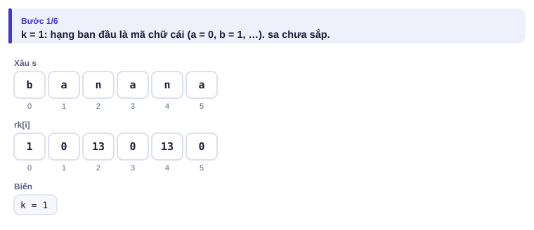
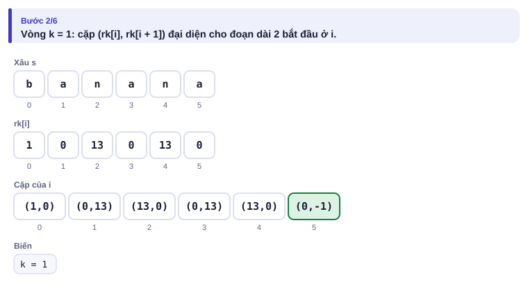
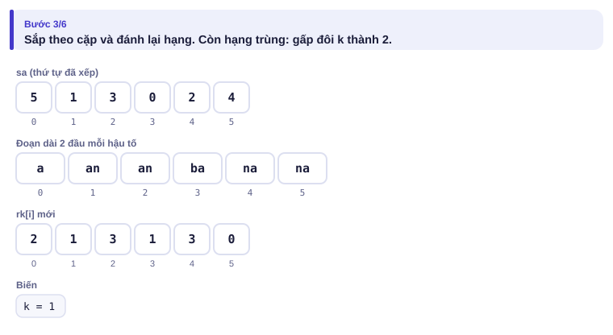
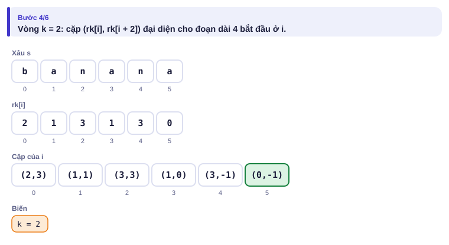
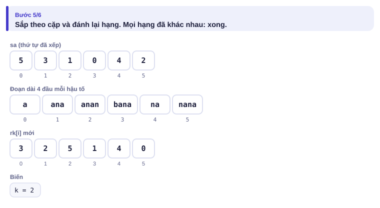
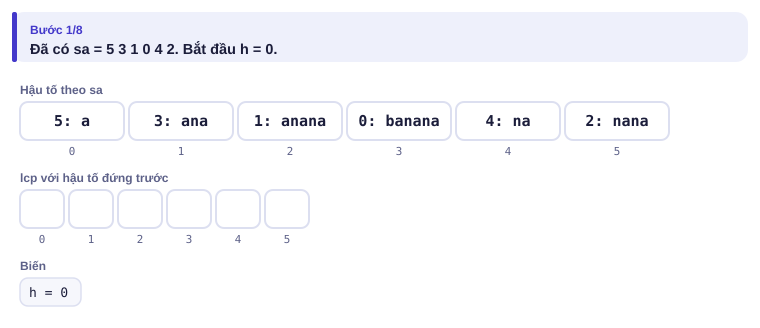
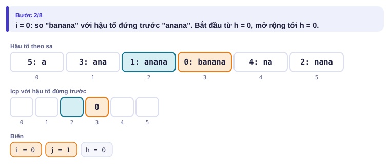
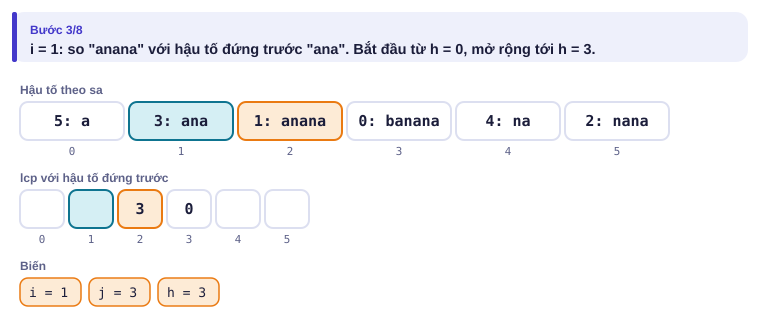
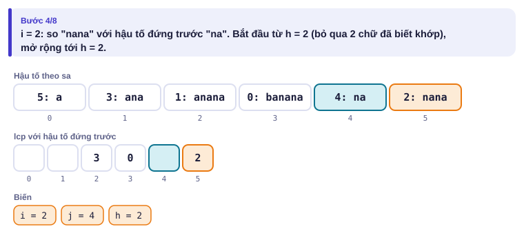
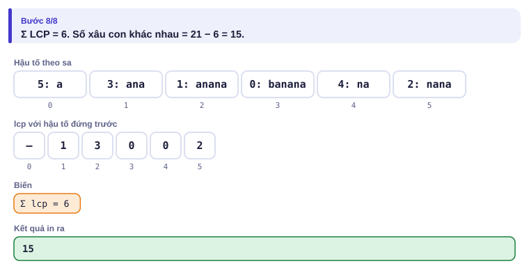

# Bài 4.8 – Mảng hậu tố

> **Tập 4 · Chuyên đề nâng cao**
> Cần biết trước: bài 1.2 (sắp xếp), bài 3.10 (băm xâu, bài LAPDAI), bài 3.3 (nhảy nhị phân, cùng ý "gấp đôi").
> Thời lượng: khoảng 2 giờ đọc, cộng 8 giờ thực hành (1,5 tuần).

**Học xong bài này, em sẽ:**

- dựng **mảng hậu tố** (suffix array) trong O(n log² n) bằng nhân đôi;
- dựng **mảng LCP** bằng thuật toán Kasai trong O(n);
- đếm **xâu con khác nhau**, tìm xâu con lặp dài nhất, tìm xâu con thứ k;
- giải trọn bài kiểu đề thi **Mật khẩu**.

**Dấu hiệu nhận biết:** hỏi về **mọi** xâu con cùng lúc: đếm xâu con khác nhau, xâu con lặp dài nhất, xâu con thứ k theo thứ tự từ điển.

> [!TIP]
> **Học cùng hai trang mô phỏng.** [Mảng hậu tố bằng nhân đôi](../../mo-phong/t4-sa.html): thử ví dụ "toàn chữ a" để thấy số vòng tăng. [Kasai](../../mo-phong/t4-kasai.html): bật **Đoán trước**, đoán LCP rồi mới xem.

---

## 1. Bài toán mở màn: Đếm xâu con khác nhau

Xâu s gồm chữ cái thường, dài n ≤ 10⁵. Có bao nhiêu xâu con **khác nhau** (không tính xâu rỗng)? (bài [Distinct Substrings](https://cses.fi/problemset/task/2105))

| Vào | Ra |
| --- | --- |
| `abaa` | `8` |

Tám xâu đó là: a, b, ab, ba, aa, aba, baa, abaa.

---

## 2. Dừng lại 10 phút

> [!IMPORTANT]
> **Dừng lại và nghĩ.**
> 1. Cho hết mọi xâu con vào một `set<string>`: có bao nhiêu xâu con (tính cả trùng), tổng độ dài là bao nhiêu khi n = 10⁵?
> 2. Mọi xâu con là **tiền tố của một hậu tố**. Xếp các hậu tố của `abaa` theo thứ tự từ điển. Hai hậu tố đứng cạnh nhau có chung tiền tố dài L thì bao nhiêu xâu con bị đếm trùng?
> 3. Vì sao chỉ cần so mỗi hậu tố với hậu tố **đứng ngay trước** nó, không cần so với mọi hậu tố trước?

<details>
<summary>Đáp án</summary>

1. n(n + 1)/2 ≈ 5·10⁹ xâu con, tổng độ dài cỡ n³/6 ≈ 1,7·10¹⁴ ký tự. Không thể.
2. Thứ tự: `a`, `aa`, `abaa`, `baa`. Hậu tố đứng sau có L tiền tố đầu tiên đã xuất hiện ở hậu tố đứng trước, nên trùng đúng L xâu. Đáp án = n(n + 1)/2 − Σ LCP = 10 − (1 + 1 + 0) = 8.
3. Trong thứ tự từ điển, các hậu tố có chung tiền tố P đứng **liền một khối**. Tiền tố dài nhất trùng với **bất kỳ** hậu tố nào trước nó chính là tiền tố trùng với hậu tố ngay trước.

</details>

---

## 3. Lời giải ngây thơ và vì sao nó chậm

Sắp xếp n hậu tố bằng `sort` với phép so sánh xâu: mỗi phép so sánh tới O(n), tổng O(n² log n). Với `aaaa…a` dài 10⁵ đó là 10¹¹ phép: quá chậm. Băm + tìm nhị phân (bài 3.10) so sánh hai hậu tố trong O(log n), tổng O(n log² n) nhưng hằng số lớn và có rủi ro va chạm.

---

## 4. Ý tưởng then chốt

> [!IMPORTANT]
> **Nhân đôi:** `rk[i]` là hạng của đoạn dài k bắt đầu ở i. Đoạn dài 2k bắt đầu ở i chính là hai đoạn dài k nối nhau, nên so sánh bằng **cặp (rk[i], rk[i + k])** (−1 nếu i + k ra ngoài xâu). Sắp theo cặp, đánh lại hạng, gấp đôi k. Sau tối đa log n vòng, mọi hạng khác nhau.
>
> **Kasai:** nếu hậu tố i có LCP với hậu tố đứng trước là h, thì hậu tố i + 1 có LCP **ít nhất h − 1**. Đi i theo thứ tự trong xâu gốc, h chỉ giảm 1 mỗi bước nên tổng số lần tăng là O(n).

### Chạy từng bước

Xâu `banana`. Đoán trước khi mở.

<details>
<summary><b>Bước 1</b> – Hạng ban đầu là mã chữ cái</summary>



</details>

<details>
<summary><b>Bước 2</b> – Vòng k = 1: lập cặp</summary>



</details>

<details>
<summary><b>Bước 3</b> – Sắp theo cặp, đánh lại hạng (còn hạng trùng: an/an, na/na)</summary>



</details>

<details>
<summary><b>Bước 4</b> – Vòng k = 2: cặp mới phân biệt được "ana" và "anana"</summary>



</details>

<details>
<summary><b>Bước 5</b> – Mọi hạng khác nhau: sa = 5 3 1 0 4 2</summary>



</details>

Tiếp theo Kasai trên cùng xâu. Chú ý bước 4: hậu tố 2 (`nana`) bắt đầu so từ h = 2, không so lại từ đầu.

<details>
<summary><b>Bước 6</b> – Kasai: các hậu tố theo sa</summary>



</details>

<details>
<summary><b>Bước 7</b> – i = 0: "banana" với "anana", LCP 0</summary>



</details>

<details>
<summary><b>Bước 8</b> – i = 1: "anana" với "ana", LCP 3</summary>



</details>

<details>
<summary><b>Bước 9</b> – i = 2: bắt đầu từ h = 3 − 1 = 2</summary>



</details>

<details>
<summary><b>Bước 10</b> – Kết quả: 21 − 6 = 15 xâu con khác nhau</summary>



</details>

---

## 5. Mã giả và cài đặt

```
rk[i] = s[i]; k = 1
lặp: sắp sa theo cặp (rk[i], rk[i+k]); đánh lại rk; nếu đủ n hạng thì dừng; k = 2k
h = 0
với i = 0..n-1: nếu rk[i] > 0: j = sa[rk[i]-1]; mở rộng h; lcp[rk[i]] = h; h = max(h-1, 0)
đáp án = n(n+1)/2 − Σ lcp
```

```cpp
// file: xau_con.cpp
#include <bits/stdc++.h>
using namespace std;
int main() {
    string s; cin >> s;
    int n = s.size();
    vector<int> sa(n), rk(n), tmp(n);
    for (int i = 0; i < n; i++) { sa[i] = i; rk[i] = s[i]; }
    for (int k = 1; ; k <<= 1) {
        auto cmp = [&](int a, int b) {
            if (rk[a] != rk[b]) return rk[a] < rk[b];
            int ra = a + k < n ? rk[a + k] : -1, rb = b + k < n ? rk[b + k] : -1;
            return ra < rb;
        };
        sort(sa.begin(), sa.end(), cmp);
        tmp[sa[0]] = 0;
        for (int i = 1; i < n; i++) tmp[sa[i]] = tmp[sa[i - 1]] + cmp(sa[i - 1], sa[i]);
        rk = tmp;
        if (rk[sa[n - 1]] == n - 1) break;           // mọi hạng đã khác nhau
    }
    vector<int> lcp(n, 0);                           // lcp[r] = LCP(sa[r-1], sa[r])
    for (int i = 0, h = 0; i < n; i++) {
        if (rk[i] == 0) { h = 0; continue; }
        int j = sa[rk[i] - 1];
        while (i + h < n && j + h < n && s[i + h] == s[j + h]) h++;
        lcp[rk[i]] = h;
        if (h > 0) h--;
    }
    long long kq = 1LL * n * (n + 1) / 2;
    for (int r = 1; r < n; r++) kq -= lcp[r];
    cout << kq << '\n';
}
```

```python
# file: xau_con.py
s = input().strip()
n = len(s)
rk = [ord(c) for c in s]
sa = list(range(n))
k = 1
while True:
    key = [(rk[i], rk[i + k] if i + k < n else -1) for i in range(n)]
    sa.sort(key=lambda i: key[i])
    tmp = [0] * n
    for r in range(1, n):
        tmp[sa[r]] = tmp[sa[r - 1]] + (key[sa[r]] != key[sa[r - 1]])
    rk = tmp
    if rk[sa[-1]] == n - 1:
        break
    k *= 2
tong, h = 0, 0
for i in range(n):
    if rk[i] == 0:
        h = 0
        continue
    j = sa[rk[i] - 1]
    while i + h < n and j + h < n and s[i + h] == s[j + h]:
        h += 1
    tong += h
    if h:
        h -= 1
print(n * (n + 1) // 2 - tong)
```

Bản Python tính `key` một lần mỗi vòng để `sort` nhanh; với n = 10⁵ chạy khoảng 2–3 giây.

---

## 6. Vì sao đúng, chạy bao lâu

- **Nhân đôi:** đoạn dài 2k bắt đầu ở i = (đoạn dài k ở i) nối (đoạn dài k ở i + k). So sánh từ điển hai đoạn dài 2k là so nửa đầu trước, bằng thì so nửa sau: đúng là so cặp hạng. Khi 2k ≥ n, đoạn "dài 2k" chính là cả hậu tố. Có tối đa ⌈log₂ n⌉ + 1 vòng, mỗi vòng `sort` O(n log n): tổng O(n log² n).
- **Kasai:** gọi j là hậu tố đứng trước i, chung h chữ (h > 0). Bỏ chữ đầu: hậu tố j + 1 đứng trước i + 1 và chung h − 1 chữ. Hậu tố đứng **ngay** trước i + 1 nằm giữa hai cái đó trong sa, nên chung ít nhất h − 1 chữ. h tăng tổng cộng tối đa 2n lần: O(n).
- **Đếm:** hậu tố hạng r đóng góp `(n − sa[r]) − lcp[r]` xâu con chưa gặp.

---

## 7. Bẫy thường gặp

> [!WARNING]
> **Bẫy 1: đáp án tràn `int`.** n(n + 1)/2 với n = 10⁵ là 5·10⁹: dùng `long long`.

> [!WARNING]
> **Bẫy 2: Kasai quên `h--`** hoặc quên đặt `h = 0` khi gặp hậu tố hạng 0.
> *Test phá:* `banana`: quên `h--` thì hậu tố `nana` bắt đầu với h = 3, vượt LCP thật là 2.

> [!WARNING]
> **Bẫy 3: hạng −1 cho phần ra ngoài.** Nếu dùng 0 thì đoạn chạm cuối xâu bị coi bằng đoạn có chữ có hạng 0. Hạng ra ngoài phải **nhỏ hơn mọi hạng thật**.
> *Test phá:* `aa`: sa đúng là `1 0`.

> [!WARNING]
> **Bẫy 4: dừng vòng lặp quá sớm**, ví dụ chỉ khi 2k ≥ n mà quên đánh lại hạng lần cuối. Điều kiện dừng an toàn: mọi hạng đã khác nhau.

---

## 8. Ví dụ giảm dần hỗ trợ

### Ví dụ 2 – Điền vào chỗ trống: Xâu con lặp dài nhất

Tìm xâu con dài nhất xuất hiện ít nhất hai lần (được chồng lên nhau); in `-1` nếu không có. Đây chính là bài LAPDAI ở bài 3.10, nay giải bằng mảng hậu tố, không cần tìm nhị phân hay băm. (giống [Repeating Substring](https://cses.fi/problemset/task/2106))

| Vào | Ra |
| --- | --- |
| `cabababc` | `abab` |

Gợi ý: xâu con lặp lại là tiền tố chung của **hai hậu tố**; tiền tố chung dài nhất của hai hậu tố bất kỳ nằm ở đâu đó trong mảng LCP.

```cpp
int best = 0, vt = 0;
for (int r = 1; r < n; r++)
    if (____) { best = ____; vt = ____; }
if (best == 0) cout << -1; else cout << s.substr(vt, best);
```

<details>
<summary>Đáp án</summary>

`lcp[r] > best`, `lcp[r]`, `sa[r]`.

```cpp
// file: lap_dai_nhat.cpp
#include <bits/stdc++.h>
using namespace std;
vector<int> dung_sa(const string &s, vector<int> &rk) {
    int n = s.size();
    vector<int> sa(n), tmp(n);
    rk.assign(n, 0);
    for (int i = 0; i < n; i++) { sa[i] = i; rk[i] = s[i]; }
    for (int k = 1; ; k <<= 1) {
        auto cmp = [&](int a, int b) {
            if (rk[a] != rk[b]) return rk[a] < rk[b];
            int ra = a + k < n ? rk[a + k] : -1, rb = b + k < n ? rk[b + k] : -1;
            return ra < rb;
        };
        sort(sa.begin(), sa.end(), cmp);
        tmp[sa[0]] = 0;
        for (int i = 1; i < n; i++) tmp[sa[i]] = tmp[sa[i - 1]] + cmp(sa[i - 1], sa[i]);
        rk = tmp;
        if (rk[sa[n - 1]] == n - 1) break;
    }
    return sa;
}
vector<int> dung_lcp(const string &s, const vector<int> &sa, const vector<int> &rk) {
    int n = s.size();
    vector<int> lcp(n, 0);
    for (int i = 0, h = 0; i < n; i++) {
        if (rk[i] == 0) { h = 0; continue; }
        int j = sa[rk[i] - 1];
        while (i + h < n && j + h < n && s[i + h] == s[j + h]) h++;
        lcp[rk[i]] = h;
        if (h > 0) h--;
    }
    return lcp;
}
int main() {
    string s; cin >> s;
    int n = s.size();
    vector<int> rk;
    vector<int> sa = dung_sa(s, rk), lcp = dung_lcp(s, sa, rk);
    int best = 0, vt = 0;
    for (int r = 1; r < n; r++)
        if (lcp[r] > best) { best = lcp[r]; vt = sa[r]; }
    if (best == 0) cout << -1 << '\n'; else cout << s.substr(vt, best) << '\n';
}
```

</details>

### Ví dụ 3 – Tự làm: Xâu con thứ k

Liệt kê mọi xâu con **khác nhau** của s theo thứ tự từ điển. In xâu thứ k. (n ≤ 10⁵, k không vượt quá số xâu con khác nhau; bài [Substring Order I](https://cses.fi/problemset/task/2108))

| Vào | Ra |
| --- | --- |
| `babaacbaab`<br>`10` | `aba` |

> [!IMPORTANT]
> Tự làm trước. Gợi ý: đi các hậu tố theo thứ tự sa; hậu tố hạng r cho các xâu con mới **theo đúng thứ tự từ điển** là tiền tố dài lcp[r] + 1, lcp[r] + 2, …, n − sa[r].

<details>
<summary>Lời giải</summary>

```cpp
// file: xau_thu_k.cpp
#include <bits/stdc++.h>
using namespace std;
vector<int> dung_sa(const string &s, vector<int> &rk) {
    int n = s.size();
    vector<int> sa(n), tmp(n);
    rk.assign(n, 0);
    for (int i = 0; i < n; i++) { sa[i] = i; rk[i] = s[i]; }
    for (int k = 1; ; k <<= 1) {
        auto cmp = [&](int a, int b) {
            if (rk[a] != rk[b]) return rk[a] < rk[b];
            int ra = a + k < n ? rk[a + k] : -1, rb = b + k < n ? rk[b + k] : -1;
            return ra < rb;
        };
        sort(sa.begin(), sa.end(), cmp);
        tmp[sa[0]] = 0;
        for (int i = 1; i < n; i++) tmp[sa[i]] = tmp[sa[i - 1]] + cmp(sa[i - 1], sa[i]);
        rk = tmp;
        if (rk[sa[n - 1]] == n - 1) break;
    }
    return sa;
}
vector<int> dung_lcp(const string &s, const vector<int> &sa, const vector<int> &rk) {
    int n = s.size();
    vector<int> lcp(n, 0);
    for (int i = 0, h = 0; i < n; i++) {
        if (rk[i] == 0) { h = 0; continue; }
        int j = sa[rk[i] - 1];
        while (i + h < n && j + h < n && s[i + h] == s[j + h]) h++;
        lcp[rk[i]] = h;
        if (h > 0) h--;
    }
    return lcp;
}
int main() {
    string s; long long k;
    cin >> s >> k;
    int n = s.size();
    vector<int> rk;
    vector<int> sa = dung_sa(s, rk), lcp = dung_lcp(s, sa, rk);
    for (int r = 0; r < n; r++) {
        long long moi = (n - sa[r]) - lcp[r];
        if (k <= moi) { cout << s.substr(sa[r], lcp[r] + k) << '\n'; return 0; }
        k -= moi;
    }
}
```

Mọi hậu tố có tiền tố nhỏ hơn đều đứng trước trong sa, nên thứ tự "hậu tố rồi độ dài" chính là thứ tự từ điển của các xâu con mới.

</details>

---

## 9. Bài tập

| Nấc | Bài | Nguồn | Ý chính |
| --- | --- | --- | --- |
| Khởi động | [Distinct Substrings](https://cses.fi/problemset/task/2105) | CSES 2105 | Đúng mục 5 |
| Luyện | [Repeating Substring](https://cses.fi/problemset/task/2106) | CSES 2106 | Ví dụ 2 |
| Luyện | [Substring Order I](https://cses.fi/problemset/task/2108) | CSES 2108 | Ví dụ 3 |
| Thử thách | [Substring Order II](https://cses.fi/problemset/task/2109) | CSES 2109 | Đếm cả xâu trùng; cần số lần xuất hiện của mỗi tiền tố |
| Kiểu đề thi | Mật khẩu | Bài của sách, chấm theo subtask | Xem bên dưới |

### Bài kiểu đề thi: Mật khẩu

**Đề bài.** Một hệ thống sinh mật khẩu bằng cách chọn một xâu con (các ký tự liên tiếp) của xâu gốc s, có độ dài từ L tới R. Có bao nhiêu mật khẩu **khác nhau** có thể sinh ra? Đọc từ `MATKHAU.INP` (dòng đầu là s gồm chữ cái thường, dòng hai là L R), ghi ra `MATKHAU.OUT`.

Subtask: 40% có |s| ≤ 1000; 60% còn lại |s| ≤ 10⁵. Luôn có 1 ≤ L ≤ R ≤ |s|.

| MATKHAU.INP | MATKHAU.OUT |
| --- | --- |
| `banana`<br>`2 3` | `6` |

Độ dài 2: ba, an, na. Độ dài 3: ban, ana, nan.

<details>
<summary><b>Gợi ý 1</b> – hướng đi (đủ 40% điểm)</summary>

Với mỗi độ dài d từ L tới R, đưa mọi xâu con dài d vào một tập hợp (dùng băm của bài 3.10 để mỗi xâu con lấy trong O(1)). Tổng O(n²) giá trị băm: được với n ≤ 1000.

</details>

<details>
<summary><b>Gợi ý 2</b> – ý then chốt</summary>

Hậu tố hạng r cho các xâu con mới có độ dài từ `lcp[r] + 1` tới `n − sa[r]` (mỗi độ dài đúng một xâu). Cắt khoảng đó với [L, R]: đóng góp `max(0, min(R, n − sa[r]) − max(L, lcp[r] + 1) + 1)`.

</details>

<details>
<summary><b>Gợi ý 3</b> – lời giải đầy đủ</summary>

```cpp
// file: matkhau.cpp
#include <bits/stdc++.h>
using namespace std;
vector<int> dung_sa(const string &s, vector<int> &rk) {
    int n = s.size();
    vector<int> sa(n), tmp(n);
    rk.assign(n, 0);
    for (int i = 0; i < n; i++) { sa[i] = i; rk[i] = s[i]; }
    for (int k = 1; ; k <<= 1) {
        auto cmp = [&](int a, int b) {
            if (rk[a] != rk[b]) return rk[a] < rk[b];
            int ra = a + k < n ? rk[a + k] : -1, rb = b + k < n ? rk[b + k] : -1;
            return ra < rb;
        };
        sort(sa.begin(), sa.end(), cmp);
        tmp[sa[0]] = 0;
        for (int i = 1; i < n; i++) tmp[sa[i]] = tmp[sa[i - 1]] + cmp(sa[i - 1], sa[i]);
        rk = tmp;
        if (rk[sa[n - 1]] == n - 1) break;
    }
    return sa;
}
vector<int> dung_lcp(const string &s, const vector<int> &sa, const vector<int> &rk) {
    int n = s.size();
    vector<int> lcp(n, 0);
    for (int i = 0, h = 0; i < n; i++) {
        if (rk[i] == 0) { h = 0; continue; }
        int j = sa[rk[i] - 1];
        while (i + h < n && j + h < n && s[i + h] == s[j + h]) h++;
        lcp[rk[i]] = h;
        if (h > 0) h--;
    }
    return lcp;
}
int main() {
    freopen("MATKHAU.INP", "r", stdin);
    freopen("MATKHAU.OUT", "w", stdout);
    string s; int L, R;
    cin >> s >> L >> R;
    int n = s.size();
    vector<int> rk;
    vector<int> sa = dung_sa(s, rk), lcp = dung_lcp(s, sa, rk);
    long long kq = 0;
    for (int r = 0; r < n; r++) {
        int tu = max(L, lcp[r] + 1), den = min(R, n - sa[r]);
        if (den >= tu) kq += den - tu + 1;
    }
    cout << kq << '\n';
}
```

```python
# file: matkhau.py
with open("MATKHAU.INP") as f:
    s = f.readline().strip()
    L, R = map(int, f.readline().split())
n = len(s)
rk = [ord(c) for c in s]
sa = list(range(n))
k = 1
while True:
    key = [(rk[i], rk[i + k] if i + k < n else -1) for i in range(n)]
    sa.sort(key=lambda i: key[i])
    tmp = [0] * n
    for r in range(1, n):
        tmp[sa[r]] = tmp[sa[r - 1]] + (key[sa[r]] != key[sa[r - 1]])
    rk = tmp
    if rk[sa[-1]] == n - 1:
        break
    k *= 2
lcp = [0] * n
h = 0
for i in range(n):
    if rk[i] == 0:
        h = 0
        continue
    j = sa[rk[i] - 1]
    while i + h < n and j + h < n and s[i + h] == s[j + h]:
        h += 1
    lcp[rk[i]] = h
    if h:
        h -= 1
kq = 0
for r in range(n):
    tu, den = max(L, lcp[r] + 1), min(R, n - sa[r])
    if den >= tu:
        kq += den - tu + 1
with open("MATKHAU.OUT", "w") as f:
    f.write(str(kq) + "\n")
```

</details>

---

## 10. Tóm tắt, flashcard và checkpoint

**Tóm tắt trong 5 dòng.**

1. Mọi xâu con là tiền tố của một hậu tố; xếp hậu tố theo từ điển được mảng hậu tố sa.
2. Nhân đôi: so đoạn dài 2k bằng cặp (rk[i], rk[i + k]), −1 khi ra ngoài; O(n log² n).
3. Kasai: LCP của hậu tố i + 1 ít nhất LCP của i trừ 1; O(n).
4. Số xâu con khác nhau = n(n + 1)/2 − Σ LCP.
5. Hậu tố hạng r cho xâu con mới độ dài lcp[r] + 1 … n − sa[r], theo đúng thứ tự từ điển.

**Flashcard.**

<details><summary>sa của `banana`?</summary>5 3 1 0 4 2.</details>
<details><summary>Vì sao hạng ra ngoài xâu là −1?</summary>Xâu ngắn hơn là tiền tố của xâu kia thì đứng trước; −1 nhỏ hơn mọi hạng thật.</details>
<details><summary>Kasai duyệt i theo thứ tự nào?</summary>Thứ tự trong xâu gốc 0, 1, …, n − 1, không theo sa.</details>
<details><summary>Xâu con lặp dài nhất là gì trong mảng LCP?</summary>Giá trị lớn nhất của mảng LCP.</details>
<details><summary>Có bao nhiêu xâu con khác nhau của `aaaa`?</summary>4 (10 − (1 + 2 + 3)).</details>

**Ôn xoắn ốc** (mỗi bài tối đa 20 phút):

- Viết lại bao lồi chuỗi đơn điệu (bài 4.7) không nhìn sách.
- Giải lại LAPDAI (bài 3.10) bằng băm, so sánh với Ví dụ 2.
- [String Matching](https://cses.fi/problemset/task/1753) (CSES 1753): hàm tiền tố (bài 3.10).

**Checkpoint – em đã sẵn sàng sang bài tiếp theo nếu:**

- [ ] Tự dựng bảng sa và LCP cho `mississippi` bằng tay, kiểm tra bằng trang mô phỏng.
- [ ] Viết nhân đôi và Kasai không nhìn sách trong 15 phút; AC [Distinct Substrings](https://cses.fi/problemset/task/2105).
- [ ] Làm xong Ví dụ 3 mà không mở lời giải.
- [ ] Đạt trọn điểm bài Mật khẩu khi tự làm trong 30 phút.

Chưa đạt? Nếu vướng ô 1, chạy trang mô phỏng nhân đôi với ví dụ "toàn chữ a". Nếu vướng ô 2, chạy trang Kasai với ví dụ "h giữ được qua nhiều bước" và đọc lại mục 6. Nếu vướng ô 3 hoặc 4, đọc lại Gợi ý 2 của bài Mật khẩu: cả hai bài dùng cùng ý "hậu tố hạng r cho các xâu con mới nào".
