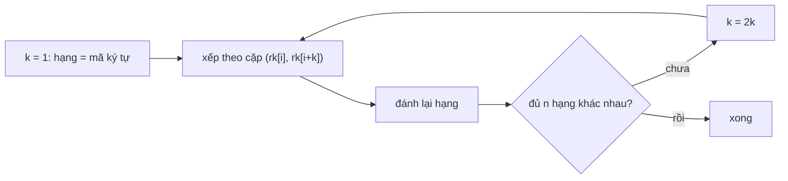

# Bài 4.8 – Mảng hậu tố

> **Tập 4** · Cần biết trước: bài 1.4 (sắp xếp), bài 3.10 (hash) · Thời lượng: khoảng 2 giờ đọc, 8 giờ thực hành

**Học xong bài này, em sẽ:** dựng **mảng hậu tố** (suffix array) trong O(n log² n) bằng nhân đôi; dựng **mảng LCP** bằng thuật toán Kasai trong O(n); đếm số **xâu con phân biệt**.

**Dấu hiệu nhận biết:** hỏi về **mọi** xâu con: đếm xâu con khác nhau, xâu con lặp dài nhất, xâu con thứ k theo thứ tự từ điển.

---

## 1. Bài toán mở màn: Đếm xâu con khác nhau

Xâu s dài n ≤ 10⁵. Có bao nhiêu xâu con **khác nhau** (không tính xâu rỗng)? (bài [Distinct Substrings](https://cses.fi/problemset/task/2105))

| Vào | Ra |
| --- | --- |
| `abaa` | `8` |

Tám xâu đó là: a, b, ab, ba, aa, aba, baa, abaa.

> [!IMPORTANT]
> **Dừng lại và nghĩ.** Mỗi xâu con là **tiền tố của một hậu tố**. Nếu xếp các hậu tố theo thứ tự từ điển, hai hậu tố đứng cạnh nhau có chung tiền tố dài L thì bao nhiêu xâu con bị đếm trùng?

<details>
<summary>Đáp án</summary>

Đúng L xâu. Hậu tố thứ i (sau khi xếp) đóng góp `độ dài − LCP(với hậu tố đứng trước)` xâu con mới. Vậy đáp án = n(n+1)/2 − Σ LCP.

</details>

---

## 2. Mảng hậu tố bằng nhân đôi

Với s = `abaa`, các hậu tố là `abaa` (0), `baa` (1), `aa` (2), `a` (3). Xếp theo từ điển:

| Thứ tự | sa | Hậu tố | LCP với hậu tố trước |
| --- | --- | --- | --- |
| 0 | 3 | a | – |
| 1 | 2 | aa | 1 |
| 2 | 0 | abaa | 1 |
| 3 | 1 | baa | 0 |

Đáp án = 10 − (1 + 1 + 0) = **8**.

**Ý tưởng nhân đôi:** `rk[i]` là hạng của đoạn dài k bắt đầu ở i. Đoạn dài 2k bắt đầu ở i được so sánh bằng cặp `(rk[i], rk[i + k])`; nếu i + k vượt ra ngoài thì coi là −1 (đứng trước mọi thứ). Mỗi vòng sắp xếp theo cặp rồi đánh lại hạng; sau log n vòng mọi hạng khác nhau.



**Kasai:** duyệt i theo thứ tự trong xâu gốc. Nếu LCP của hậu tố i là h thì LCP của hậu tố i + 1 ít nhất h − 1. Vì h chỉ giảm tối đa 1 mỗi bước, tổng số bước là O(n).

```cpp
// file: xau_con.cpp
#include <bits/stdc++.h>
using namespace std;
int main() {
    string s; cin >> s;
    int n = s.size();
    vector<int> sa(n), rk(n), tmp(n);
    for (int i = 0; i < n; i++) { sa[i] = i; rk[i] = s[i]; }
    for (int k = 1; ; k <<= 1) {
        auto cmp = [&](int a, int b) {
            if (rk[a] != rk[b]) return rk[a] < rk[b];
            int ra = a + k < n ? rk[a + k] : -1, rb = b + k < n ? rk[b + k] : -1;
            return ra < rb;
        };
        sort(sa.begin(), sa.end(), cmp);
        tmp[sa[0]] = 0;
        for (int i = 1; i < n; i++) tmp[sa[i]] = tmp[sa[i - 1]] + cmp(sa[i - 1], sa[i]);
        rk = tmp;
        if (rk[sa[n - 1]] == n - 1) break;           // mọi hạng đã khác nhau
    }
    vector<int> lcp(n, 0);                           // lcp[r] = LCP(sa[r-1], sa[r])
    for (int i = 0, h = 0; i < n; i++) {
        if (rk[i] == 0) { h = 0; continue; }
        int j = sa[rk[i] - 1];
        while (i + h < n && j + h < n && s[i + h] == s[j + h]) h++;
        lcp[rk[i]] = h;
        if (h > 0) h--;
    }
    long long kq = 1LL * n * (n + 1) / 2;
    for (int r = 1; r < n; r++) kq -= lcp[r];
    cout << kq << '\n';
}
```

Với n = 1 vòng lặp dừng ngay ở k = 1. Với n = 10⁵ có khoảng 17 vòng sắp xếp, chạy dưới 0,2 giây.

---

## 3. Bẫy thường gặp

> [!WARNING]
> **Bẫy 1: đáp án tràn `int`.** n(n+1)/2 với n = 10⁵ là 5·10⁹: dùng `long long`.

> [!WARNING]
> **Bẫy 2: Kasai quên `h--`** sẽ cho kết quả sai; đặt `h = 0` khi gặp hậu tố hạng 0.

---

## 4. Ứng dụng khác

- **Xâu con lặp dài nhất:** max của mảng LCP ([Repeating Substring](https://cses.fi/problemset/task/2106)).
- **Xâu con thứ k:** đi theo thứ tự sa, mỗi hậu tố có `n − sa[r] − lcp[r]` xâu con mới ([Substring Order I](https://cses.fi/problemset/task/2108)).
- **Tìm mẫu:** tìm nhị phân trên sa, O(|p| log n) mỗi truy vấn.

---

## 5. Bài tập

| Nấc | Bài | Nguồn | Ý chính |
| --- | --- | --- | --- |
| Khởi động | [Distinct Substrings](https://cses.fi/problemset/task/2105) | CSES 2105 | Đúng mục 2 |
| Luyện | [Repeating Substring](https://cses.fi/problemset/task/2106) | CSES 2106 | max LCP |
| Luyện | [Substring Order I](https://cses.fi/problemset/task/2108) | CSES 2108 | Đếm theo sa |
| Thử thách | [Substring Order II](https://cses.fi/problemset/task/2109) | CSES 2109 | Đếm có lặp, cần thêm LCP |

**Checkpoint:** tự dựng bảng sa và LCP cho `banana` bằng tay; AC Repeating Substring.
