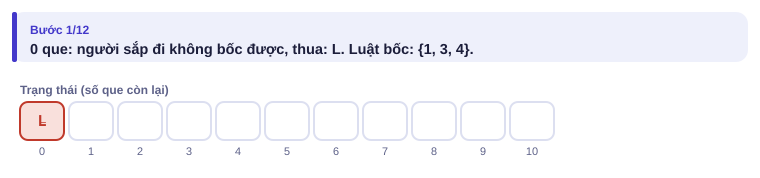
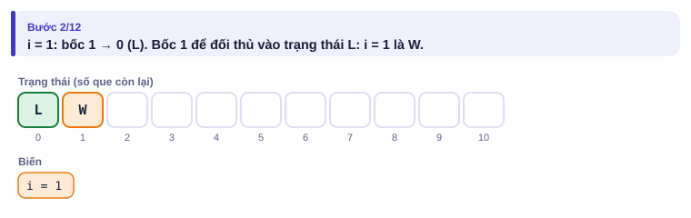
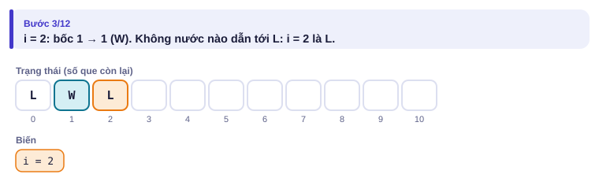
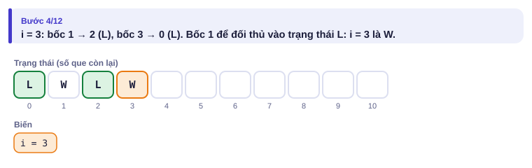
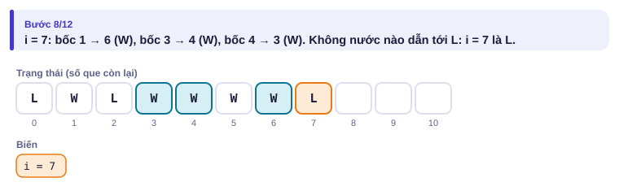
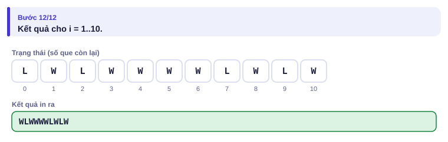
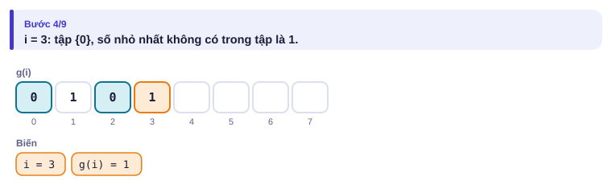
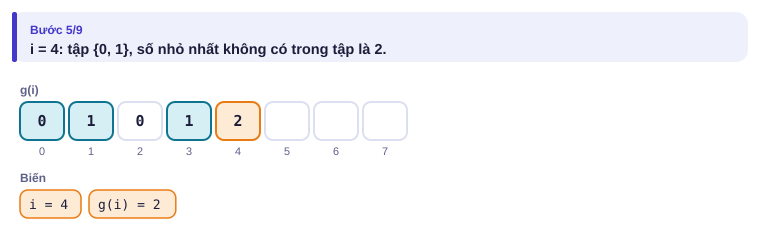
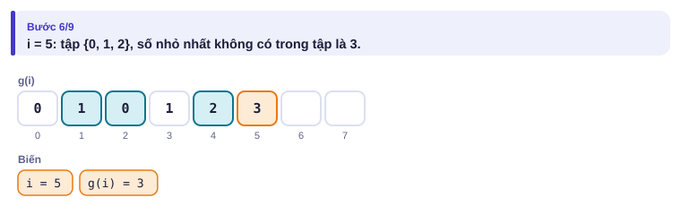
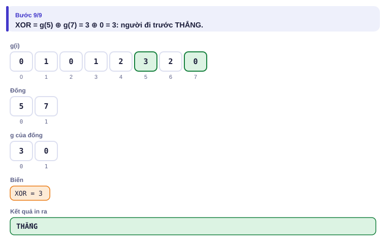

# Bài 4.9 – Lý thuyết trò chơi

> **Tập 4 · Chuyên đề nâng cao**
> Cần biết trước: bài 2.9 (QHĐ), bài 2.5 (phép XOR), bài 3.2 (sắp xếp tô pô).
> Thời lượng: khoảng 2 giờ đọc, cộng 6 giờ thực hành (1 tuần).

**Học xong bài này, em sẽ:**

- phân loại trạng thái **thắng/thua** bằng QHĐ;
- giải **trò Nim** bằng XOR và hiểu vì sao;
- tính **số Grundy** (mex) và ghép nhiều trò chơi độc lập bằng **định lý Sprague–Grundy**;
- giải trọn bài kiểu đề thi **Quân cờ trên đồ thị**.

**Dấu hiệu nhận biết:** hai người chơi lần lượt, "cả hai chơi tối ưu", không có may rủi, ai không đi được là thua; đề hỏi "ai thắng".

> [!TIP]
> **Học cùng hai trang mô phỏng.** [Thắng / thua](../../mo-phong/t4-thang-thua.html): bật **Đoán trước**, đoán W/L cho từng số que. [Số Grundy](../../mo-phong/t4-grundy.html): đoán mex rồi đoán ai thắng.

---

## 1. Bài toán mở màn: Bốc que

Có n que. An và Bình lần lượt bốc, An đi trước. Mỗi lượt được bốc p₁, p₂, … hoặc pₖ que. Ai đến lượt mà không bốc được là thua. Với **mỗi** n từ 1 tới N, người đi trước thắng (W) hay thua (L)? (N ≤ 10⁶, k ≤ 100; bài [Stick Game](https://cses.fi/problemset/task/1729))

| Vào | Ra |
| --- | --- |
| `10 3`<br>`1 3 4` | `WLWWWWLWLW` |

---

## 2. Dừng lại 10 phút

> [!IMPORTANT]
> **Dừng lại và nghĩ.**
> 1. Còn 0 que: người sắp đi thắng hay thua? Còn 2 que (chỉ bốc được 1)?
> 2. Phát biểu bằng lời: khi nào trạng thái là **thắng**, khi nào là **thua**?
> 3. Có hai đống que, mỗi lượt chọn **một** đống để bốc theo luật {1, 3, 4}. Hai đống 2 và 2: ai thắng? Có cần tính bảng cho mọi cặp (a, b) không?

<details>
<summary>Đáp án</summary>

1. 0 que: thua (không đi được). 2 que: phải bốc 1, để lại 1 que cho đối thủ, đối thủ bốc nốt; vậy 2 là thua.
2. **Thắng** khi có **ít nhất một** nước đi đưa đối thủ vào trạng thái thua. **Thua** khi **mọi** nước đi đều đưa đối thủ vào trạng thái thắng (hoặc không có nước nào).
3. Người đi sau thắng bằng cách "bắt chước": đối thủ bốc ở đống này, mình bốc y hệt ở đống kia. Không cần bảng hai chiều: số Grundy (mục 5) cho phép tính từng đống rồi XOR lại.

</details>

---

## 3. Lời giải ngây thơ và vì sao nó chậm

Đệ quy thử mọi cách chơi của cả hai người: số ván cờ tăng theo hàm mũ. Nhưng kết quả chỉ phụ thuộc **số que còn lại**, không phụ thuộc đã chơi thế nào để tới đó: đó chính là dấu hiệu của QHĐ (bài 2.9). Có N + 1 trạng thái, mỗi trạng thái xét k nước: O(N·k).

---

## 4. Ý tưởng then chốt

> [!IMPORTANT]
> **thang[0] = sai. thang[i] = đúng khi tồn tại pⱼ ≤ i với thang[i − pⱼ] = sai.** Luôn đánh giá cho người **sắp đi**.

### Chạy từng bước

Luật {1, 3, 4}. Đoán W/L rồi mới mở.

<details>
<summary><b>Bước 1</b> – 0 que là L</summary>



</details>

<details>
<summary><b>Bước 2</b> – i = 1</summary>



</details>

<details>
<summary><b>Bước 3</b> – i = 2: nước duy nhất dẫn tới W</summary>



</details>

<details>
<summary><b>Bước 4</b> – i = 3</summary>



</details>

<details>
<summary><b>Bước 5</b> – i = 7: mọi nước đều dẫn tới W</summary>



</details>

<details>
<summary><b>Bước 6</b> – Kết quả</summary>



</details>

---

## 5. Mã giả và cài đặt

```
thang[0] = sai
với i = 1..N: thang[i] = có x trong p, x ≤ i, thang[i − x] sai
```

```cpp
// file: boc_que.cpp
#include <bits/stdc++.h>
using namespace std;
int main() {
    int n, k; cin >> n >> k;
    vector<int> p(k);
    for (int &x : p) cin >> x;
    vector<char> thang(n + 1, 0);
    string kq;
    for (int i = 1; i <= n; i++) {
        for (int x : p) if (x <= i && !thang[i - x]) { thang[i] = 1; break; }
        kq += thang[i] ? 'W' : 'L';
    }
    cout << kq << '\n';
}
```

```python
# file: boc_que.py
import sys
data = sys.stdin.buffer.read().split()
n, k = int(data[0]), int(data[1])
p = sorted(int(x) for x in data[2:2 + k])
thang = bytearray(n + 1)
for i in range(1, n + 1):
    for x in p:
        if x > i:
            break
        if not thang[i - x]:
            thang[i] = 1
            break
print("".join("W" if thang[i] else "L" for i in range(1, n + 1)))
```

Bản Python chạy được tới N cỡ 10⁵ trong thời gian cho phép; N = 10⁶ với k = 100 cần C++.

### Nim và số Grundy

**Trò Nim:** nhiều đống sỏi a₁, …, aₙ; mỗi lượt bốc **bao nhiêu tùy ý** (ít nhất 1) từ **một** đống. Người đi trước thua khi và chỉ khi **a₁ ⊕ a₂ ⊕ … ⊕ aₙ = 0**.

**Số Grundy** của một trạng thái: `g(x) = mex{ g(y) : đi được từ x tới y }`, với mex là số tự nhiên nhỏ nhất **không** có trong tập. g(x) = 0 nghĩa là thua. Trong Nim một đống, g(x) = x.

**Định lý Sprague–Grundy:** chơi đồng thời nhiều trò độc lập (mỗi lượt chọn một trò để đi một nước) thì g(tổng) = **XOR** các g. Người đi trước thắng khi XOR khác 0.

<details>
<summary><b>Hình</b> – Grundy với luật {1, 3, 4}, hai đống 5 và 7 (mở lần lượt)</summary>






</details>

---

## 6. Vì sao đúng, chạy bao lâu

- **Thắng/thua:** quy nạp theo i. Nếu có nước tới trạng thái thua thì đi nước đó, đối thủ ở thế thua. Nếu mọi nước tới trạng thái thắng thì đối thủ luôn có cách thắng.
- **Nim:** (a) từ XOR = 0, mọi nước đổi đúng một đống nên XOR thành khác 0; (b) từ XOR = x ≠ 0, lấy bit cao nhất của x, có đống aᵢ chứa bit đó; đổi aᵢ thành aᵢ ⊕ x (nhỏ hơn aᵢ) thì XOR về 0. Người đi trước giữ XOR = 0 cho đối thủ tới khi mọi đống bằng 0.
- **Grundy:** trạng thái có g = v đi được tới mọi giá trị 0, 1, …, v − 1 (định nghĩa mex) và không tới được v: hành xử y hệt một đống Nim cỡ v. Vì thế tổng các trò = Nim với các đống g.
- **Thời gian:** bảng một trò O(N·k); Grundy trên đồ thị O(n + m).

---

## 7. Bẫy thường gặp

> [!WARNING]
> **Bẫy 1: lẫn "thắng" của người đi trước và người đi sau.** Trạng thái luôn được đánh giá cho người **sắp đi**.

> [!WARNING]
> **Bẫy 2: cộng Grundy thay vì XOR.** Ba đống Grundy 1, 2, 3 có tổng 6 nhưng XOR bằng 0: người đi trước **thua**.

> [!WARNING]
> **Bẫy 3: mex sai khi tập có số trùng hoặc chưa sắp.** Dùng mảng đánh dấu cỡ (số nước + 1): mex không bao giờ vượt quá số nước đi.

> [!WARNING]
> **Bẫy 4: luật "ai đi nước cuối thì thua"** (misère) khác hẳn; Nim misère phải xử lý riêng khi mọi đống ≤ 1. Đọc kỹ câu "ai không đi được thì thua" hay "ai đi nước cuối thì thua".

---

## 8. Ví dụ giảm dần hỗ trợ

### Ví dụ 2 – Điền vào chỗ trống: Nim

Có t ván. Mỗi ván có n đống x₁, …, xₙ. In `first` nếu người đi trước thắng, ngược lại `second`. (bài [Nim Game I](https://cses.fi/problemset/task/1730))

| Vào | Ra |
| --- | --- |
| `3`<br>`4`<br>`5 7 2 5`<br>`2`<br>`4 1`<br>`3`<br>`3 5 6` | `first`<br>`first`<br>`second` |

```cpp
int x = 0;
for (int i = 0; i < n; i++) { long long a; cin >> a; ____; }
cout << (____ ? "first" : "second") << '\n';
```

<details>
<summary>Đáp án</summary>

`x ^= a` và `x != 0`.

```cpp
// file: nim.cpp
#include <bits/stdc++.h>
using namespace std;
int main() {
    int t; cin >> t;
    while (t--) {
        int n; cin >> n;
        long long x = 0;
        for (int i = 0; i < n; i++) { long long a; cin >> a; x ^= a; }
        cout << (x != 0 ? "first" : "second") << '\n';
    }
}
```

</details>

### Ví dụ 3 – Tự làm: Cầu thang

Cầu thang có n bậc, bậc i có pᵢ quả bóng. Mỗi lượt chọn một bậc k ≥ 2 và chuyển ít nhất một quả bóng từ bậc k xuống bậc k − 1. Ai không đi được là thua. Có t ván; in `first` hoặc `second`. (bài [Stair Game](https://cses.fi/problemset/task/1099))

| Vào | Ra |
| --- | --- |
| `3`<br>`3`<br>`0 2 1`<br>`4`<br>`1 1 1 1`<br>`2`<br>`5 3` | `first`<br>`second`<br>`first` |

> [!IMPORTANT]
> Tự làm trước. Gợi ý: bóng ở bậc **lẻ** có quan trọng không? Nếu đối thủ chuyển bóng từ bậc lẻ xuống bậc chẵn, em có thể "trả lại" ngay không?

<details>
<summary>Lời giải</summary>

Chỉ các bậc **chẵn** là các đống Nim: chuyển bóng từ bậc chẵn xuống bậc lẻ giống như bốc khỏi đống Nim. Nếu đối thủ chuyển từ bậc lẻ k xuống bậc chẵn k − 1, em chuyển đúng số bóng đó từ k − 1 xuống k − 2 (cũng lẻ), XOR các bậc chẵn trở lại như cũ. Đáp án: XOR các pᵢ với i chẵn.

```cpp
// file: cau_thang.cpp
#include <bits/stdc++.h>
using namespace std;
int main() {
    int t; cin >> t;
    while (t--) {
        int n; cin >> n;
        long long x = 0;
        for (int i = 1; i <= n; i++) { long long p; cin >> p; if (i % 2 == 0) x ^= p; }
        cout << (x ? "first" : "second") << '\n';
    }
}
```

</details>

---

## 9. Bài tập

| Nấc | Bài | Nguồn | Ý chính |
| --- | --- | --- | --- |
| Khởi động | [Stick Game](https://cses.fi/problemset/task/1729) | CSES 1729 | Đúng mục 5 |
| Khởi động | [Nim Game I](https://cses.fi/problemset/task/1730) | CSES 1730 | Ví dụ 2 |
| Luyện | [Nim Game II](https://cses.fi/problemset/task/1098) | CSES 1098 | Luật {1, 2, 3}: g(x) = x mod 4 |
| Luyện | [Stair Game](https://cses.fi/problemset/task/1099) | CSES 1099 | Ví dụ 3 |
| Thử thách | [Grundy's Game](https://cses.fi/problemset/task/2207) | CSES 2207 | Tính trước Grundy và quan sát |
| Kiểu đề thi | Quân cờ trên đồ thị | Bài của sách, chấm theo subtask | Xem bên dưới |

### Bài kiểu đề thi: Quân cờ trên đồ thị

**Đề bài.** Bàn cờ là một đồ thị có hướng **không có chu trình** gồm n ô và m mũi tên. Có k quân cờ đặt ở các ô (nhiều quân có thể chung một ô). An và Bình lần lượt đi, An đi trước. Mỗi lượt, người chơi chọn **một** quân và di chuyển nó theo một mũi tên đi ra từ ô của nó. Ai đến lượt mà không quân nào đi được là thua. In `AN` hoặc `BINH`. Đọc từ `QUANCO.INP` (dòng đầu n m k; m dòng sau là u v cho mũi tên u → v; dòng cuối là k ô có quân), ghi ra `QUANCO.OUT`.

Subtask: 40% có k = 1; 60% còn lại không có ràng buộc thêm. Luôn có n, k ≤ 10⁵, m ≤ 2·10⁵.

| QUANCO.INP | QUANCO.OUT |
| --- | --- |
| `6 8 3`<br>`1 2`<br>`1 3`<br>`2 4`<br>`3 4`<br>`3 5`<br>`4 6`<br>`5 6`<br>`2 6`<br>`2 4 5` | `AN` |
| `6 8 2`<br>`1 2`<br>`1 3`<br>`2 4`<br>`3 4`<br>`3 5`<br>`4 6`<br>`5 6`<br>`2 6`<br>`1 4` | `BINH` |

<details>
<summary><b>Gợi ý 1</b> – hướng đi (đủ 40% điểm)</summary>

Một quân: trạng thái là ô đang đứng. Ô không có mũi tên ra là L. Ô là W nếu có mũi tên tới ô L. Tính theo thứ tự tô pô **ngược** (bài 3.2) để mọi ô đích đã có kết quả trước.

</details>

<details>
<summary><b>Gợi ý 2</b> – ý then chốt</summary>

Nhiều quân là tổng các trò chơi độc lập: tính Grundy cho mọi ô, `g(u) = mex{ g(v) : u → v }`, rồi XOR g của các ô có quân. Ở ví dụ: g = 1, 2, 0, 1, 1, 0 cho ô 1..6; ván 1: 2 ⊕ 1 ⊕ 1 = 2 ≠ 0 nên AN thắng; ván 2: 1 ⊕ 1 = 0 nên BINH thắng.

</details>

<details>
<summary><b>Gợi ý 3</b> – lời giải đầy đủ</summary>

Thứ tự tô pô bằng Kahn, rồi duyệt ngược. Mex của ô u: đánh dấu các g(v) bằng "dấu thời gian" u để không phải xóa mảng.

```cpp
// file: quanco.cpp
#include <bits/stdc++.h>
using namespace std;
int main() {
    freopen("QUANCO.INP", "r", stdin);
    freopen("QUANCO.OUT", "w", stdout);
    int n, m, k;
    scanf("%d %d %d", &n, &m, &k);
    vector<vector<int>> ke(n + 1);
    vector<int> vao(n + 1, 0);
    for (int i = 0; i < m; i++) { int u, v; scanf("%d %d", &u, &v); ke[u].push_back(v); vao[v]++; }
    vector<int> thu_tu, q;
    for (int u = 1; u <= n; u++) if (vao[u] == 0) q.push_back(u);
    for (size_t i = 0; i < q.size(); i++) {
        int u = q[i]; thu_tu.push_back(u);
        for (int v : ke[u]) if (--vao[v] == 0) q.push_back(v);
    }
    vector<int> g(n + 1, 0), dau(n + 2, 0);
    for (int i = n - 1; i >= 0; i--) {
        int u = thu_tu[i];
        for (int v : ke[u]) if (g[v] <= (int)ke[u].size()) dau[g[v]] = u;
        int mex = 0;
        while (dau[mex] == u) mex++;
        g[u] = mex;
    }
    int x = 0;
    for (int i = 0; i < k; i++) { int c; scanf("%d", &c); x ^= g[c]; }
    printf("%s\n", x ? "AN" : "BINH");
}
```

```python
# file: quanco.py
import sys
with open("QUANCO.INP") as f:
    data = f.read().split()
n, m, k = int(data[0]), int(data[1]), int(data[2])
ke = [[] for _ in range(n + 1)]
vao = [0] * (n + 1)
for i in range(m):
    u, v = int(data[3 + 2 * i]), int(data[4 + 2 * i])
    ke[u].append(v)
    vao[v] += 1
q = [u for u in range(1, n + 1) if vao[u] == 0]
i = 0
while i < len(q):
    u = q[i]; i += 1
    for v in ke[u]:
        vao[v] -= 1
        if vao[v] == 0:
            q.append(v)
g = [0] * (n + 1)
for u in reversed(q):
    tap = {g[v] for v in ke[u]}
    mex = 0
    while mex in tap:
        mex += 1
    g[u] = mex
x = 0
for c in data[3 + 2 * m: 3 + 2 * m + k]:
    x ^= g[int(c)]
with open("QUANCO.OUT", "w") as f:
    f.write(("AN" if x else "BINH") + "\n")
```

</details>

---

## 10. Tóm tắt, flashcard và checkpoint

**Tóm tắt trong 5 dòng.**

1. Thắng = có nước tới thua; thua = mọi nước tới thắng; không đi được là thua.
2. QHĐ trên trạng thái, đánh giá cho người sắp đi; trên đồ thị thì theo thứ tự tô pô ngược.
3. Nim: người đi trước thua khi XOR các đống bằng 0.
4. Grundy g(x) = mex các g kề; g = 0 là thua.
5. Tổng các trò độc lập: XOR các Grundy (Sprague–Grundy).

**Flashcard.**

<details><summary>mex{0, 1, 3}?</summary>2.</details>
<details><summary>Nim với các đống 1, 2, 3: ai thắng?</summary>Người đi sau (1 ⊕ 2 ⊕ 3 = 0).</details>
<details><summary>Luật bốc {1, 2, 3}: g(x)?</summary>x mod 4.</details>
<details><summary>Vì sao mex không vượt quá số nước đi?</summary>Tập có tối đa d phần tử thì một trong các số 0..d không có mặt.</details>
<details><summary>Cầu thang: bậc nào là đống Nim?</summary>Các bậc chẵn.</details>

**Ôn xoắn ốc** (mỗi bài tối đa 20 phút):

- Viết lại Kasai (bài 4.8) không nhìn sách.
- [Course Schedule](https://cses.fi/problemset/task/1679) (CSES 1679): thứ tự tô pô (bài 3.2), nền của bài Quân cờ.
- [Gray Code](https://cses.fi/problemset/task/2205) (CSES 2205): công thức i ⊕ (i >> 1), ôn phép bit (bài 2.5).

**Checkpoint – em đã sẵn sàng sang bài tiếp theo nếu:**

- [ ] Tự tính bảng W/L và bảng g cho luật {2, 3} tới i = 10, kiểm tra bằng trang mô phỏng.
- [ ] Giải thích được vì sao Nim dùng XOR (mục 6); AC [Nim Game I](https://cses.fi/problemset/task/1730).
- [ ] Làm xong Ví dụ 3 (Cầu thang) mà không mở lời giải.
- [ ] Đạt trọn điểm bài Quân cờ khi tự làm trong 35 phút.

Chưa đạt? Nếu vướng ô 1, chạy trang mô phỏng thắng/thua với ví dụ "luật {2, 3}". Nếu vướng ô 2, đọc lại câu 3 của mục 2 (chiến lược bắt chước là Nim hai đống bằng nhau). Nếu vướng ô 4, chạy trang Số Grundy với ví dụ "hai đống giống nhau" rồi đọc lại Gợi ý 2.
