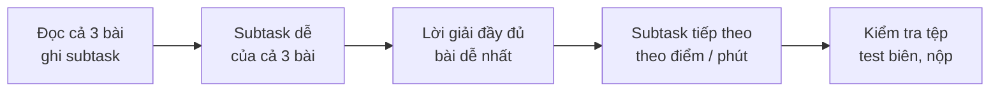

# Bài 5.1 – Chiến lược phòng thi

> **Tập 5** · Đọc lần đầu sau Tập 0; đọc lại trước mỗi kỳ thi · Thời lượng: 1 giờ đọc

**Học xong bài này, em sẽ:** chia thời gian cho đề 120, 180 và 300 phút; quyết định **làm subtask nào trước** dựa trên điểm kỳ vọng; biết cách **ghép nhiều lời giải** trong một chương trình; có checklist 10 dòng trước khi nộp.

Bài 0.10 đã có quy trình 120 phút cho người mới. Bài này gom lại toàn bộ chiến lược cho mọi cấp thi và thêm phần ra quyết định.

---

## 1. Các kỳ thi em sẽ gặp

| Kỳ thi | Thời gian | Hình thức | Chấm |
| --- | --- | --- | --- |
| HSG lớp 9, lớp 12 cấp tỉnh/thành phố | 120 phút, 3 bài | Đọc/ghi tệp `.INP` / `.OUT`; C++, Python hoặc Pascal | Theo subtask, chấm sau kỳ thi |
| Olympic 30/4 | 180 phút, 3 bài | Đọc/ghi tệp | Theo test hoặc subtask |
| HSG Quốc gia | 180 phút mỗi ngày, 2 ngày | Đọc/ghi tệp | Theo subtask |
| VOI chọn đội, APIO, IOI | 5 giờ, 3 bài | Có thể nộp hàm, bài tương tác | Theo nhóm test, thấy điểm ngay (IOI) |

> [!IMPORTANT]
> **Đọc kỹ quy chế năm đó.** Tên thư mục bài làm, tên tệp chương trình, ngôn ngữ được dùng, có được dùng `bits/stdc++.h` hay không: những thứ này có thể đổi theo năm. Sai tên tệp là **0 điểm**, dù thuật toán đúng.

---

## 2. Điểm kỳ vọng: làm gì trước?

Với mỗi subtask, ước lượng hai con số: **điểm** và **số phút** cần để làm chắc. Ưu tiên subtask có **điểm / phút** cao nhất.

Ví dụ một đề giả định 3 bài (10, 5, 5 điểm), với một học sinh vừa xong Tập 1:

| Subtask | Điểm | Phút ước lượng | Điểm / phút | Thứ tự |
| --- | --- | --- | --- | --- |
| Bài 1, mô phỏng 60% | 6 | 20 | 0,30 | 1 |
| Bài 3, vét cạn 30% | 1,5 | 15 | 0,10 | 3 |
| Bài 2, đệ quy 40% | 2 | 25 | 0,08 | 4 |
| Bài 1, tối ưu 100% | thêm 4 | 15 | 0,27 | 2 |
| Bài 2, ngăn xếp 100% | thêm 3 | ? (chưa học) | – | bỏ qua |

Quy tắc: subtask nào chưa nghĩ ra lời giải trong 10 phút thì xếp xuống cuối.

---

## 3. Chia thời gian



| | 120 phút | 180 phút | 300 phút |
| --- | --- | --- | --- |
| Đọc đề | 10 phút | 15 phút | 30 phút |
| Lấy subtask dễ cả 3 bài | 40 phút | 45 phút | 90 phút |
| Đi sâu một bài | 50 phút | 100 phút | 150 phút |
| Kiểm tra, nộp | 20 phút | 20 phút | 30 phút |

**Mốc dừng:** một bài đã quá 1/3 tổng thời gian mà không tiến triển thì chuyển bài.

---

## 4. Ghép nhiều lời giải trong một chương trình

Khi lời giải đầy đủ chưa chắc chắn, đừng xóa lời giải vét cạn. Hãy để chương trình **tự chọn**:

```cpp
int main() {
    doc_du_lieu();
    if (n <= 1000) giai_vet_can();      // chắc chắn đúng cho subtask nhỏ
    else giai_day_du();                 // nếu sai, chỉ mất phần điểm lớn
}
```

Cách này còn giúp em **stress test** ngay trong phòng thi: sinh test nhỏ, chạy cả hai hàm, so kết quả (xem [bài 1.9](../../tap-1-nen-tang-thuat-toan/bai-1-9-stress-test/)).

> [!WARNING]
> **Bẫy: dùng biến toàn cục chung** cho hai lời giải. Một hàm làm bẩn mảng sẽ khiến hàm kia sai. Mỗi hàm tự khởi tạo dữ liệu của mình.

---

## 5. Checklist 10 dòng trước khi nộp

1. Tên tệp chương trình, tệp `.INP`, `.OUT` đúng **từng chữ**, đúng chữ hoa.
2. Đã bỏ comment `freopen` (C++) hoặc mở đúng tệp (Python).
3. Không in thêm chữ thừa (`"Ket qua: "`, dòng debug).
4. Dùng `long long` cho tổng, tích, đáp án có thể vượt 2·10⁹.
5. Mảng đủ kích thước với giới hạn **lớn nhất**, không phải giới hạn ví dụ.
6. Chạy thử test biên: n = 1, mọi số bằng nhau, đáp án bằng 0 hoặc −1.
7. Chạy thử test lớn nhất tự sinh: dưới 1 giây.
8. Đệ quy sâu trên 10⁵ tầng: đổi sang vòng lặp (Python dễ lỗi nhất).
9. Python: đọc nhanh bằng `sys.stdin.buffer` hoặc đọc cả tệp một lần.
10. Lưu bài vào đúng thư mục thi, mở lại kiểm tra tệp đã có.

---

## 6. Tâm lý phòng thi

- **10 phút đầu không code.** Đọc cả đề giúp não "chạy ngầm" bài khó trong lúc em làm bài dễ.
- **Bị kẹt:** viết ra giấy một ví dụ nhỏ bằng tay, thử đảo chiều (duyệt từ cuối), thử chặt nhị phân đáp án, thử nghĩ "nếu n nhỏ thì làm sao".
- **Sau kỳ thi:** ghi ngay vào nhật ký lỗi (bài 5.5) những gì làm sai, khi còn nhớ rõ.

---

**Checkpoint:** với một đề cũ bất kỳ, lập bảng điểm / phút như mục 2 **trước khi** làm, rồi so với kết quả thật sau khi làm.
