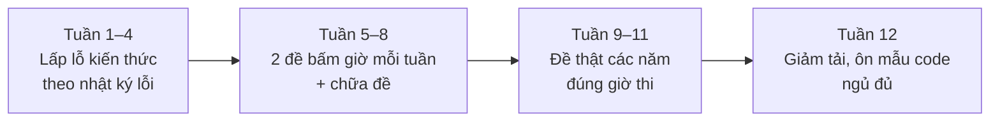

# Bài 5.5 – Kho đề và kế hoạch luyện thi

> **Tập 5** · Dùng suốt quá trình học · Thời lượng: 30 phút đọc, rồi theo kế hoạch

**Học xong bài này, em sẽ:** biết lấy đề ở đâu cho từng cấp; có kế hoạch 12 tuần trước một kỳ thi; ghi **nhật ký lỗi** để không mất điểm hai lần vì cùng một lỗi.

---

## 1. Lấy đề ở đâu?

| Nguồn | Có gì | Hợp với |
| --- | --- | --- |
| [VNOI Online Judge](https://oj.vnoi.info/) | Đề VOI, HSG nhiều tỉnh, kỳ thi VNOI Cup; tiếng Việt | Mọi cấp, nhất là HSG Quốc gia |
| [LQDOJ](https://lqdoj.edu.vn/) | Đề HSG cấp tỉnh/TP, bài luyện theo chủ đề; tiếng Việt | Tập 0–2 |
| [CSES Problem Set](https://cses.fi/problemset/) | 300 bài kinh điển theo chủ đề | Tập 1–4, luyện kỹ thuật |
| [AtCoder Beginner Contest](https://atcoder.jp/contests/archive) | Đề tuần, bài A–D dễ, E–G khó dần | Tập 1–3 |
| [Codeforces](https://codeforces.com/problemset) | Lọc theo độ khó và chủ đề; thi ảo (virtual contest) | Mọi cấp |
| [USACO](https://usaco.org/) | Bronze → Silver → Gold → Platinum, có lời giải | Tập 1–4 |
| [oj.uz](https://oj.uz/problems) | Đề BOI, CEOI, JOI, APIO, IOI có subtask; nhiều bài có grader | Tập 3–4 |

Đề HSG cấp tỉnh/thành phố đôi khi dùng lại bài của các kỳ thi quốc tế cho học sinh phổ thông, giữ nguyên subtask. Vì vậy **subtask dễ của đề BOI, CEOI, JOI** là nguồn luyện rất sát.

---

## 2. Đề nào làm sau tập nào?

| Học xong | Đề trong sách | Đề ngoài sách |
| --- | --- | --- |
| Tập 0 | [0.10](../../tap-0-nhap-mon/bai-0-10-ky-nang-phong-thi/) | Đề HSG lớp 9 cấp tỉnh/thành phố các năm; LQDOJ mức dễ |
| Tập 1 | [1.10](../../tap-1-nen-tang-thuat-toan/bai-1-10-de-thi-thu/), [5.2](../bai-5-2-de-luyen-chon-doi-tuyen/) | USACO Bronze; AtCoder ABC A–D |
| Tập 2 | [2.11](../../tap-2-cau-truc-du-lieu/bai-2-11-de-thi-thu/), [5.3](../bai-5-3-de-luyen-hsg-thanh-pho/) | Đề HSG 12 các tỉnh; Olympic 30/4; USACO Silver |
| Tập 3 | [3.11](../../tap-3-do-thi-qhd-nang-cao/bai-3-11-de-thi-thu/), [5.4](../bai-5-4-de-luyen-hsg-quoc-gia/) | Đề HSG Quốc gia các năm trên VNOI; USACO Gold |
| Tập 4 | [4.11](../../tap-4-chuyen-de-nang-cao/bai-4-11-de-thi-thu/) | VOI, APIO, IOI trên oj.uz; USACO Platinum |

---

## 3. Kế hoạch 12 tuần trước kỳ thi



| Giai đoạn | Mỗi tuần | Đo bằng |
| --- | --- | --- |
| Tuần 1–4 | 15–20 bài CSES/LQDOJ theo **chủ đề yếu nhất** | Số bài AC mỗi chủ đề |
| Tuần 5–8 | 2 đề bấm giờ; mỗi đề chữa đủ mọi subtask (upsolve) | Điểm thi thử |
| Tuần 9–11 | 2–3 đề thật, đúng **giờ** thi trong ngày (ví dụ 7:30 sáng) | Điểm so với điểm giải năm trước |
| Tuần 12 | Ôn lại mẫu code (đọc nhanh, đọc/ghi tệp, Dijkstra, DSU…), không học chủ đề mới | Checklist 10 dòng ở bài 5.1 |

**Upsolve** nghĩa là sau kỳ thi thử, làm lại bài chưa được điểm cho tới khi AC, có xem lời giải nếu cần. Đây là phần **quan trọng nhất**: một đề làm 3 giờ, chữa thêm 3 giờ.

---

## 4. Nhật ký lỗi

Mỗi lần mất điểm, ghi một dòng. Sau 2–3 tháng, em sẽ thấy vài lỗi lặp lại nhiều nhất: đó là thứ cần sửa trước tiên.

| Ngày | Đề / bài | Mất | Loại lỗi | Nguyên nhân | Lần sau sẽ |
| --- | --- | --- | --- | --- | --- |
| 03/03 | 5.3 / TOANHA | 3 điểm | Sai đáp án | Dùng `<=` thay vì `<` | Thử test có hai số bằng nhau |
| 10/03 | 5.2 / NHAMAY | 6 điểm | Tràn số | Tổng ⌊T/tᵢ⌋ vượt `long long` | Dừng cộng sớm; tính cận lớn nhất trước |
| 17/03 | 2.11 / bài 3 | 7 điểm | Không kịp giờ | Sa vào bài 2 quá 70 phút | Đặt đồng hồ mốc 1/3 thời gian |

Các loại lỗi thường gặp: **đọc sai đề**, **sai tên tệp**, **tràn số**, **thiếu trường hợp biên**, **quá thời gian**, **không kịp giờ**, **chưa biết thuật toán**. Riêng loại cuối cùng mới cần học thêm; các loại còn lại sửa bằng thói quen.

---

## 5. Bảng theo dõi điểm

Ghi điểm mọi đề bấm giờ vào một bảng (giấy, Google Sheets hoặc tệp `diem.csv` trong repo của em):

```text
ngay,de,thoi_gian,bai1,bai2,bai3,tong,ghi_chu
2026-03-03,5.3,120,10,5,2,17,bai 3 chi lam O(n log n)
2026-03-10,5.2,120,6,7,7,20,
```

Mục tiêu không phải điểm tuyệt đối mỗi lần, mà là **đường điểm đi lên** và **nhật ký lỗi ngắn lại**.

---

**Checkpoint cuối Tập 5:** có nhật ký lỗi ít nhất 10 dòng; đã làm cả ba đề luyện 5.2–5.4 đúng giờ; điểm 3 đề thật gần nhất đều đạt mức giải mình nhắm tới.
